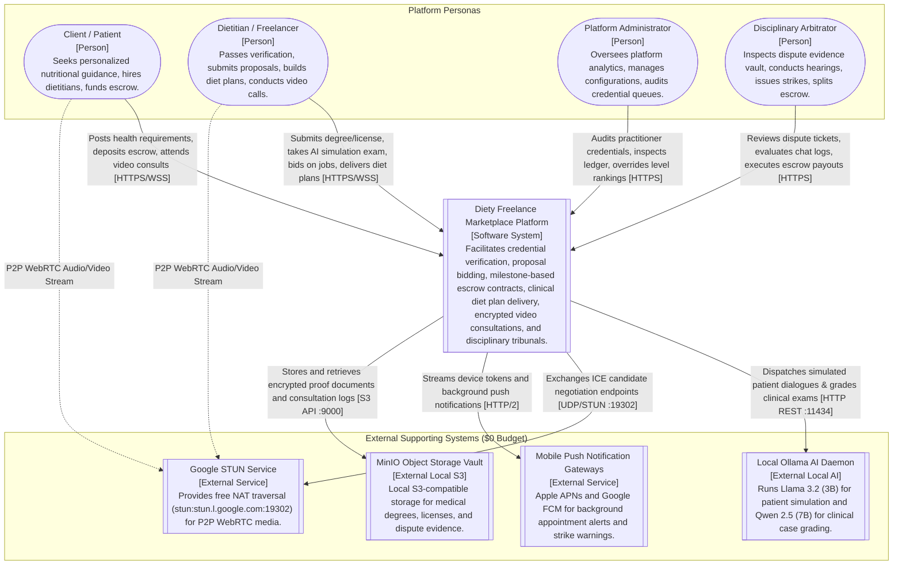
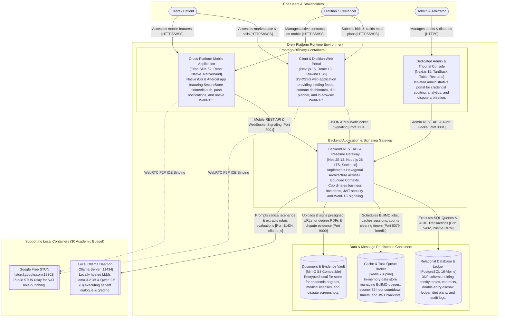
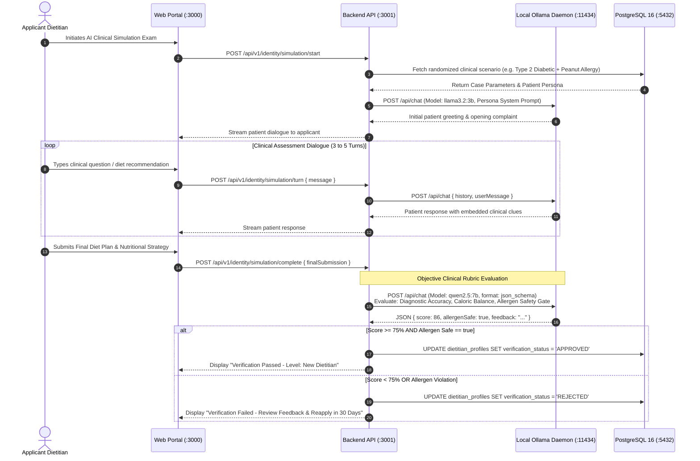
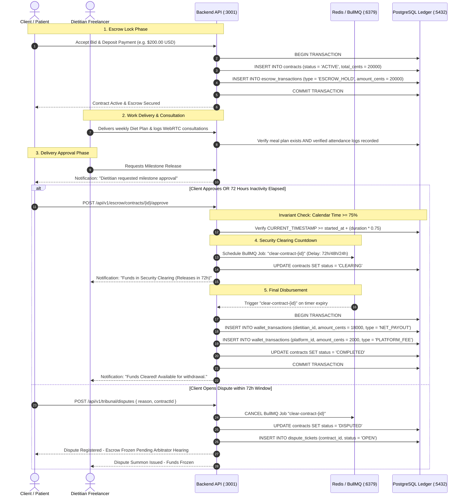

# C4 Architectural Diagrams & System Structural Models
## Dietitian Freelance Marketplace Platform ("Diety")

**Document Version:** 1.0.0  
**Specification Standard:** The C4 Model for Visualizing Software Architecture (Context, Containers, Components, Code)  
**Renderer Compatibility:** GitHub-Native Mermaid Flowchart Notation (Full compatibility with GitHub, GitLab, VS Code, and standard Markdown viewers)  
**Companion Documents:**
- [`SOFTWARE_REQUIREMENTS_SPECIFICATION.md`](file:///d:/FullStackProjects/Diety/SOFTWARE_REQUIREMENTS_SPECIFICATION.md) (SRS)
- [`SOFTWARE_DESIGN_SPECIFICATION.md`](file:///d:/FullStackProjects/Diety/SOFTWARE_DESIGN_SPECIFICATION.md) (SDS)
- [`DATABASE_SCHEMA.md`](file:///d:/FullStackProjects/Diety/DATABASE_SCHEMA.md) (3NF Database Specification)
- [`CODE_ARCHITECTURE_AND_PRINCIPLES.md`](file:///d:/FullStackProjects/Diety/CODE_ARCHITECTURE_AND_PRINCIPLES.md) (Hexagonal Architecture & DDD Design Principles)
- [`CODE_SPECIFICATION_AND_DEPENDENCIES.md`](file:///d:/FullStackProjects/Diety/CODE_SPECIFICATION_AND_DEPENDENCIES.md) (Engineering Rules & External Dependency Catalog)

---

## 1. Architectural Narrative & Visual Legend

The C4 model partitions the architecture of the **Diety Platform** into four distinct levels of abstraction, providing an intuitive, top-down map for engineers, architects, security auditors, and academic evaluators:

```
[ Level 1: System Context ]  --> Highest level: Who uses the platform and what external systems integrate with it?
        │
[ Level 2: Containers ]      --> High-level runtime topology: Web Apps, Mobile App, API, Database, Cache, AI Engine.
        │
[ Level 3: Components ]      --> Architectural composition: Hexagonal modules and 6 Bounded Contexts inside the API.
        │
[ Level 4: Code / Workflows] --> Deep-dive execution: The AI Clinical Simulation Pipeline & Escrow Clearing Engines.
```

### 1.1 Notation & Shape Legend

| Visual Element | Mermaid Representation | C4 Semantic Meaning |
| :--- | :--- | :--- |
| **Person / User** | `[("Person: Role Name")]` or `([Role Name])` | Human actors interacting with the system (Client, Dietitian, Administrator). |
| **Software System** | `[[System Name]]` | The central platform or an external software system boundary. |
| **Container** | `[Container: Name<br/>Tech Stack<br/>Description]` | An executable process, client application, microservice, or persistent data store. |
| **Database / Store** | `[(Database: Name<br/>Tech Stack<br/>Description)]` | Persistent or in-memory state repository (PostgreSQL 16, Redis 7, MinIO S3). |
| **Component** | `[Component: Name<br/>Responsibility]` | A module, controller, use case, or adapter operating inside a container. |
| **Synchronous Edge** | `-- "Description [HTTPS/REST]" -->` | Direct blocking remote procedure or API request. |
| **Asynchronous Edge** | `-.->| "Description [WebSocket/Queue]" |` | Non-blocking event streaming, push notification, or message queue payload. |

---

## 2. C4 Level 1: System Context Diagram

The System Context diagram illustrates the perimeter boundary of the Diety Platform, showing all human personas and external services.

### 2.1 Context Diagram (Mermaid)



### 2.2 System Context Tabular Fallback

| Source Element | Target Element | Interaction / Protocol | Purpose |
| :--- | :--- | :--- | :--- |
| **Client / Patient** | **Diety System** | HTTPS / WSS | Posts clinical requirements, deposits fiat into escrow, attends video consultations, tracks meal plans. |
| **Dietitian / Freelancer**| **Diety System** | HTTPS / WSS | Submits credentials, completes AI case simulation exam, bids on proposals, delivers diet plans, withdraws cleared earnings. |
| **Administrator** | **Diety System** | HTTPS | Audits credential verification queues, inspects financial logs, configures system fees. |
| **Disciplinary Arbitrator**| **Diety System** | HTTPS | Accesses confidential evidence vault, issues disciplinary strikes, arbitrates escrow splits. |
| **Diety System** | **Ollama AI** | HTTP REST (`:11434`) | Generates interactive clinical patient prompts and computes objective rubric grading for unverified applicants. |
| **Diety System** | **MinIO S3** | S3 API (`:9000`) | Securely persists uploaded degree PDFs, governmental licenses, and dispute attachments. |
| **Diety System** | **Google STUN** | UDP / STUN (`:19302`)| Discovers public IP/port mappings for WebRTC peer connection establishment. |
| **Diety System** | **APNs / FCM** | HTTP/2 | Dispatches real-time push alerts for pending appointments, client messages, and dispute summons. |

---

## 3. C4 Level 2: Container Diagram

The Container diagram zooms into the **Diety Platform**, illustrating the client applications, server engines, real-time gateways, databases, queues, and file stores that compose the runtime system.

### 3.1 Container Diagram (Mermaid)



### 3.2 Container Summary & Technology Matrix

| Container Name | Technology Stack | Hosting / Port | Primary Responsibility |
| :--- | :--- | :--- | :--- |
| **Web Portal** | Next.js 15, React 19, Tailwind CSS, shadcn/ui | Node.js (`:3000`) | Client intake forms, bidding feed, contract timeline, interactive meal builder, simple-peer video calls. |
| **Admin Console** | Next.js 15, TanStack Table, Recharts, Radix UI | Node.js (`:3002`) | Split-screen evidence tribunal, degree verification queue, disciplinary strike controller, financial yields. |
| **Mobile App** | Expo SDK 52+, React Native 0.76, NativeWind | iOS / Android | Push-driven native experience with biometrics, camera uploads, offline caching, and native WebRTC. |
| **Backend API** | NestJS 12, Node.js 26 LTS, Socket.io, Prisma 7 | Docker / Node (`:3001`)| Unified hexagonal backend enforcing business invariants, JWT auth, WebRTC signaling, and BullMQ worker. |
| **PostgreSQL Database**| PostgreSQL 16 Alpine | Docker (`:5432`)| 3NF authoritative relational storage for user profiles, contracts, immutable escrow ledger, and audit history. |
| **Redis Cache & Queue**| Redis 7 Alpine | Docker (`:6379`)| BullMQ worker broker (72h escrow clearing, 15m no-show timer), rate-limiting, and token blacklisting. |
| **MinIO S3 Vault** | MinIO Release 2024-11 | Docker (`:9000/9001`)| S3-compatible encrypted document storage for verification degrees, government IDs, and tribunal attachments. |
| **Ollama AI Daemon** | Ollama v0.5+, Llama 3.2 (3B), Qwen 2.5 (7B) | Local Host (`:11434`)| Local zero-cost clinical simulation engine: generates interactive patient scenarios and automated grading. |

---

## 4. C4 Level 3: Component Diagram (Backend API Subsystem)

The Component diagram decomposes the **Backend REST API & Realtime Gateway** container (`apps/api`), showing how the 6 Bounded Contexts are organized in accordance with **Hexagonal Architecture** (Ports and Adapters) and **Deep Module Design**.

### 4.1 Component Diagram (Mermaid)

```mermaid
flowchart TB
    %% Ingress Traffic
    subgraph Ingress["Presentation & Delivery Layer (Adapters)"]
        AuthController["Auth & Security Controller<br/>[NestJS REST]<br/>Perimeter JWT validation, Argon2 password hashing, RBAC guards."]
        MarketplaceController["Marketplace Controller<br/>[NestJS REST]<br/>Requirement posting, dynamic intake parsing, proposal submission."]
        EscrowController["Escrow & Ledger Controller<br/>[NestJS REST]<br/>Contract milestone management, payment confirmation, refund processing."]
        ReputationController["Reputation Controller<br/>[NestJS REST]<br/>Level metric retrieval, 60-day stats, strike status queries."]
        ClinicalController["Clinical & Diet Controller<br/>[NestJS REST]<br/>Digital meal planner CRUD, macro calculation, allergen conflict checks."]
        TribunalController["Dispute Tribunal Controller<br/>[NestJS REST]<br/>Complaint filing, evidence uploads, arbitrator hearing execution."]
        SignalingGateway["WebRTC Signaling Gateway<br/>[NestJS Socket.io]<br/>Room negotiation, ICE candidate relay, server attendance recording."]
    end

    %% Application / Use Case Layer (Middle)
    subgraph UseCases["Application & Orchestration Layer (Use Cases)"]
        VerifyDietitianUC["VerifyDietitianUseCase<br/>Coordinates degree audit or dispatches AI simulation exam."]
        AcceptProposalUC["AcceptProposalUseCase<br/>Validates single-hire lock, creates contract, freezes initial escrow."]
        DisburseEscrowUC["DisburseEscrowUseCase<br/>Verifies 72h clearing, >=75% calendar elapsed, logs ledger transactions."]
        EvaluateLevelUC["EvaluateDietitianLevelUseCase<br/>Computes 60-day rolling success metrics, assigns Silver/Gold/Platinum."]
        RecordAttendanceUC["RecordAttendanceUseCase<br/>Logs cryptographic room tokens, verifies 15-min presence rule."]
        ArbitrateDisputeUC["ArbitrateDisputeUseCase<br/>Freezes wallet disbursements, executes pro-rata split, applies strikes."]
    end

    %% Domain Layer (Innermost - Pure Business Logic)
    subgraph DomainCore["Core Domain Layer (Aggregates & Value Objects)"]
        IdentityDomain["Identity & Applicant Aggregate<br/>- VerificationStatus: PENDING/APPROVED/REJECTED<br/>- SafetyGateEvaluator"]
        ContractDomain["Contract & Escrow Aggregate<br/>- TotalUSD = PlatformFee + NetEarnings<br/>- Invariant: LocalCurrencyRefundExact"]
        ReputationDomain["LevelProfile Aggregate<br/>- Rolling60DayWindow<br/>- StrikePolicy (Strike 2/3 demotion)"]
        ClinicalDomain["DietPlan & Attendance Aggregate<br/>- MacronutrientBalance<br/>- AllergenConflictSet<br/>- CryptographicRoomToken"]
        TribunalDomain["DisputeTicket Aggregate<br/>- ThreeStrikeProtocol<br/>- EvidenceVault"]
    end

    %% Infrastructure Adapters (Outward Facing)
    subgraph InfrastructureAdapters["Infrastructure Layer (Output Adapters)"]
        PrismaAdapter["Prisma Database Adapter<br/>[Prisma ORM]<br/>Translates domain entities to 3NF SQL, implements Unit of Work."]
        OllamaAdapter["Ollama AI Clinical Adapter<br/>[ollama-js]<br/>Calls local Llama 3.2 (patient sim) & Qwen 2.5 (rubric evaluation)."]
        RedisBullMQAdapter["BullMQ Queue Adapter<br/>[ioredis / BullMQ]<br/>Manages 72h escrow clearing delays, 15m no-show timers."]
        MinIOS3Adapter["MinIO S3 Adapter<br/>[minio SDK]<br/>Uploads files, streams confidential evidence, signs presigned URLs."]
    end

    %% Connections: Ingress to Use Cases
    AuthController --> VerifyDietitianUC
    MarketplaceController --> AcceptProposalUC
    EscrowController --> DisburseEscrowUC
    ReputationController --> EvaluateLevelUC
    ClinicalController --> RecordAttendanceUC
    TribunalController --> ArbitrateDisputeUC
    SignalingGateway --> RecordAttendanceUC

    %% Connections: Use Cases to Domain
    VerifyDietitianUC --> IdentityDomain
    AcceptProposalUC --> ContractDomain
    DisburseEscrowUC --> ContractDomain
    EvaluateLevelUC --> ReputationDomain
    RecordAttendanceUC --> ClinicalDomain
    ArbitrateDisputeUC --> TribunalDomain
    ArbitrateDisputeUC --> ContractDomain

    %% Connections: Use Cases to Infrastructure
    VerifyDietitianUC --> OllamaAdapter
    VerifyDietitianUC --> MinIOS3Adapter
    AcceptProposalUC --> PrismaAdapter
    DisburseEscrowUC --> PrismaAdapter
    DisburseEscrowUC --> RedisBullMQAdapter
    EvaluateLevelUC --> PrismaAdapter
    RecordAttendanceUC --> PrismaAdapter
    ArbitrateDisputeUC --> PrismaAdapter
    ArbitrateDisputeUC --> MinIOS3Adapter
```



### 4.2 Component Responsibility & Boundary Protocol

| Component Name | Layer | Bounded Context | Invariant & Responsibility |
| :--- | :--- | :--- | :--- |
| **`VerifyDietitianUseCase`** | Application | Identity & Credentialing | Enforces that only applicants with an approved government license OR $\ge 75\%$ score on the AI clinical exam can bid. |
| **`AcceptProposalUseCase`** | Application | Marketplace & Bidding | Atomically transitions requirement to `IN_PROGRESS`, locks single-hire flag, and initializes escrow record. |
| **`DisburseEscrowUseCase`** | Application | Escrow & Financial Ledger | Verifies: (1) Client approval OR 72h auto-release, (2) $\ge 75\%$ contract calendar elapsed, (3) digital meal plan delivered, (4) all video calls verified. |
| **`EvaluateDietitianLevelUseCase`**| Application | Reputation & Level Ranking | Runs every 24h: recalculates 60-day rolling metrics, checks completion rates ($\ge 90\%$), updates proposal caps (25/35/50/75). |
| **`RecordAttendanceUseCase`** | Application | Clinical Consultation | Validates cryptographic room tokens, tracks presence every 60s, marks NO_SHOW if absent after 15 minutes. |
| **`ArbitrateDisputeUseCase`** | Application | Dispute Tribunal | Immediately locks escrow disbursements upon filing. Executes administrative split decisions and issues strikes. |
| **`Ollama AI Adapter`** | Infrastructure | Identity & Credentialing | Deep module wrapping Ollama API. Conceals prompt templates, JSON schema output formatting, and retry logic. |
| **`Prisma Database Adapter`** | Infrastructure | Universal | Implements Application Repository Ports, mapping domain aggregates to 3NF PostgreSQL tables inside `$transaction` bounds. |

---

## 5. C4 Level 4: Code & Workflow Deep-Dives

Level 4 diagrams illustrate the exact behavioral execution sequences for the two most architecturally critical engines in the platform.

### 5.1 Workflow 1: Local AI Clinical Case Simulation Engine

This workflow demonstrates how an unverified dietitian completes the automated clinical safety exam with $0 API budget.



---

### 5.2 Workflow 2: Milestone Escrow Locking & Security Clearance

This workflow illustrates the triple-check release protocol that protects both Clients and Dietitians against fraud.



---

## 6. Accessibility & Structural Review Evidence

As specified in the `c4-diagramming` guidelines, the structural models presented in this document have been reviewed against communication and accessibility requirements:

### 6.1 Architecture Review Record

| Quality Dimension | Verification Status | Architectural Evidence |
| :--- | :--- | :--- |
| **Audience & Job Definition** | PASS | Designed for full-stack engineers, software architects, and academic assessors to understand the system perimeter, container topology, hexagonal layers, and critical workflows. |
| **Consistent Abstraction** | PASS | Level 1 stays strictly at the system boundary; Level 2 isolates container processes; Level 3 details internal NestJS modules; Level 4 traces code execution. |
| **GitHub Renderability** | PASS | Employs standard Mermaid `flowchart` and `sequenceDiagram` syntax, avoiding unsupported `@mermaid-js/mermaid` C4 plugin dependencies. |
| **Color-Independent Meaning**| PASS | Node identities are established through text labels, bracket shapes, and line styles (`[Container]`, `[(Database)]`, `[[System]]`, `-- solid -->`, `-. dashed .->`), ensuring full readability in grayscale and high-contrast modes. |
| **Uncertainty & Boundaries** | PASS | External zero-cost services (Ollama, MinIO, Google STUN) are explicitly segregated inside dedicated subgraphs. |
| **Single Source of Truth** | PASS | Directly reflects the 3NF schema in `DATABASE_SCHEMA.md` and the 14-book principles in `CODE_ARCHITECTURE_AND_PRINCIPLES.md`. |
