# Database Schema Specification (3NF)
## Dietitian Freelance Marketplace Platform

**Standard:** Third Normal Form (3NF) Relational Architecture  
**Scope:** Complete Entity Dictionary, Constraints, Referential Integrity, Invariants & DDL  
**Currency Standard:** Non-negative Integer Base Currency (USD cents) with local currency invariant snapshot

---

## 1. Schema Architecture & Design Principles

1. **Strict Third Normal Form (3NF):**
   - **1NF:** Every column contains atomic, indivisible values. All multi-valued attributes (specializations, languages, allergens, daily meals, evidence files) are extracted into normalized relational tables and junction entities.
   - **2NF:** Every non-key attribute is fully functionally dependent on the entire primary key. In all composite-key junction tables, attributes depend on the full composite key.
   - **3NF:** No transitive functional dependencies. All statuses, roles, categories, severities, document types, and lookups reside in dedicated reference tables with foreign key constraints.
2. **Financial Precision & Invariants:**
   - All internal monetary calculations are conducted and stored as integers representing cents/paisas. Floating-point numbers are strictly forbidden for currency.
   - Check constraints enforce that contract sums are balanced: $\text{total\_amount} = \text{platform\_fee} + \text{net\_amount}$.
3. **Auditability & Regulatory Retention:**
   - Soft deletion (`is_deleted`, `deleted_at`) is enforced on core operational records (`users`, `contracts`, `wallets`, `complaints`) to ensure financial, dispute, and tax audit trails remain intact for statutory retention (7 years).
4. **Referential Integrity & Cascading Rules:**
   - Critical transactional records (`contracts`, `wallets`, `escrow_transactions`) use `ON DELETE RESTRICT` to prevent accidental deletion.
   - Subordinate compositional entities (`diet_plan_meals`, `complaint_evidence_files`) cascade on parent deletion where appropriate.

---

## 2. Complete Entity-Relationship Diagram (ERD)

```mermaid
erDiagram
    USERS ||--o| DIETITIAN_PROFILES : "has"
    USERS ||--o| WALLETS : "owns"
    USERS ||--o{ REQUIREMENTS : "creates as client"
    USERS ||--o{ CONTRACTS : "client in"
    USERS ||--o{ CONTRACTS : "dietitian in"
    USERS ||--o{ COMPLAINTS : "files"
    USERS ||--o{ COMPLAINTS : "receives"
    USERS ||--o{ STRIKE_RECORDS : "incurs"
    USERS }o--|| ROLES : "assigned"
    USERS }o--|| USER_STATUSES : "has status"

    DIETITIAN_PROFILES ||--o{ DIETITIAN_SPECIALIZATIONS : "has"
    SPECIALIZATIONS ||--o{ DIETITIAN_SPECIALIZATIONS : "referenced in"
    DIETITIAN_PROFILES ||--o{ DIETITIAN_LANGUAGES : "speaks"
    LANGUAGES ||--o{ DIETITIAN_LANGUAGES : "referenced in"
    DIETITIAN_PROFILES ||--o{ VERIFICATION_DOCUMENTS : "submits"
    VERIFICATION_DOCUMENTS }o--|| DOCUMENT_TYPES : "classified as"
    DIETITIAN_PROFILES }o--|| VERIFICATION_STATUSES : "verified as"
    DIETITIAN_PROFILES }o--|| PRACTITIONER_TYPES : "certified as"
    DIETITIAN_PROFILES }o--|| DIETITIAN_LEVELS : "ranked at"
    DIETITIAN_PROFILES ||--o{ DIETITIAN_LEVEL_HISTORY : "evaluated in"
    DIETITIAN_PROFILES ||--o{ AI_ASSESSMENTS : "evaluated by"
    DIETITIAN_LEVEL_HISTORY }o--|| DIETITIAN_LEVELS : "from level"
    DIETITIAN_LEVEL_HISTORY }o--|| DIETITIAN_LEVELS : "to level"
    DIETITIAN_PROFILES ||--o{ BIDS : "submits"

    REQUIREMENTS ||--o{ BIDS : "receives"
    REQUIREMENTS ||--o| CONTRACTS : "awarded to"
    REQUIREMENTS }o--|| HEALTH_GOALS : "targets"
    REQUIREMENTS }o--|| DIETARY_PREFERENCES : "prefers"
    REQUIREMENTS }o--|| REQUIREMENT_STATUSES : "current state"
    REQUIREMENTS ||--o{ REQUIREMENT_ALLERGENS : "restricts"
    ALLERGENS ||--o{ REQUIREMENT_ALLERGENS : "tagged in"

    BIDS }o--|| BID_STATUSES : "state"

    CONTRACTS ||--o| ESCROW_TRANSACTIONS : "funded by"
    CONTRACTS ||--o| DISPUTES : "arbitrated via"
    CONTRACTS ||--o{ DIET_PLANS : "delivers"
    CONTRACTS ||--o{ APPOINTMENTS : "books"
    CONTRACTS ||--o{ REVIEWS : "evaluated in"
    CONTRACTS }o--|| CONTRACT_STATUSES : "state"

    WALLETS ||--o{ WALLET_TRANSACTIONS : "ledger"
    WALLET_TRANSACTIONS }o--|| TRANSACTION_TYPES : "type"
    WALLET_TRANSACTIONS }o--|| PAYOUT_DESTINATIONS : "routed to"

    CONVERSATIONS ||--o{ MESSAGES : "contains"
    CONVERSATIONS }o--|| USERS : "client"
    CONVERSATIONS }o--|| USERS : "dietitian"

    DIET_PLANS ||--o{ DIET_PLAN_DAYS : "contains"
    DIET_PLAN_DAYS ||--o{ DIET_PLAN_MEALS : "schedules"
    DIET_PLAN_MEALS }o--|| MEAL_TYPES : "type"

    APPOINTMENTS }o--|| APPOINTMENT_STATUSES : "state"

    COMPLAINTS ||--o{ COMPLAINT_EVIDENCE_FILES : "contains"
    COMPLAINTS ||--o{ COMPLAINT_MESSAGES : "thread"
    COMPLAINTS }o--|| COMPLAINT_CATEGORIES : "categorized"
    COMPLAINTS }o--|| COMPLAINT_SEVERITIES : "severity"
    COMPLAINTS }o--|| COMPLAINT_STATUSES : "state"
    COMPLAINTS }o--|| RESOLUTION_ACTIONS : "action"
    COMPLAINT_MESSAGES }o--|| RECIPIENT_ROLES : "audience"
```



---

## 3. Data Dictionary & Detailed Entity Specifications

### Domain 1: Identity, Roles & Authentication

#### 1. `roles` (Reference Table)
Stores primary system actor roles.
- **`role_id`** (`SMALLINT`, `PRIMARY KEY`): Unique role ID. (1 = CUSTOMER, 2 = DIETITIAN, 3 = ADMIN).
- **`role_name`** (`VARCHAR(30)`, `NOT NULL`, `UNIQUE`): Name of role.

#### 2. `user_statuses` (Reference Table)
Stores overall standing of user accounts.
- **`status_id`** (`SMALLINT`, `PRIMARY KEY`): Unique status ID. (1 = ACTIVE, 2 = SUSPENDED, 3 = BANNED).
- **`status_name`** (`VARCHAR(30)`, `NOT NULL`, `UNIQUE`): Name of status.

#### 3. `users` (Primary Identity Entity)
Stores authentication, contact, and geographical baseline for all actors.
- **`user_id`** (`UUID`, `PRIMARY KEY`): Unique identifier (UUIDv4).
- **`email`** (`VARCHAR(255)`, `NOT NULL`, `UNIQUE`): Verified email address.
- **`phone_country_code`** (`VARCHAR(8)`, `NOT NULL`): International dialing prefix (e.g. `+92`, `+1`).
- **`phone_number`** (`VARCHAR(30)`, `NOT NULL`, `UNIQUE`): E.164 formatted telephone number.
- **`full_name`** (`VARCHAR(150)`, `NOT NULL`): Legal or display name.
- **`password_hash`** (`VARCHAR(255)`, `NOT NULL`): Cryptographic password hash.
- **`role_id`** (`SMALLINT`, `NOT NULL`, `FK -> roles(role_id)`): Bound user role.
- **`status_id`** (`SMALLINT`, `NOT NULL`, `FK -> user_statuses(status_id)`): Current account standing.
- **`country_code`** (`CHAR(2)`, `NOT NULL`): ISO 3166-1 alpha-2 country code.
- **`timezone`** (`VARCHAR(60)`, `NOT NULL`): Standard IANA timezone string.
- **`avatar_url`** (`VARCHAR(500)`, `NULL`): Path/URL to profile picture.
- **`is_deleted`** (`BOOLEAN`, `NOT NULL`, `DEFAULT FALSE`): Soft deletion marker.
- **`deleted_at`** (`TIMESTAMPTZ`, `NULL`): Timestamp when account was deleted/anonymized.
- **`created_at`** (`TIMESTAMPTZ`, `NOT NULL`, `DEFAULT CURRENT_TIMESTAMP`).
- **`updated_at`** (`TIMESTAMPTZ`, `NOT NULL`, `DEFAULT CURRENT_TIMESTAMP`).

---

### Domain 2: Dietitian Credentialing, Verification, AI Competency & Level Ranking Vault

#### 4. `verification_statuses` (Reference Table)
Defines administrative verification stages for professional profiles.
- **`verification_status_id`** (`SMALLINT`, `PRIMARY KEY`): Status ID. (1 = DRAFT, 2 = PENDING_VERIFICATION, 3 = APPROVED, 4 = REJECTED, 5 = ACTION_REQUIRED, 6 = MODIFIED_PENDING_REVIEW, 7 = SUSPENDED).
- **`status_name`** (`VARCHAR(40)`, `NOT NULL`, `UNIQUE`).

#### 5. `practitioner_types` (Reference Table - Credential Badging)
Defines the clinical qualification category and client-facing credential badge.
- **`practitioner_type_id`** (`SMALLINT`, `PRIMARY KEY`): (1 = LICENSED_DIETITIAN, 2 = CLINICAL_NUTRITIONIST, 3 = ASSOCIATE_NUTRITIONIST).
- **`type_name`** (`VARCHAR(40)`, `NOT NULL`, `UNIQUE`): 'Licensed Dietitian (RD)', 'Clinical Nutritionist', 'Associate Nutritionist'.
- **`badge_slug`** (`VARCHAR(30)`, `NOT NULL`, `UNIQUE`): 'rd', 'clinical_nutritionist', 'associate_nutritionist'.
- **`description`** (`TEXT`, `NOT NULL`).

#### 6. `dietitian_levels` (Reference Table - Fiverr Tier Model)
Defines the 4-tier progressive ranking system based on a rolling 60-day performance window.
- **`level_id`** (`SMALLINT`, `PRIMARY KEY`): Unique tier ID (1 = NEW_DIETITIAN, 2 = LEVEL_1, 3 = LEVEL_2, 4 = TOP_RATED).
- **`level_name`** (`VARCHAR(40)`, `NOT NULL`, `UNIQUE`): Display title ('New Dietitian', 'Level 1', 'Level 2', 'Top Rated').
- **`badge_slug`** (`VARCHAR(30)`, `NOT NULL`, `UNIQUE`): Badge slug (`new`, `silver`, `gold`, `platinum`).
- **`min_60d_earnings_usd_cents`** (`INTEGER`, `NOT NULL`, `CHECK (min_60d_earnings_usd_cents >= 0)`): Minimum rolling 60-day earnings in USD cents ($0, $400, $2,000, $5,000).
- **`min_60d_completed_contracts`** (`SMALLINT`, `NOT NULL`, `CHECK (min_60d_completed_contracts >= 0)`): Minimum completed orders within rolling 60 days (0, 5, 20, 50).
- **`min_60d_rating`** (`NUMERIC(2,1)`, `NOT NULL`, `CHECK (min_60d_rating BETWEEN 0.0 AND 5.0)`): Minimum rolling 60-day client rating (0.0, 4.7, 4.8, 4.9).
- **`min_60d_completion_rate`** (`NUMERIC(4,1)`, `NOT NULL`, `CHECK (min_60d_completion_rate BETWEEN 0.0 AND 100.0)`): Minimum contract completion rate % (0.0%, 90.0%, 95.0%, 98.0%).
- **`max_active_bids`** (`SMALLINT`, `NOT NULL`, `CHECK (max_active_bids > 0)`): Maximum simultaneous pending proposals (25, 35, 50, 75).
- **`clearance_hours`** (`SMALLINT`, `NOT NULL`, `CHECK (clearance_hours > 0)`): Post-completion security clearing buffer in hours (72h, 72h, 48h, 24h).
- **`commission_percentage`** (`NUMERIC(4,2)`, `NOT NULL`, `CHECK (commission_percentage BETWEEN 0.0 AND 100.0)`): Platform fee deduction (10.00%, 10.00%, 10.00%, 8.00%).
- **`requires_admin_vetting`** (`BOOLEAN`, `NOT NULL`, `DEFAULT FALSE`): True only for Top Rated (Platinum) tier.

#### 7. `dietitian_profiles` (Professional Practice Entity)
Maintains clinical credentials, rates, level standing, practitioner type, and practice metrics.
- **`dietitian_id`** (`UUID`, `PRIMARY KEY`): Surrogate key.
- **`user_id`** (`UUID`, `NOT NULL`, `UNIQUE`, `FK -> users(user_id)`): Bound user account.
- **`practitioner_type_id`** (`SMALLINT`, `NOT NULL`, `DEFAULT 2`, `FK -> practitioner_types(practitioner_type_id)`): Conferred badge type.
- **`current_level_id`** (`SMALLINT`, `NOT NULL`, `DEFAULT 1`, `FK -> dietitian_levels(level_id)`): Active level ranking tier.
- **`title`** (`VARCHAR(100)`, `NOT NULL`): e.g. "Clinical Nutritionist (RD)", "Doctor of Nutrition & Dietetics".
- **`bio`** (`TEXT`, `NOT NULL`): Professional coaching philosophy and background.
- **`experience_years`** (`SMALLINT`, `NOT NULL`, `CHECK (experience_years >= 0)`): Verified clinical experience.
- **`country_of_practice`** (`CHAR(2)`, `NOT NULL`): Country governing qualification.
- **`license_number`** (`VARCHAR(100)`, `NULL`): Registration or license string (nullable for non-licensed degree track).
- **`issuing_board`** (`VARCHAR(150)`, `NULL`): Name of accrediting board (PNDS, CDR, HCPC - nullable if non-licensed).
- **`hourly_rate_usd_cents`** (`INTEGER`, `NOT NULL`, `CHECK (hourly_rate_usd_cents > 0)`): Base 1-on-1 consultation rate.
- **`monthly_rate_usd_cents`** (`INTEGER`, `NOT NULL`, `CHECK (monthly_rate_usd_cents > 0)`): Base monthly coaching rate.
- **`verification_status_id`** (`SMALLINT`, `NOT NULL`, `FK -> verification_statuses`): Administrative standing.
- **`average_rating`** (`NUMERIC(3,2)`, `NOT NULL`, `DEFAULT 5.00`): Cached aggregate rating.
- **`review_count`** (`INTEGER`, `NOT NULL`, `DEFAULT 0`): Count of completed verified reviews.
- **`grace_period_expires_at`** (`TIMESTAMPTZ`, `NULL`): Expiration of 30-day performance grace period if metrics fall below tier criteria.
- **`level_last_evaluated_at`** (`TIMESTAMPTZ`, `NULL`): Timestamp of last automated 60-day evaluation execution.
- **`created_at`** (`TIMESTAMPTZ`, `NOT NULL`, `DEFAULT CURRENT_TIMESTAMP`).
- **`updated_at`** (`TIMESTAMPTZ`, `NOT NULL`, `DEFAULT CURRENT_TIMESTAMP`).

#### 8. `dietitian_level_history` (Performance Evaluation & Audit Log)
Immutable record of all 60-day performance evaluations, promotions, grace period notices, demotions, and disciplinary resets.
- **`history_id`** (`UUID`, `PRIMARY KEY`): Surrogate key.
- **`dietitian_id`** (`UUID`, `NOT NULL`, `FK -> dietitian_profiles(dietitian_id)`).
- **`previous_level_id`** (`SMALLINT`, `NOT NULL`, `FK -> dietitian_levels(level_id)`).
- **`new_level_id`** (`SMALLINT`, `NOT NULL`, `FK -> dietitian_levels(level_id)`).
- **`rolling_60d_earnings_usd_cents`** (`INTEGER`, `NOT NULL`): Total net earnings generated within the evaluated 60-day window.
- **`rolling_60d_completed_contracts`** (`SMALLINT`, `NOT NULL`): Number of successfully completed contracts within the 60-day window.
- **`rolling_60d_rating`** (`NUMERIC(3,2)`, `NULL`): Average client review rating within the 60-day window.
- **`rolling_60d_completion_rate`** (`NUMERIC(4,1)`, `NULL`): Percentage of accepted contracts completed without cancellation or refund.
- **`active_strike_count`** (`SMALLINT`, `NOT NULL`, `DEFAULT 0`): Active strikes on file at the time of evaluation.
- **`change_type`** (`VARCHAR(30)`, `NOT NULL`, `CHECK (change_type IN ('PROMOTION', 'DEMOTION', 'MAINTAINED', 'GRACE_PERIOD_ISSUED', 'STRIKE_RESET', 'ADMIN_OVERRIDE'))`).
- **`reason`** (`TEXT`, `NOT NULL`): Detailed explanation of evaluation outcome.
- **`evaluation_date`** (`TIMESTAMPTZ`, `NOT NULL`, `DEFAULT CURRENT_TIMESTAMP`).

#### 9. `ai_assessments` (Clinical Case Simulation & Evaluation Log)
Maintains audit trail of all automated clinical case evaluations for degree holders without board licenses.
- **`assessment_id`** (`UUID`, `PRIMARY KEY`): Surrogate key.
- **`dietitian_id`** (`UUID`, `NOT NULL`, `FK -> dietitian_profiles(dietitian_id)`).
- **`safety_score`** (`NUMERIC(4,1)`, `NOT NULL`, `CHECK (safety_score BETWEEN 0.0 AND 100.0)`): Strict 100% required.
- **`nutrition_logic_score`** (`NUMERIC(4,1)`, `NOT NULL`, `CHECK (nutrition_logic_score BETWEEN 0.0 AND 100.0)`): Target ≥ 80.0%.
- **`communication_score`** (`NUMERIC(4,1)`, `NOT NULL`, `CHECK (communication_score BETWEEN 0.0 AND 100.0)`).
- **`total_score`** (`NUMERIC(4,1)`, `NOT NULL`, `CHECK (total_score BETWEEN 0.0 AND 100.0)`).
- **`safety_breach_detected`** (`BOOLEAN`, `NOT NULL`, `DEFAULT FALSE`): True if any critical contraindication was violated.
- **`status`** (`VARCHAR(30)`, `NOT NULL`, `CHECK (status IN ('PASSED', 'FLAGGED_FOR_BOARD', 'FAILED'))`).
- **`case_scenarios_json`** (`TEXT`, `NOT NULL`): Seeded case prompts.
- **`candidate_answers_json`** (`TEXT`, `NOT NULL`): Candidate's proposed macros and meal plans.
- **`ai_feedback_summary`** (`TEXT`, `NOT NULL`): Clinical feedback report.
- **`reviewed_by_admin_id`** (`UUID`, `NULL`, `FK -> users(user_id)`): Board reviewer if flagged.
- **`board_decision_notes`** (`TEXT`, `NULL`): Notes from Admin Board audit.
- **`completed_at`** (`TIMESTAMPTZ`, `NOT NULL`, `DEFAULT CURRENT_TIMESTAMP`).

#### 10. `specializations` & `dietitian_specializations` (Junction Table)
- **`specializations`**: `specialization_id` (`SMALLSERIAL`, `PRIMARY KEY`), `specialization_name` (`VARCHAR(60)`, `NOT NULL`, `UNIQUE`).
- **`dietitian_specializations`**:
  - `dietitian_id` (`UUID`, `NOT NULL`, `FK -> dietitian_profiles(dietitian_id)`).
  - `specialization_id` (`SMALLINT`, `NOT NULL`, `FK -> specializations(specialization_id)`).
  - `PRIMARY KEY (dietitian_id, specialization_id)`.

#### 11. `languages` & `dietitian_languages` (Junction Table)
- **`languages`**: `language_id` (`SMALLSERIAL`, `PRIMARY KEY`), `language_code` (`CHAR(3)`, `NOT NULL`, `UNIQUE`), `language_name` (`VARCHAR(60)`, `NOT NULL`, `UNIQUE`).
- **`dietitian_languages`**:
  - `dietitian_id` (`UUID`, `NOT NULL`, `FK -> dietitian_profiles(dietitian_id)`).
  - `language_id` (`SMALLINT`, `NOT NULL`, `FK -> languages(language_id)`).
  - `PRIMARY KEY (dietitian_id, language_id)`.

#### 12. `document_types` & `verification_documents` (Private Vault Entity)
- **`document_types`**:
  - `document_type_id` (`SMALLINT`, `PRIMARY KEY`): (1 = CNIC_FRONT, 2 = CNIC_BACK, 3 = PASSPORT, 4 = DEGREE, 5 = TRANSCRIPT, 6 = LICENSE, 7 = EXPERIENCE_LETTER, 8 = CERTIFICATION).
  - `type_code` (`VARCHAR(30)`, `NOT NULL`, `UNIQUE`).
- **`verification_documents`**:
  - `document_id` (`UUID`, `PRIMARY KEY`).
  - `dietitian_id` (`UUID`, `NOT NULL`, `FK -> dietitian_profiles(dietitian_id)`).
  - `document_type_id` (`SMALLINT`, `NOT NULL`, `FK -> document_types(document_type_id)`).
  - `file_vault_path` (`VARCHAR(500)`, `NOT NULL`): Private encrypted storage path.
  - `is_verified` (`BOOLEAN`, `NOT NULL`, `DEFAULT FALSE`): Admin inspection flag.
  - `verified_by_admin_id` (`UUID`, `NULL`, `FK -> users(user_id)`).
  - `verified_at` (`TIMESTAMPTZ`, `NULL`).
  - `uploaded_at` (`TIMESTAMPTZ`, `NOT NULL`, `DEFAULT CURRENT_TIMESTAMP`).

---

### Domain 3: Requirements & Dynamic Health Intake (PHI Isolation)

#### 9. `health_goals`, `dietary_preferences`, & `requirement_statuses` (Reference Tables)
- **`health_goals`**: `health_goal_id` (`SMALLSERIAL`, `PK`), `goal_name` (`VARCHAR(60)`, `UNIQUE`).
- **`dietary_preferences`**: `dietary_preference_id` (`SMALLSERIAL`, `PK`), `preference_name` (`VARCHAR(60)`, `UNIQUE`).
- **`requirement_statuses`**: `status_id` (`SMALLINT`, `PK`), `status_name` (`VARCHAR(30)`, `UNIQUE`) — 1=OPEN, 2=ASSIGNED, 3=COMPLETED, 4=CANCELLED.

#### 10. `requirements` (Project Entity)
Stores project scope and health intake data.
- **`requirement_id`** (`UUID`, `PRIMARY KEY`).
- **`customer_id`** (`UUID`, `NOT NULL`, `FK -> users(user_id)`).
- **`title`** (`VARCHAR(150)`, `NOT NULL`).
- **`description`** (`TEXT`, `NOT NULL`).
- **`health_goal_id`** (`SMALLINT`, `NOT NULL`, `FK -> health_goals`).
- **`dietary_preference_id`** (`SMALLINT`, `NOT NULL`, `FK -> dietary_preferences`).
- **`age`** (`SMALLINT`, `NOT NULL`, `CHECK (age > 0)`).
- **`gender`** (`VARCHAR(20)`, `NOT NULL`).
- **`height_cm`** (`NUMERIC(5,2)`, `NOT NULL`, `CHECK (height_cm > 0)`).
- **`current_weight_kg`** (`NUMERIC(5,2)`, `NOT NULL`, `CHECK (current_weight_kg > 0)`): Protected Health Information.
- **`target_weight_kg`** (`NUMERIC(5,2)`, `NOT NULL`, `CHECK (target_weight_kg > 0)`): Protected Health Information.
- **`budget_usd_cents`** (`INTEGER`, `NOT NULL`, `CHECK (budget_usd_cents > 0)`).
- **`duration_weeks`** (`SMALLINT`, `NOT NULL`, `CHECK (duration_weeks > 0)`).
- **`status_id`** (`SMALLINT`, `NOT NULL`, `FK -> requirement_statuses`).
- **`created_at`** (`TIMESTAMPTZ`, `NOT NULL`, `DEFAULT CURRENT_TIMESTAMP`).
- **`updated_at`** (`TIMESTAMPTZ`, `NOT NULL`, `DEFAULT CURRENT_TIMESTAMP`).

#### 11. `allergens` & `requirement_allergens` (Junction Table)
- **`allergens`**: `allergen_id` (`SMALLSERIAL`, `PK`), `allergen_name` (`VARCHAR(50)`, `UNIQUE`).
- **`requirement_allergens`**:
  - `requirement_id` (`UUID`, `NOT NULL`, `FK -> requirements(requirement_id)`).
  - `allergen_id` (`SMALLINT`, `NOT NULL`, `FK -> allergens(allergen_id)`).
  - `PRIMARY KEY (requirement_id, allergen_id)`.

---

### Domain 4: Real-Time Bidding & Proposals

#### 12. `bid_statuses` & `bids`
- **`bid_statuses`**: `status_id` (`SMALLINT`, `PK`), `status_name` (`VARCHAR(30)`, `UNIQUE`) — 1=PENDING, 2=ACCEPTED, 3=REJECTED, 4=WITHDRAWN, 5=EXPIRED.
- **`bids`**:
  - `bid_id` (`UUID`, `PRIMARY KEY`).
  - `requirement_id` (`UUID`, `NOT NULL`, `FK -> requirements(requirement_id)`).
  - `dietitian_id` (`UUID`, `NOT NULL`, `FK -> dietitian_profiles(dietitian_id)`).
  - `amount_usd_cents` (`INTEGER`, `NOT NULL`, `CHECK (amount_usd_cents > 0)`).
  - `delivery_days` (`SMALLINT`, `NOT NULL`, `CHECK (delivery_days > 0)`).
  - `proposal_text` (`TEXT`, `NOT NULL`).
  - `status_id` (`SMALLINT`, `NOT NULL`, `FK -> bid_statuses`).
  - `created_at` (`TIMESTAMPTZ`, `NOT NULL`, `DEFAULT CURRENT_TIMESTAMP`).
  - `updated_at` (`TIMESTAMPTZ`, `NOT NULL`, `DEFAULT CURRENT_TIMESTAMP`).
  - `CONSTRAINT uq_dietitian_requirement UNIQUE (dietitian_id, requirement_id)`: Enforces one proposal per requirement.

---

### Domain 5: Contracts, Escrow & Payment Idempotency

#### 13. `contract_statuses` & `contracts`
- **`contract_statuses`**: `status_id` (`SMALLINT`, `PK`), `status_name` (`VARCHAR(40)`, `UNIQUE`) — 1=ESCROW_HELD, 2=IN_PROGRESS, 3=DELIVERED, 4=PENDING_CLEARANCE, 5=COMPLETED, 6=DISPUTED, 7=REFUNDED.
- **`contracts`**:
  - `contract_id` (`UUID`, `PRIMARY KEY`).
  - `requirement_id` (`UUID`, `NOT NULL`, `UNIQUE`, `FK -> requirements(requirement_id)`).
  - `customer_id` (`UUID`, `NOT NULL`, `FK -> users(user_id)`).
  - `dietitian_id` (`UUID`, `NOT NULL`, `FK -> dietitian_profiles(dietitian_id)`).
  - `total_amount_usd_cents` (`INTEGER`, `NOT NULL`, `CHECK (total_amount_usd_cents > 0)`).
  - `platform_fee_usd_cents` (`INTEGER`, `NOT NULL`, `CHECK (platform_fee_usd_cents >= 0)`): System commission (parameterized by tier: 10% standard, 8% Top Rated).
  - `net_amount_usd_cents` (`INTEGER`, `NOT NULL`, `CHECK (net_amount_usd_cents > 0)`).
  - `charged_currency` (`CHAR(3)`, `NOT NULL`): Regional fiat code (e.g. `PKR`, `USD`).
  - `charged_amount_local` (`BIGINT`, `NOT NULL`): Exact local currency units charged at checkout (refund invariant).
  - `status_id` (`SMALLINT`, `NOT NULL`, `FK -> contract_statuses`).
  - `delivered_at` (`TIMESTAMPTZ`, `NULL`).
  - `approved_at` (`TIMESTAMPTZ`, `NULL`).
  - `clearing_ends_at` (`TIMESTAMPTZ`, `NULL`): `approved_at + INTERVAL '<tier_clearance_hours> hours'` (72h New/L1, 48h L2, 24h Top Rated).
  - `is_deleted` (`BOOLEAN`, `NOT NULL`, `DEFAULT FALSE`).
  - `deleted_at` (`TIMESTAMPTZ`, `NULL`).
  - `created_at` (`TIMESTAMPTZ`, `NOT NULL`, `DEFAULT CURRENT_TIMESTAMP`).
  - `CONSTRAINT chk_contract_math CHECK (total_amount_usd_cents = platform_fee_usd_cents + net_amount_usd_cents)`.

#### 14. `escrow_transactions` & `payment_transactions`
- **`escrow_transactions`**:
  - `escrow_tx_id` (`UUID`, `PRIMARY KEY`).
  - `contract_id` (`UUID`, `NOT NULL`, `FK -> contracts(contract_id)`).
  - `amount_usd_cents` (`INTEGER`, `NOT NULL`, `CHECK (amount_usd_cents > 0)`).
  - `gateway_reference` (`VARCHAR(150)`, `NOT NULL`, `UNIQUE`).
  - `is_released` (`BOOLEAN`, `NOT NULL`, `DEFAULT FALSE`).
  - `is_refunded` (`BOOLEAN`, `NOT NULL`, `DEFAULT FALSE`).
  - `funded_at` (`TIMESTAMPTZ`, `NOT NULL`, `DEFAULT CURRENT_TIMESTAMP`).
  - `settled_at` (`TIMESTAMPTZ`, `NULL`).
- **`payment_transactions`** (Deduplication & Replay Defense):
  - `payment_tx_id` (`UUID`, `PRIMARY KEY`).
  - `gateway_tx_id` (`VARCHAR(150)`, `NOT NULL`, `UNIQUE`): Dropping duplicate webhooks.
  - `contract_id` (`UUID`, `NULL`, `FK -> contracts(contract_id)`).
  - `amount_cents` (`BIGINT`, `NOT NULL`).
  - `currency` (`CHAR(3)`, `NOT NULL`).
  - `status` (`VARCHAR(50)`, `NOT NULL`).
  - `created_at` (`TIMESTAMPTZ`, `NOT NULL`, `DEFAULT CURRENT_TIMESTAMP`).

---

### Domain 6: Wallets & Payout Disbursals

#### 15. `wallets`, `transaction_types`, `payout_destinations`, & `wallet_transactions`
- **`wallets`**:
  - `wallet_id` (`UUID`, `PRIMARY KEY`).
  - `user_id` (`UUID`, `NOT NULL`, `UNIQUE`, `FK -> users(user_id)`).
  - `pending_clearance_usd_cents` (`INTEGER`, `NOT NULL`, `DEFAULT 0`, `CHECK (pending_clearance_usd_cents >= 0)`).
  - `available_balance_usd_cents` (`INTEGER`, `NOT NULL`, `DEFAULT 0`, `CHECK (available_balance_usd_cents >= 0)`).
  - `is_deleted` (`BOOLEAN`, `NOT NULL`, `DEFAULT FALSE`).
  - `deleted_at` (`TIMESTAMPTZ`, `NULL`).
  - `updated_at` (`TIMESTAMPTZ`, `NOT NULL`, `DEFAULT CURRENT_TIMESTAMP`).
- **`transaction_types`**: `type_id` (`SMALLINT`, `PK`), `type_name` (`VARCHAR(40)`, `UNIQUE`) — 1=ESCROW_RELEASE, 2=WITHDRAWAL_PAYOUT, 3=DISPUTE_REFUND.
- **`payout_destinations`**: `destination_id` (`SMALLINT`, `PK`), `destination_name` (`VARCHAR(40)`, `UNIQUE`) — 1=RAAST_ID, 2=PAK_BANK_IBAN, 3=PAYONEER.
- **`wallet_transactions`**:
  - `transaction_id` (`UUID`, `PRIMARY KEY`).
  - `wallet_id` (`UUID`, `NOT NULL`, `FK -> wallets(wallet_id)`).
  - `amount_usd_cents` (`INTEGER`, `NOT NULL`, `CHECK (amount_usd_cents > 0)`).
  - `transaction_type_id` (`SMALLINT`, `NOT NULL`, `FK -> transaction_types`).
  - `destination_id` (`SMALLINT`, `NULL`, `FK -> payout_destinations`).
  - `destination_account_reference` (`VARCHAR(150)`, `NULL`): Encrypted account identifier.
  - `status` (`VARCHAR(30)`, `NOT NULL`): `PENDING`, `COMPLETED`, `FAILED`.
  - `created_at` (`TIMESTAMPTZ`, `NOT NULL`, `DEFAULT CURRENT_TIMESTAMP`).

---

### Domain 7: Communications & Anti-Spam Gate

#### 16. `conversations` & `messages`
- **`conversations`**:
  - `conversation_id` (`UUID`, `PRIMARY KEY`).
  - `client_id` (`UUID`, `NOT NULL`, `FK -> users(user_id)`).
  - `dietitian_id` (`UUID`, `NOT NULL`, `FK -> users(user_id)`).
  - `is_unlocked` (`BOOLEAN`, `NOT NULL`, `DEFAULT FALSE`): Set to TRUE only after dietitian's first reply.
  - `created_at` (`TIMESTAMPTZ`, `NOT NULL`, `DEFAULT CURRENT_TIMESTAMP`).
  - `updated_at` (`TIMESTAMPTZ`, `NOT NULL`, `DEFAULT CURRENT_TIMESTAMP`).
  - `CONSTRAINT uq_client_dietitian_convo UNIQUE (client_id, dietitian_id)`.
- **`messages`**:
  - `message_id` (`UUID`, `PRIMARY KEY`).
  - `conversation_id` (`UUID`, `NOT NULL`, `FK -> conversations(conversation_id)`).
  - `sender_id` (`UUID`, `NOT NULL`, `FK -> users(user_id)`).
  - `content` (`TEXT`, `NOT NULL`).
  - `is_flagged_for_leakage` (`BOOLEAN`, `NOT NULL`, `DEFAULT FALSE`).
  - `created_at` (`TIMESTAMPTZ`, `NOT NULL`, `DEFAULT CURRENT_TIMESTAMP`).

---

### Domain 8: Normalized Digital Meal Plan Builder

#### 17. `meal_types`, `diet_plans`, `diet_plan_days`, & `diet_plan_meals`
- **`meal_types`**: `meal_type_id` (`SMALLINT`, `PK`), `meal_name` (`VARCHAR(40)`, `UNIQUE`) — 1=PRE_BREAKFAST, 2=BREAKFAST, 3=MID_MORNING_SNACK, 4=LUNCH, 5=EVENING_SNACK, 6=DINNER, 7=BEDTIME.
- **`diet_plans`**:
  - `diet_plan_id` (`UUID`, `PRIMARY KEY`).
  - `contract_id` (`UUID`, `NOT NULL`, `FK -> contracts(contract_id)`).
  - `week_number` (`SMALLINT`, `NOT NULL`, `CHECK (week_number > 0)`).
  - `daily_water_target_liters` (`NUMERIC(3,1)`, `NOT NULL`, `DEFAULT 2.5`).
  - `general_notes` (`TEXT`, `NULL`).
  - `created_at` (`TIMESTAMPTZ`, `NOT NULL`, `DEFAULT CURRENT_TIMESTAMP`).
  - `CONSTRAINT uq_contract_week UNIQUE (contract_id, week_number)`.
- **`diet_plan_days`**:
  - `diet_plan_day_id` (`UUID`, `PRIMARY KEY`).
  - `diet_plan_id` (`UUID`, `NOT NULL`, `FK -> diet_plans(diet_plan_id)`).
  - `day_of_week` (`SMALLINT`, `NOT NULL`, `CHECK (day_of_week BETWEEN 1 AND 7)`): 1=Monday, 7=Sunday.
  - `CONSTRAINT uq_plan_day UNIQUE (diet_plan_id, day_of_week)`.
- **`diet_plan_meals`**:
  - `meal_id` (`UUID`, `PRIMARY KEY`).
  - `diet_plan_day_id` (`UUID`, `NOT NULL`, `FK -> diet_plan_days(diet_plan_day_id)`).
  - `meal_type_id` (`SMALLINT`, `NOT NULL`, `FK -> meal_types(meal_type_id)`).
  - `scheduled_time` (`TIME`, `NOT NULL`).
  - `food_description` (`TEXT`, `NOT NULL`).
  - `target_calories` (`SMALLINT`, `NOT NULL`, `CHECK (target_calories >= 0)`).
  - `target_protein_grams` (`NUMERIC(5,1)`, `NOT NULL`, `CHECK (target_protein_grams >= 0)`).
  - `target_carbs_grams` (`NUMERIC(5,1)`, `NOT NULL`, `CHECK (target_carbs_grams >= 0)`).
  - `target_fats_grams` (`NUMERIC(5,1)`, `NOT NULL`, `CHECK (target_fats_grams >= 0)`).
  - `instructions` (`TEXT`, `NULL`).

---

### Domain 9: Video Consultations & Attendance Verification

#### 18. `appointment_statuses` & `appointments`
- **`appointment_statuses`**: `status_id` (`SMALLINT`, `PK`), `status_name` (`VARCHAR(40)`, `UNIQUE`) — 1=SCHEDULED, 2=COMPLETED, 3=RESCHEDULED, 4=CLIENT_NO_SHOW, 5=DIETITIAN_NO_SHOW, 6=TECH_DISCONNECT.
- **`appointments`**:
  - `appointment_id` (`UUID`, `PRIMARY KEY`).
  - `contract_id` (`UUID`, `NOT NULL`, `FK -> contracts(contract_id)`).
  - `scheduled_at_utc` (`TIMESTAMPTZ`, `NOT NULL`).
  - `duration_minutes` (`SMALLINT`, `NOT NULL`, `DEFAULT 30`).
  - `secure_room_token_hash` (`VARCHAR(128)`, `NOT NULL`, `UNIQUE`): Cryptographic token hash.
  - `dietitian_joined_at` (`TIMESTAMPTZ`, `NULL`): Verified presence timestamp.
  - `client_joined_at` (`TIMESTAMPTZ`, `NULL`): Verified presence timestamp.
  - `status_id` (`SMALLINT`, `NOT NULL`, `FK -> appointment_statuses`).
  - `created_at` (`TIMESTAMPTZ`, `NOT NULL`, `DEFAULT CURRENT_TIMESTAMP`).
  - `updated_at` (`TIMESTAMPTZ`, `NOT NULL`, `DEFAULT CURRENT_TIMESTAMP`).

---

### Domain 10: Complaints, Disputes & Three-Strike System

#### 19. `complaint_categories`, `complaint_severities`, `complaint_statuses`, `resolution_actions`, `complaints`, & `complaint_evidence_files`
- **`complaint_categories`**: `category_id` (`SMALLINT`, `PK`), `category_name` (`VARCHAR(60)`, `UNIQUE`) — `MEDICALLY_UNSAFE`, `HARASSMENT`, `NO_SHOW`, `OFF_PLATFORM`, `FAKE_CREDENTIALS`, `EXTORTION`.
- **`complaint_severities`**: `severity_id` (`SMALLINT`, `PK`), `severity_name` (`VARCHAR(20)`, `UNIQUE`) — `LOW`, `MEDIUM`, `HIGH`, `CRITICAL`.
- **`complaint_statuses`**: `status_id` (`SMALLINT`, `PK`), `status_name` (`VARCHAR(30)`, `UNIQUE`) — `SUBMITTED`, `UNDER_REVIEW`, `ACTION_TAKEN`, `DISMISSED`.
- **`resolution_actions`**: `action_id` (`SMALLINT`, `PK`), `action_name` (`VARCHAR(50)`, `UNIQUE`) — `NO_ACTION`, `WARNING_ISSUED`, `STRIKE_RECORDED`, `TEMPORARY_SUSPENSION`, `PERMANENT_BAN`.
- **`complaints`**:
  - `complaint_id` (`UUID`, `PRIMARY KEY`).
  - `ticket_number` (`VARCHAR(30)`, `NOT NULL`, `UNIQUE`): e.g. `CMP-2026-00042`.
  - `complainant_id` (`UUID`, `NOT NULL`, `FK -> users(user_id)`).
  - `respondent_id` (`UUID`, `NULL`, `FK -> users(user_id)`).
  - `contract_id` (`UUID`, `NULL`, `FK -> contracts(contract_id)`).
  - `category_id` (`SMALLINT`, `NOT NULL`, `FK -> complaint_categories`).
  - `severity_id` (`SMALLINT`, `NOT NULL`, `FK -> complaint_severities`).
  - `description` (`TEXT`, `NOT NULL`).
  - `status_id` (`SMALLINT`, `NOT NULL`, `FK -> complaint_statuses`).
  - `resolution_action_id` (`SMALLINT`, `NULL`, `FK -> resolution_actions`).
  - `admin_notes` (`TEXT`, `NULL`).
  - `is_deleted` (`BOOLEAN`, `NOT NULL`, `DEFAULT FALSE`).
  - `deleted_at` (`TIMESTAMPTZ`, `NULL`).
  - `resolved_at` (`TIMESTAMPTZ`, `NULL`).
  - `created_at` (`TIMESTAMPTZ`, `NOT NULL`, `DEFAULT CURRENT_TIMESTAMP`).
  - `updated_at` (`TIMESTAMPTZ`, `NOT NULL`, `DEFAULT CURRENT_TIMESTAMP`).
- **`complaint_evidence_files`**:
  - `evidence_id` (`UUID`, `PRIMARY KEY`).
  - `complaint_id` (`UUID`, `NOT NULL`, `FK -> complaints(complaint_id)`).
  - `file_vault_path` (`VARCHAR(500)`, `NOT NULL`).
  - `uploaded_at` (`TIMESTAMPTZ`, `NOT NULL`, `DEFAULT CURRENT_TIMESTAMP`).

#### 20. `recipient_roles` & `complaint_messages` (Thread Isolation)
- **`recipient_roles`**: `role_id` (`SMALLINT`, `PK`), `role_name` (`VARCHAR(30)`, `UNIQUE`) — 1=COMPLAINANT, 2=RESPONDENT, 3=INTERNAL_ADMIN_NOTE.
- **`complaint_messages`**:
  - `message_id` (`UUID`, `PRIMARY KEY`).
  - `complaint_id` (`UUID`, `NOT NULL`, `FK -> complaints(complaint_id)`).
  - `sender_id` (`UUID`, `NOT NULL`, `FK -> users(user_id)`).
  - `recipient_role_id` (`SMALLINT`, `NOT NULL`, `FK -> recipient_roles`).
  - `content` (`TEXT`, `NOT NULL`).
  - `created_at` (`TIMESTAMPTZ`, `NOT NULL`, `DEFAULT CURRENT_TIMESTAMP`).

#### 21. `strike_records` & `disputes`
- **`strike_records`**:
  - `strike_id` (`UUID`, `PRIMARY KEY`).
  - `user_id` (`UUID`, `NOT NULL`, `FK -> users(user_id)`).
  - `complaint_id` (`UUID`, `NULL`, `FK -> complaints(complaint_id)`).
  - `strike_number` (`SMALLINT`, `NOT NULL`, `CHECK (strike_number BETWEEN 1 AND 3)`).
  - `reason` (`TEXT`, `NOT NULL`).
  - `issued_by_admin_id` (`UUID`, `NOT NULL`, `FK -> users(user_id)`).
  - `created_at` (`TIMESTAMPTZ`, `NOT NULL`, `DEFAULT CURRENT_TIMESTAMP`).
- **`disputes`**:
  - `dispute_id` (`UUID`, `PRIMARY KEY`).
  - `contract_id` (`UUID`, `NOT NULL`, `UNIQUE`, `FK -> contracts(contract_id)`).
  - `initiator_id` (`UUID`, `NOT NULL`, `FK -> users(user_id)`).
  - `reason` (`TEXT`, `NOT NULL`).
  - `status` (`VARCHAR(30)`, `NOT NULL`, `DEFAULT 'OPEN'`): `OPEN`, `RESOLVED`.
  - `admin_notes` (`TEXT`, `NULL`).
  - `refund_usd_cents` (`INTEGER`, `NULL`).
  - `payout_usd_cents` (`INTEGER`, `NULL`).
  - `resolved_at` (`TIMESTAMPTZ`, `NULL`).
  - `created_at` (`TIMESTAMPTZ`, `NOT NULL`, `DEFAULT CURRENT_TIMESTAMP`).

---

### Domain 11: Double-Blind Reputation & Reviews

#### 22. `reviews` (Concealment Invariant)
- **`review_id`** (`UUID`, `PRIMARY KEY`).
- **`contract_id`** (`UUID`, `NOT NULL`, `FK -> contracts(contract_id)`).
- **`reviewer_id`** (`UUID`, `NOT NULL`, `FK -> users(user_id)`).
- **`reviewee_id`** (`UUID`, `NOT NULL`, `FK -> users(user_id)`).
- **`rating`** (`NUMERIC(2,1)`, `NOT NULL`, `CHECK (rating BETWEEN 1.0 AND 5.0)`).
- **`feedback_text`** (`TEXT`, `NOT NULL`).
- **`is_revealed`** (`BOOLEAN`, `NOT NULL`, `DEFAULT FALSE`): Unlocks when BOTH submit or 14 days elapse.
- **`is_suppressed_for_extortion`** (`BOOLEAN`, `NOT NULL`, `DEFAULT FALSE`).
- **`submitted_at`** (`TIMESTAMPTZ`, `NOT NULL`, `DEFAULT CURRENT_TIMESTAMP`).
- **`revealed_at`** (`TIMESTAMPTZ`, `NULL`).
- **`CONSTRAINT uq_contract_reviewer UNIQUE (contract_id, reviewer_id)`**.

---

## 4. Complete SQL DDL Implementation Script

```sql
-- ============================================================================
-- DIETITIAN FREELANCE PLATFORM - COMPLETE 3NF SCHEMA DDL
-- ============================================================================

-- Extensions
CREATE EXTENSION IF NOT EXISTS "uuid-ossp";

-- Domain 1: Identity & Roles
CREATE TABLE roles (
    role_id SMALLINT PRIMARY KEY,
    role_name VARCHAR(30) NOT NULL UNIQUE
);
INSERT INTO roles (role_id, role_name) VALUES (1, 'CUSTOMER'), (2, 'DIETITIAN'), (3, 'ADMIN');

CREATE TABLE user_statuses (
    status_id SMALLINT PRIMARY KEY,
    status_name VARCHAR(30) NOT NULL UNIQUE
);
INSERT INTO user_statuses (status_id, status_name) VALUES (1, 'ACTIVE'), (2, 'SUSPENDED'), (3, 'BANNED');

CREATE TABLE users (
    user_id UUID PRIMARY KEY DEFAULT gen_random_uuid(),
    email VARCHAR(255) NOT NULL UNIQUE,
    phone_country_code VARCHAR(8) NOT NULL,
    phone_number VARCHAR(30) NOT NULL UNIQUE,
    full_name VARCHAR(150) NOT NULL,
    password_hash VARCHAR(255) NOT NULL,
    role_id SMALLINT NOT NULL REFERENCES roles(role_id) ON DELETE RESTRICT,
    status_id SMALLINT NOT NULL REFERENCES user_statuses(status_id) ON DELETE RESTRICT,
    country_code CHAR(2) NOT NULL,
    timezone VARCHAR(60) NOT NULL,
    avatar_url VARCHAR(500) NULL,
    is_deleted BOOLEAN NOT NULL DEFAULT FALSE,
    deleted_at TIMESTAMPTZ NULL,
    created_at TIMESTAMPTZ NOT NULL DEFAULT CURRENT_TIMESTAMP,
    updated_at TIMESTAMPTZ NOT NULL DEFAULT CURRENT_TIMESTAMP
);
CREATE INDEX idx_users_email ON users(email);
CREATE INDEX idx_users_phone ON users(phone_number);

-- Domain 2: Dietitian Credentialing, Verification, AI Competency & Level Ranking
CREATE TABLE verification_statuses (
    verification_status_id SMALLINT PRIMARY KEY,
    status_name VARCHAR(40) NOT NULL UNIQUE
);
INSERT INTO verification_statuses (verification_status_id, status_name) VALUES 
(1, 'DRAFT'), (2, 'PENDING_VERIFICATION'), (3, 'APPROVED'), (4, 'REJECTED'), 
(5, 'ACTION_REQUIRED'), (6, 'MODIFIED_PENDING_REVIEW'), (7, 'SUSPENDED');

CREATE TABLE practitioner_types (
    practitioner_type_id SMALLINT PRIMARY KEY,
    type_name VARCHAR(40) NOT NULL UNIQUE,
    badge_slug VARCHAR(30) NOT NULL UNIQUE,
    description TEXT NOT NULL
);
INSERT INTO practitioner_types (practitioner_type_id, type_name, badge_slug, description) VALUES 
(1, 'Licensed Dietitian (RD)', 'rd', 'Verified degree plus active government or board registration/license for medical nutrition therapy.'),
(2, 'Clinical Nutritionist', 'clinical_nutritionist', 'Verified academic degree in nutrition/dietetics and passed proctored AI Clinical Case Simulation.'),
(3, 'Associate Nutritionist', 'associate_nutritionist', 'Provisional or academic degree holder passed clinical safety checks for general wellness coaching.');

CREATE TABLE dietitian_levels (
    level_id SMALLINT PRIMARY KEY,
    level_name VARCHAR(40) NOT NULL UNIQUE,
    badge_slug VARCHAR(30) NOT NULL UNIQUE,
    min_60d_earnings_usd_cents INTEGER NOT NULL CHECK (min_60d_earnings_usd_cents >= 0),
    min_60d_completed_contracts SMALLINT NOT NULL CHECK (min_60d_completed_contracts >= 0),
    min_60d_rating NUMERIC(2,1) NOT NULL CHECK (min_60d_rating BETWEEN 0.0 AND 5.0),
    min_60d_completion_rate NUMERIC(4,1) NOT NULL CHECK (min_60d_completion_rate BETWEEN 0.0 AND 100.0),
    max_active_bids SMALLINT NOT NULL CHECK (max_active_bids > 0),
    clearance_hours SMALLINT NOT NULL CHECK (clearance_hours > 0),
    commission_percentage NUMERIC(4,2) NOT NULL CHECK (commission_percentage BETWEEN 0.0 AND 100.0),
    requires_admin_vetting BOOLEAN NOT NULL DEFAULT FALSE
);
INSERT INTO dietitian_levels (level_id, level_name, badge_slug, min_60d_earnings_usd_cents, min_60d_completed_contracts, min_60d_rating, min_60d_completion_rate, max_active_bids, clearance_hours, commission_percentage, requires_admin_vetting) VALUES 
(1, 'New Dietitian', 'new', 0, 0, 0.0, 0.0, 25, 72, 10.00, FALSE),
(2, 'Level 1', 'silver', 40000, 5, 4.7, 90.0, 35, 72, 10.00, FALSE),
(3, 'Level 2', 'gold', 200000, 20, 4.8, 95.0, 50, 48, 10.00, FALSE),
(4, 'Top Rated', 'platinum', 500000, 50, 4.9, 98.0, 75, 24, 8.00, TRUE);

CREATE TABLE dietitian_profiles (
    dietitian_id UUID PRIMARY KEY DEFAULT gen_random_uuid(),
    user_id UUID NOT NULL UNIQUE REFERENCES users(user_id) ON DELETE CASCADE,
    practitioner_type_id SMALLINT NOT NULL DEFAULT 2 REFERENCES practitioner_types(practitioner_type_id) ON DELETE RESTRICT,
    current_level_id SMALLINT NOT NULL DEFAULT 1 REFERENCES dietitian_levels(level_id) ON DELETE RESTRICT,
    title VARCHAR(100) NOT NULL,
    bio TEXT NOT NULL,
    experience_years SMALLINT NOT NULL CHECK (experience_years >= 0),
    country_of_practice CHAR(2) NOT NULL,
    license_number VARCHAR(100) NULL,
    issuing_board VARCHAR(150) NULL,
    hourly_rate_usd_cents INTEGER NOT NULL CHECK (hourly_rate_usd_cents > 0),
    monthly_rate_usd_cents INTEGER NOT NULL CHECK (monthly_rate_usd_cents > 0),
    verification_status_id SMALLINT NOT NULL REFERENCES verification_statuses(verification_status_id) ON DELETE RESTRICT,
    average_rating NUMERIC(3,2) NOT NULL DEFAULT 5.00,
    review_count INTEGER NOT NULL DEFAULT 0,
    grace_period_expires_at TIMESTAMPTZ NULL,
    level_last_evaluated_at TIMESTAMPTZ NULL,
    created_at TIMESTAMPTZ NOT NULL DEFAULT CURRENT_TIMESTAMP,
    updated_at TIMESTAMPTZ NOT NULL DEFAULT CURRENT_TIMESTAMP
);
CREATE INDEX idx_dietitians_verification ON dietitian_profiles(verification_status_id);
CREATE INDEX idx_dietitians_level ON dietitian_profiles(current_level_id);
CREATE INDEX idx_dietitians_type ON dietitian_profiles(practitioner_type_id);

CREATE TABLE dietitian_level_history (
    history_id UUID PRIMARY KEY DEFAULT gen_random_uuid(),
    dietitian_id UUID NOT NULL REFERENCES dietitian_profiles(dietitian_id) ON DELETE CASCADE,
    previous_level_id SMALLINT NOT NULL REFERENCES dietitian_levels(level_id) ON DELETE RESTRICT,
    new_level_id SMALLINT NOT NULL REFERENCES dietitian_levels(level_id) ON DELETE RESTRICT,
    rolling_60d_earnings_usd_cents INTEGER NOT NULL,
    rolling_60d_completed_contracts SMALLINT NOT NULL,
    rolling_60d_rating NUMERIC(3,2) NULL,
    rolling_60d_completion_rate NUMERIC(4,1) NULL,
    active_strike_count SMALLINT NOT NULL DEFAULT 0,
    change_type VARCHAR(30) NOT NULL CHECK (change_type IN ('PROMOTION', 'DEMOTION', 'MAINTAINED', 'GRACE_PERIOD_ISSUED', 'STRIKE_RESET', 'ADMIN_OVERRIDE')),
    reason TEXT NOT NULL,
    evaluation_date TIMESTAMPTZ NOT NULL DEFAULT CURRENT_TIMESTAMP
);
CREATE INDEX idx_level_hist_dietitian ON dietitian_level_history(dietitian_id);
CREATE INDEX idx_level_hist_date ON dietitian_level_history(evaluation_date);

CREATE TABLE ai_assessments (
    assessment_id UUID PRIMARY KEY DEFAULT gen_random_uuid(),
    dietitian_id UUID NOT NULL REFERENCES dietitian_profiles(dietitian_id) ON DELETE CASCADE,
    safety_score NUMERIC(4,1) NOT NULL CHECK (safety_score BETWEEN 0.0 AND 100.0),
    nutrition_logic_score NUMERIC(4,1) NOT NULL CHECK (nutrition_logic_score BETWEEN 0.0 AND 100.0),
    communication_score NUMERIC(4,1) NOT NULL CHECK (communication_score BETWEEN 0.0 AND 100.0),
    total_score NUMERIC(4,1) NOT NULL CHECK (total_score BETWEEN 0.0 AND 100.0),
    safety_breach_detected BOOLEAN NOT NULL DEFAULT FALSE,
    status VARCHAR(30) NOT NULL CHECK (status IN ('PASSED', 'FLAGGED_FOR_BOARD', 'FAILED')),
    case_scenarios_json TEXT NOT NULL,
    candidate_answers_json TEXT NOT NULL,
    ai_feedback_summary TEXT NOT NULL,
    reviewed_by_admin_id UUID NULL REFERENCES users(user_id) ON DELETE SET NULL,
    board_decision_notes TEXT NULL,
    completed_at TIMESTAMPTZ NOT NULL DEFAULT CURRENT_TIMESTAMP
);
CREATE INDEX idx_ai_assess_dietitian ON ai_assessments(dietitian_id);
CREATE INDEX idx_ai_assess_status ON ai_assessments(status);

CREATE TABLE specializations (
    specialization_id SMALLSERIAL PRIMARY KEY,
    specialization_name VARCHAR(60) NOT NULL UNIQUE
);

CREATE TABLE dietitian_specializations (
    dietitian_id UUID NOT NULL REFERENCES dietitian_profiles(dietitian_id) ON DELETE CASCADE,
    specialization_id SMALLINT NOT NULL REFERENCES specializations(specialization_id) ON DELETE RESTRICT,
    PRIMARY KEY (dietitian_id, specialization_id)
);

CREATE TABLE languages (
    language_id SMALLSERIAL PRIMARY KEY,
    language_code CHAR(3) NOT NULL UNIQUE,
    language_name VARCHAR(60) NOT NULL UNIQUE
);

CREATE TABLE dietitian_languages (
    dietitian_id UUID NOT NULL REFERENCES dietitian_profiles(dietitian_id) ON DELETE CASCADE,
    language_id SMALLINT NOT NULL REFERENCES languages(language_id) ON DELETE RESTRICT,
    PRIMARY KEY (dietitian_id, language_id)
);

CREATE TABLE document_types (
    document_type_id SMALLINT PRIMARY KEY,
    type_code VARCHAR(30) NOT NULL UNIQUE
);
INSERT INTO document_types (document_type_id, type_code) VALUES 
(1, 'CNIC_FRONT'), (2, 'CNIC_BACK'), (3, 'PASSPORT'), (4, 'DEGREE'), 
(5, 'TRANSCRIPT'), (6, 'LICENSE'), (7, 'EXPERIENCE_LETTER'), (8, 'CERTIFICATION');

CREATE TABLE verification_documents (
    document_id UUID PRIMARY KEY DEFAULT gen_random_uuid(),
    dietitian_id UUID NOT NULL REFERENCES dietitian_profiles(dietitian_id) ON DELETE CASCADE,
    document_type_id SMALLINT NOT NULL REFERENCES document_types(document_type_id) ON DELETE RESTRICT,
    file_vault_path VARCHAR(500) NOT NULL,
    is_verified BOOLEAN NOT NULL DEFAULT FALSE,
    verified_by_admin_id UUID NULL REFERENCES users(user_id) ON DELETE SET NULL,
    verified_at TIMESTAMPTZ NULL,
    uploaded_at TIMESTAMPTZ NOT NULL DEFAULT CURRENT_TIMESTAMP
);

-- Domain 3: Requirements & Health Intake
CREATE TABLE health_goals (
    health_goal_id SMALLSERIAL PRIMARY KEY,
    goal_name VARCHAR(60) NOT NULL UNIQUE
);

CREATE TABLE dietary_preferences (
    dietary_preference_id SMALLSERIAL PRIMARY KEY,
    preference_name VARCHAR(60) NOT NULL UNIQUE
);

CREATE TABLE requirement_statuses (
    status_id SMALLINT PRIMARY KEY,
    status_name VARCHAR(30) NOT NULL UNIQUE
);
INSERT INTO requirement_statuses (status_id, status_name) VALUES 
(1, 'OPEN'), (2, 'ASSIGNED'), (3, 'COMPLETED'), (4, 'CANCELLED');

CREATE TABLE requirements (
    requirement_id UUID PRIMARY KEY DEFAULT gen_random_uuid(),
    customer_id UUID NOT NULL REFERENCES users(user_id) ON DELETE RESTRICT,
    title VARCHAR(150) NOT NULL,
    description TEXT NOT NULL,
    health_goal_id SMALLINT NOT NULL REFERENCES health_goals(health_goal_id) ON DELETE RESTRICT,
    dietary_preference_id SMALLINT NOT NULL REFERENCES dietary_preferences(dietary_preference_id) ON DELETE RESTRICT,
    age SMALLINT NOT NULL CHECK (age > 0),
    gender VARCHAR(20) NOT NULL,
    height_cm NUMERIC(5,2) NOT NULL CHECK (height_cm > 0),
    current_weight_kg NUMERIC(5,2) NOT NULL CHECK (current_weight_kg > 0),
    target_weight_kg NUMERIC(5,2) NOT NULL CHECK (target_weight_kg > 0),
    budget_usd_cents INTEGER NOT NULL CHECK (budget_usd_cents > 0),
    duration_weeks SMALLINT NOT NULL CHECK (duration_weeks > 0),
    status_id SMALLINT NOT NULL REFERENCES requirement_statuses(status_id) ON DELETE RESTRICT,
    created_at TIMESTAMPTZ NOT NULL DEFAULT CURRENT_TIMESTAMP,
    updated_at TIMESTAMPTZ NOT NULL DEFAULT CURRENT_TIMESTAMP
);
CREATE INDEX idx_requirements_status ON requirements(status_id);
CREATE INDEX idx_requirements_customer ON requirements(customer_id);

CREATE TABLE allergens (
    allergen_id SMALLSERIAL PRIMARY KEY,
    allergen_name VARCHAR(50) NOT NULL UNIQUE
);

CREATE TABLE requirement_allergens (
    requirement_id UUID NOT NULL REFERENCES requirements(requirement_id) ON DELETE CASCADE,
    allergen_id SMALLINT NOT NULL REFERENCES allergens(allergen_id) ON DELETE RESTRICT,
    PRIMARY KEY (requirement_id, allergen_id)
);

-- Domain 4: Real-Time Bidding & Proposals
CREATE TABLE bid_statuses (
    status_id SMALLINT PRIMARY KEY,
    status_name VARCHAR(30) NOT NULL UNIQUE
);
INSERT INTO bid_statuses (status_id, status_name) VALUES 
(1, 'PENDING'), (2, 'ACCEPTED'), (3, 'REJECTED'), (4, 'WITHDRAWN'), (5, 'EXPIRED');

CREATE TABLE bids (
    bid_id UUID PRIMARY KEY DEFAULT gen_random_uuid(),
    requirement_id UUID NOT NULL REFERENCES requirements(requirement_id) ON DELETE CASCADE,
    dietitian_id UUID NOT NULL REFERENCES dietitian_profiles(dietitian_id) ON DELETE CASCADE,
    amount_usd_cents INTEGER NOT NULL CHECK (amount_usd_cents > 0),
    delivery_days SMALLINT NOT NULL CHECK (delivery_days > 0),
    proposal_text TEXT NOT NULL,
    status_id SMALLINT NOT NULL REFERENCES bid_statuses(status_id) ON DELETE RESTRICT,
    created_at TIMESTAMPTZ NOT NULL DEFAULT CURRENT_TIMESTAMP,
    updated_at TIMESTAMPTZ NOT NULL DEFAULT CURRENT_TIMESTAMP,
    CONSTRAINT uq_dietitian_requirement UNIQUE (dietitian_id, requirement_id)
);
CREATE INDEX idx_bids_requirement ON bids(requirement_id);
CREATE INDEX idx_bids_dietitian ON bids(dietitian_id);

-- Domain 5: Contracts & Escrow
CREATE TABLE contract_statuses (
    status_id SMALLINT PRIMARY KEY,
    status_name VARCHAR(40) NOT NULL UNIQUE
);
INSERT INTO contract_statuses (status_id, status_name) VALUES 
(1, 'ESCROW_HELD'), (2, 'IN_PROGRESS'), (3, 'DELIVERED'), (4, 'PENDING_CLEARANCE'), 
(5, 'COMPLETED'), (6, 'DISPUTED'), (7, 'REFUNDED');

CREATE TABLE contracts (
    contract_id UUID PRIMARY KEY DEFAULT gen_random_uuid(),
    requirement_id UUID NOT NULL UNIQUE REFERENCES requirements(requirement_id) ON DELETE RESTRICT,
    customer_id UUID NOT NULL REFERENCES users(user_id) ON DELETE RESTRICT,
    dietitian_id UUID NOT NULL REFERENCES dietitian_profiles(dietitian_id) ON DELETE RESTRICT,
    total_amount_usd_cents INTEGER NOT NULL CHECK (total_amount_usd_cents > 0),
    platform_fee_usd_cents INTEGER NOT NULL CHECK (platform_fee_usd_cents >= 0),
    net_amount_usd_cents INTEGER NOT NULL CHECK (net_amount_usd_cents > 0),
    charged_currency CHAR(3) NOT NULL,
    charged_amount_local BIGINT NOT NULL,
    status_id SMALLINT NOT NULL REFERENCES contract_statuses(status_id) ON DELETE RESTRICT,
    delivered_at TIMESTAMPTZ NULL,
    approved_at TIMESTAMPTZ NULL,
    clearing_ends_at TIMESTAMPTZ NULL,
    is_deleted BOOLEAN NOT NULL DEFAULT FALSE,
    deleted_at TIMESTAMPTZ NULL,
    created_at TIMESTAMPTZ NOT NULL DEFAULT CURRENT_TIMESTAMP,
    CONSTRAINT chk_contract_math CHECK (total_amount_usd_cents = platform_fee_usd_cents + net_amount_usd_cents)
);
CREATE INDEX idx_contracts_customer ON contracts(customer_id);
CREATE INDEX idx_contracts_dietitian ON contracts(dietitian_id);
CREATE INDEX idx_contracts_status ON contracts(status_id);

CREATE TABLE escrow_transactions (
    escrow_tx_id UUID PRIMARY KEY DEFAULT gen_random_uuid(),
    contract_id UUID NOT NULL REFERENCES contracts(contract_id) ON DELETE RESTRICT,
    amount_usd_cents INTEGER NOT NULL CHECK (amount_usd_cents > 0),
    gateway_reference VARCHAR(150) NOT NULL UNIQUE,
    is_released BOOLEAN NOT NULL DEFAULT FALSE,
    is_refunded BOOLEAN NOT NULL DEFAULT FALSE,
    funded_at TIMESTAMPTZ NOT NULL DEFAULT CURRENT_TIMESTAMP,
    settled_at TIMESTAMPTZ NULL
);

CREATE TABLE payment_transactions (
    payment_tx_id UUID PRIMARY KEY DEFAULT gen_random_uuid(),
    gateway_tx_id VARCHAR(150) NOT NULL UNIQUE,
    contract_id UUID NULL REFERENCES contracts(contract_id) ON DELETE SET NULL,
    amount_cents BIGINT NOT NULL,
    currency CHAR(3) NOT NULL,
    status VARCHAR(50) NOT NULL,
    created_at TIMESTAMPTZ NOT NULL DEFAULT CURRENT_TIMESTAMP
);

-- Domain 6: Wallets & Payout Disbursals
CREATE TABLE wallets (
    wallet_id UUID PRIMARY KEY DEFAULT gen_random_uuid(),
    user_id UUID NOT NULL UNIQUE REFERENCES users(user_id) ON DELETE RESTRICT,
    pending_clearance_usd_cents INTEGER NOT NULL DEFAULT 0 CHECK (pending_clearance_usd_cents >= 0),
    available_balance_usd_cents INTEGER NOT NULL DEFAULT 0 CHECK (available_balance_usd_cents >= 0),
    is_deleted BOOLEAN NOT NULL DEFAULT FALSE,
    deleted_at TIMESTAMPTZ NULL,
    updated_at TIMESTAMPTZ NOT NULL DEFAULT CURRENT_TIMESTAMP
);

CREATE TABLE transaction_types (
    type_id SMALLINT PRIMARY KEY,
    type_name VARCHAR(40) NOT NULL UNIQUE
);
INSERT INTO transaction_types (type_id, type_name) VALUES 
(1, 'ESCROW_RELEASE'), (2, 'WITHDRAWAL_PAYOUT'), (3, 'DISPUTE_REFUND');

CREATE TABLE payout_destinations (
    destination_id SMALLINT PRIMARY KEY,
    destination_name VARCHAR(40) NOT NULL UNIQUE
);
INSERT INTO payout_destinations (destination_id, destination_name) VALUES 
(1, 'RAAST_ID'), (2, 'PAK_BANK_IBAN'), (3, 'PAYONEER');

CREATE TABLE wallet_transactions (
    transaction_id UUID PRIMARY KEY DEFAULT gen_random_uuid(),
    wallet_id UUID NOT NULL REFERENCES wallets(wallet_id) ON DELETE RESTRICT,
    amount_usd_cents INTEGER NOT NULL CHECK (amount_usd_cents > 0),
    transaction_type_id SMALLINT NOT NULL REFERENCES transaction_types(type_id) ON DELETE RESTRICT,
    destination_id SMALLINT NULL REFERENCES payout_destinations(destination_id) ON DELETE RESTRICT,
    destination_account_reference VARCHAR(150) NULL,
    status VARCHAR(30) NOT NULL,
    created_at TIMESTAMPTZ NOT NULL DEFAULT CURRENT_TIMESTAMP
);

-- Domain 7: Communications
CREATE TABLE conversations (
    conversation_id UUID PRIMARY KEY DEFAULT gen_random_uuid(),
    client_id UUID NOT NULL REFERENCES users(user_id) ON DELETE CASCADE,
    dietitian_id UUID NOT NULL REFERENCES users(user_id) ON DELETE CASCADE,
    is_unlocked BOOLEAN NOT NULL DEFAULT FALSE,
    created_at TIMESTAMPTZ NOT NULL DEFAULT CURRENT_TIMESTAMP,
    updated_at TIMESTAMPTZ NOT NULL DEFAULT CURRENT_TIMESTAMP,
    CONSTRAINT uq_client_dietitian_convo UNIQUE (client_id, dietitian_id)
);

CREATE TABLE messages (
    message_id UUID PRIMARY KEY DEFAULT gen_random_uuid(),
    conversation_id UUID NOT NULL REFERENCES conversations(conversation_id) ON DELETE CASCADE,
    sender_id UUID NOT NULL REFERENCES users(user_id) ON DELETE CASCADE,
    content TEXT NOT NULL,
    is_flagged_for_leakage BOOLEAN NOT NULL DEFAULT FALSE,
    created_at TIMESTAMPTZ NOT NULL DEFAULT CURRENT_TIMESTAMP
);
CREATE INDEX idx_messages_conversation ON messages(conversation_id);

-- Domain 8: Meal Planning
CREATE TABLE meal_types (
    meal_type_id SMALLINT PRIMARY KEY,
    meal_name VARCHAR(40) NOT NULL UNIQUE
);
INSERT INTO meal_types (meal_type_id, meal_name) VALUES 
(1, 'PRE_BREAKFAST'), (2, 'BREAKFAST'), (3, 'MID_MORNING_SNACK'), 
(4, 'LUNCH'), (5, 'EVENING_SNACK'), (6, 'DINNER'), (7, 'BEDTIME');

CREATE TABLE diet_plans (
    diet_plan_id UUID PRIMARY KEY DEFAULT gen_random_uuid(),
    contract_id UUID NOT NULL REFERENCES contracts(contract_id) ON DELETE CASCADE,
    week_number SMALLINT NOT NULL CHECK (week_number > 0),
    daily_water_target_liters NUMERIC(3,1) NOT NULL DEFAULT 2.5,
    general_notes TEXT NULL,
    created_at TIMESTAMPTZ NOT NULL DEFAULT CURRENT_TIMESTAMP,
    CONSTRAINT uq_contract_week UNIQUE (contract_id, week_number)
);

CREATE TABLE diet_plan_days (
    diet_plan_day_id UUID PRIMARY KEY DEFAULT gen_random_uuid(),
    diet_plan_id UUID NOT NULL REFERENCES diet_plans(diet_plan_id) ON DELETE CASCADE,
    day_of_week SMALLINT NOT NULL CHECK (day_of_week BETWEEN 1 AND 7),
    CONSTRAINT uq_plan_day UNIQUE (diet_plan_id, day_of_week)
);

CREATE TABLE diet_plan_meals (
    meal_id UUID PRIMARY KEY DEFAULT gen_random_uuid(),
    diet_plan_day_id UUID NOT NULL REFERENCES diet_plan_days(diet_plan_day_id) ON DELETE CASCADE,
    meal_type_id SMALLINT NOT NULL REFERENCES meal_types(meal_type_id) ON DELETE RESTRICT,
    scheduled_time TIME NOT NULL,
    food_description TEXT NOT NULL,
    target_calories SMALLINT NOT NULL CHECK (target_calories >= 0),
    target_protein_grams NUMERIC(5,1) NOT NULL CHECK (target_protein_grams >= 0),
    target_carbs_grams NUMERIC(5,1) NOT NULL CHECK (target_carbs_grams >= 0),
    target_fats_grams NUMERIC(5,1) NOT NULL CHECK (target_fats_grams >= 0),
    instructions TEXT NULL
);

-- Domain 9: Consultations
CREATE TABLE appointment_statuses (
    status_id SMALLINT PRIMARY KEY,
    status_name VARCHAR(40) NOT NULL UNIQUE
);
INSERT INTO appointment_statuses (status_id, status_name) VALUES 
(1, 'SCHEDULED'), (2, 'COMPLETED'), (3, 'RESCHEDULED'), 
(4, 'CLIENT_NO_SHOW'), (5, 'DIETITIAN_NO_SHOW'), (6, 'TECH_DISCONNECT');

CREATE TABLE appointments (
    appointment_id UUID PRIMARY KEY DEFAULT gen_random_uuid(),
    contract_id UUID NOT NULL REFERENCES contracts(contract_id) ON DELETE CASCADE,
    scheduled_at_utc TIMESTAMPTZ NOT NULL,
    duration_minutes SMALLINT NOT NULL DEFAULT 30,
    secure_room_token_hash VARCHAR(128) NOT NULL UNIQUE,
    dietitian_joined_at TIMESTAMPTZ NULL,
    client_joined_at TIMESTAMPTZ NULL,
    status_id SMALLINT NOT NULL REFERENCES appointment_statuses(status_id) ON DELETE RESTRICT,
    created_at TIMESTAMPTZ NOT NULL DEFAULT CURRENT_TIMESTAMP,
    updated_at TIMESTAMPTZ NOT NULL DEFAULT CURRENT_TIMESTAMP
);
CREATE INDEX idx_appointments_contract ON appointments(contract_id);

-- Domain 10: Complaints, Disputes & Disciplinary System
CREATE TABLE complaint_categories (
    category_id SMALLINT PRIMARY KEY,
    category_name VARCHAR(60) NOT NULL UNIQUE
);
INSERT INTO complaint_categories (category_id, category_name) VALUES 
(1, 'MEDICALLY_UNSAFE'), (2, 'HARASSMENT'), (3, 'NO_SHOW'), 
(4, 'OFF_PLATFORM'), (5, 'FAKE_CREDENTIALS'), (6, 'EXTORTION');

CREATE TABLE complaint_severities (
    severity_id SMALLINT PRIMARY KEY,
    severity_name VARCHAR(20) NOT NULL UNIQUE
);
INSERT INTO complaint_severities (severity_id, severity_name) VALUES 
(1, 'LOW'), (2, 'MEDIUM'), (3, 'HIGH'), (4, 'CRITICAL');

CREATE TABLE complaint_statuses (
    status_id SMALLINT PRIMARY KEY,
    status_name VARCHAR(30) NOT NULL UNIQUE
);
INSERT INTO complaint_statuses (status_id, status_name) VALUES 
(1, 'SUBMITTED'), (2, 'UNDER_REVIEW'), (3, 'ACTION_TAKEN'), (4, 'DISMISSED');

CREATE TABLE resolution_actions (
    action_id SMALLINT PRIMARY KEY,
    action_name VARCHAR(50) NOT NULL UNIQUE
);
INSERT INTO resolution_actions (action_id, action_name) VALUES 
(1, 'NO_ACTION'), (2, 'WARNING_ISSUED'), (3, 'STRIKE_RECORDED'), 
(4, 'TEMPORARY_SUSPENSION'), (5, 'PERMANENT_BAN');

CREATE TABLE complaints (
    complaint_id UUID PRIMARY KEY DEFAULT gen_random_uuid(),
    ticket_number VARCHAR(30) NOT NULL UNIQUE,
    complainant_id UUID NOT NULL REFERENCES users(user_id) ON DELETE RESTRICT,
    respondent_id UUID NULL REFERENCES users(user_id) ON DELETE RESTRICT,
    contract_id UUID NULL REFERENCES contracts(contract_id) ON DELETE SET NULL,
    category_id SMALLINT NOT NULL REFERENCES complaint_categories(category_id) ON DELETE RESTRICT,
    severity_id SMALLINT NOT NULL REFERENCES complaint_severities(severity_id) ON DELETE RESTRICT,
    description TEXT NOT NULL,
    status_id SMALLINT NOT NULL REFERENCES complaint_statuses(status_id) ON DELETE RESTRICT,
    resolution_action_id SMALLINT NULL REFERENCES resolution_actions(action_id) ON DELETE RESTRICT,
    admin_notes TEXT NULL,
    is_deleted BOOLEAN NOT NULL DEFAULT FALSE,
    deleted_at TIMESTAMPTZ NULL,
    resolved_at TIMESTAMPTZ NULL,
    created_at TIMESTAMPTZ NOT NULL DEFAULT CURRENT_TIMESTAMP,
    updated_at TIMESTAMPTZ NOT NULL DEFAULT CURRENT_TIMESTAMP
);
CREATE INDEX idx_complaints_ticket ON complaints(ticket_number);
CREATE INDEX idx_complaints_contract ON complaints(contract_id);

CREATE TABLE complaint_evidence_files (
    evidence_id UUID PRIMARY KEY DEFAULT gen_random_uuid(),
    complaint_id UUID NOT NULL REFERENCES complaints(complaint_id) ON DELETE CASCADE,
    file_vault_path VARCHAR(500) NOT NULL,
    uploaded_at TIMESTAMPTZ NOT NULL DEFAULT CURRENT_TIMESTAMP
);

CREATE TABLE recipient_roles (
    role_id SMALLINT PRIMARY KEY,
    role_name VARCHAR(30) NOT NULL UNIQUE
);
INSERT INTO recipient_roles (role_id, role_name) VALUES 
(1, 'COMPLAINANT'), (2, 'RESPONDENT'), (3, 'INTERNAL_ADMIN_NOTE');

CREATE TABLE complaint_messages (
    message_id UUID PRIMARY KEY DEFAULT gen_random_uuid(),
    complaint_id UUID NOT NULL REFERENCES complaints(complaint_id) ON DELETE CASCADE,
    sender_id UUID NOT NULL REFERENCES users(user_id) ON DELETE RESTRICT,
    recipient_role_id SMALLINT NOT NULL REFERENCES recipient_roles(role_id) ON DELETE RESTRICT,
    content TEXT NOT NULL,
    created_at TIMESTAMPTZ NOT NULL DEFAULT CURRENT_TIMESTAMP
);

CREATE TABLE strike_records (
    strike_id UUID PRIMARY KEY DEFAULT gen_random_uuid(),
    user_id UUID NOT NULL REFERENCES users(user_id) ON DELETE RESTRICT,
    complaint_id UUID NULL REFERENCES complaints(complaint_id) ON DELETE SET NULL,
    strike_number SMALLINT NOT NULL CHECK (strike_number BETWEEN 1 AND 3),
    reason TEXT NOT NULL,
    issued_by_admin_id UUID NOT NULL REFERENCES users(user_id) ON DELETE RESTRICT,
    created_at TIMESTAMPTZ NOT NULL DEFAULT CURRENT_TIMESTAMP
);
CREATE INDEX idx_strikes_user ON strike_records(user_id);

CREATE TABLE disputes (
    dispute_id UUID PRIMARY KEY DEFAULT gen_random_uuid(),
    contract_id UUID NOT NULL UNIQUE REFERENCES contracts(contract_id) ON DELETE RESTRICT,
    initiator_id UUID NOT NULL REFERENCES users(user_id) ON DELETE RESTRICT,
    reason TEXT NOT NULL,
    status VARCHAR(30) NOT NULL DEFAULT 'OPEN',
    admin_notes TEXT NULL,
    refund_usd_cents INTEGER NULL,
    payout_usd_cents INTEGER NULL,
    resolved_at TIMESTAMPTZ NULL,
    created_at TIMESTAMPTZ NOT NULL DEFAULT CURRENT_TIMESTAMP
);

-- Domain 11: Reviews
CREATE TABLE reviews (
    review_id UUID PRIMARY KEY DEFAULT gen_random_uuid(),
    contract_id UUID NOT NULL REFERENCES contracts(contract_id) ON DELETE RESTRICT,
    reviewer_id UUID NOT NULL REFERENCES users(user_id) ON DELETE RESTRICT,
    reviewee_id UUID NOT NULL REFERENCES users(user_id) ON DELETE RESTRICT,
    rating NUMERIC(2,1) NOT NULL CHECK (rating BETWEEN 1.0 AND 5.0),
    feedback_text TEXT NOT NULL,
    is_revealed BOOLEAN NOT NULL DEFAULT FALSE,
    is_suppressed_for_extortion BOOLEAN NOT NULL DEFAULT FALSE,
    submitted_at TIMESTAMPTZ NOT NULL DEFAULT CURRENT_TIMESTAMP,
    revealed_at TIMESTAMPTZ NULL,
    CONSTRAINT uq_contract_reviewer UNIQUE (contract_id, reviewer_id)
);
CREATE INDEX idx_reviews_reviewee ON reviews(reviewee_id);
```
