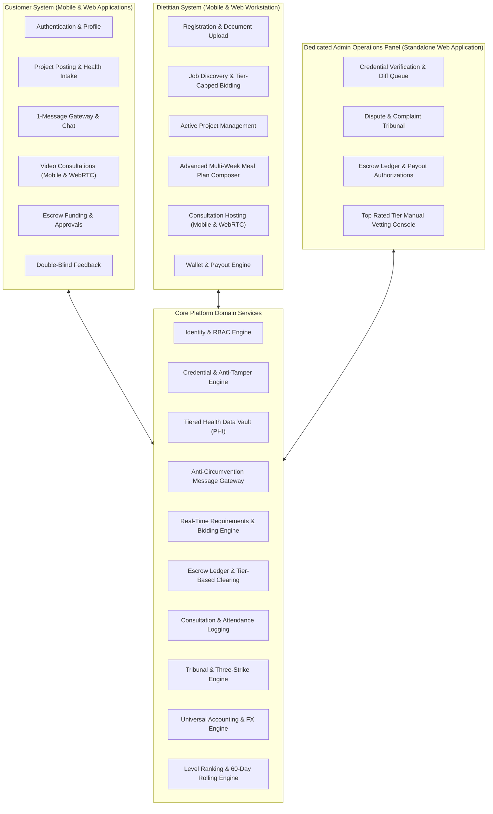
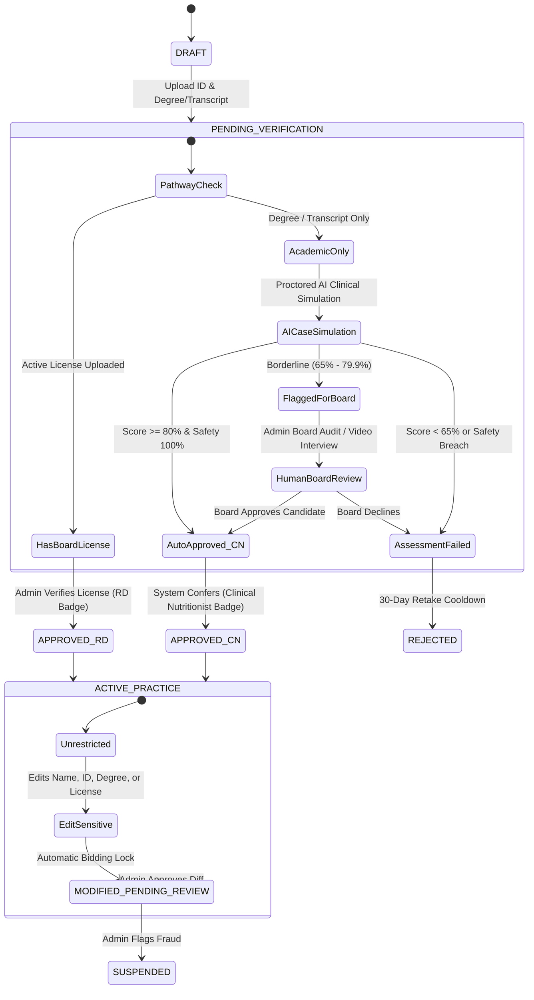
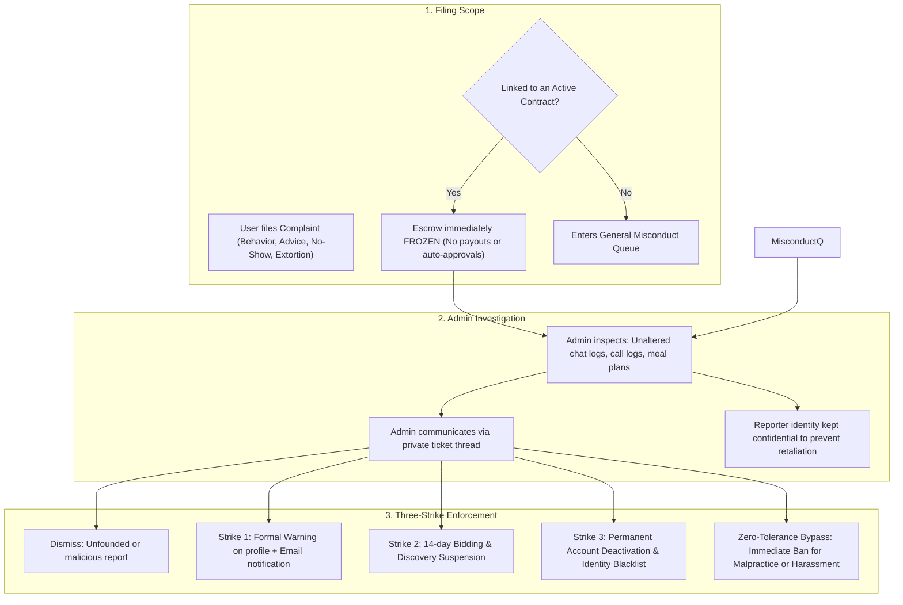
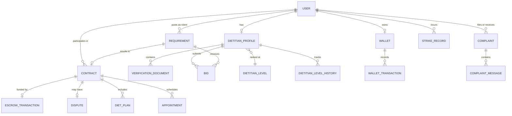

# Software Requirements Specification (SRS)
## Dietitian Freelance Marketplace Platform

**Document Version:** 1.0  
**Standard Compliance:** IEEE 830 / ISO/IEC/IEEE 29148  
**Scope:** Functional and Non-Functional Software Requirements (Platform-Agnostic, Vendor-Neutral)

---

## 1. Introduction

### 1.1 Purpose
This Software Requirements Specification (SRS) defines the complete functional, behavioral, security, and architectural requirements for a specialized, two-sided freelance marketplace connecting credentialed Dietitians and Nutritionists with clients globally. It establishes an unambiguous specification for software engineering teams, quality assurance testers, and project stakeholders.

### 1.2 Scope of the System
The system comprises three primary operational subsystems served across five specialized application frontends:
1. **Client Experience (Dual-Platform: Mobile & Web Applications):**
   - **Customer Mobile Application (iOS & Android):** Portable, touch-first client interface for project wizard posting, real-time push alerts, live proposal evaluation, in-app encrypted video/voice consultations, daily meal plan schedule tracking, adherence logging, and rapid messaging.
   - **Customer Web Application (Desktop Browser):** Rich desktop web portal providing multi-column proposal comparisons, in-depth dietitian credential inspection, large-screen video consultations, health history visualization, and billing/invoice receipt management.
2. **Dietitian Practice System (Dual-Platform: Mobile & Web Applications):**
   - **Dietitian Mobile Application (iOS & Android):** Practice management on the go, real-time notifications for newly posted projects and inquiries, rapid proposal dispatch, mobile video consultations, quick client check-ins, and wallet balance/clearing tracking.
   - **Dietitian Web Application (Clinical Desktop Workstation):** High-productivity clinical desktop dashboard featuring an advanced multi-week digital meal plan composer (macronutrient & calorie calculations, meal timing schedules, recipe tagging), side-by-side proposal drafting, multi-client workspace navigation, and comprehensive financial ledger exports.
3. **Dedicated Administrator Operations Panel (Completely Separate Web Panel):**
   - A fully segregated, independent administrative web application deployed on an isolated domain/subdomain with standalone authentication, access controls, and network boundaries. Dedicated to credential audit queues, document diff viewers, dispute arbitration tribunals with complete communication playback, platform escrow balance monitors, and payout authorizations. It is completely isolated from client and dietitian application bundles to ensure zero permission or code leakage.

### 1.3 Definitions, Acronyms, and Abbreviations
- **KYC (Know Your Customer):** Identity and professional credential verification process.
- **Escrow:** Financial mechanism where client funds are held by the platform and released only upon verified milestone completion.
- **72-Hour Security Clearing:** Mandatory buffer period post-approval where dietitian earnings remain locked in wallet before becoming withdrawable.
- **PHI (Protected Health Information):** Health metrics, medical diagnoses, food allergies, and biometric measurements.
- **PII (Personally Identifiable Information):** Legal names, national identity numbers, phone numbers, and physical addresses.
- **Double-Blind Review:** Reputation evaluation mechanism where feedback is concealed until both parties submit or the window closes.
- **Three-Strike Policy:** Tiered disciplinary protocol (Warning -> Temporary Suspension -> Permanent Blacklist) for platform misconduct.

---

## 2. Overall Description

### 2.1 Product Perspective & Context

### 2.2 User Classes & Characteristics
1. **Client / Customer:** Individual seeking nutritional advice for weight management, athletic performance, or chronic health conditions (e.g., PCOS, Diabetes). Expects high data privacy, verified credentials, and prompt communication.
2. **Dietitian / Nutritionist:** Formally educated and licensed practitioner in food and nutrition science. Expects transparent compensation, protection against scope creep, fair dispute arbitration, and freedom from review extortion.
3. **Platform Administrator:** Trusted operator responsible for legal compliance, identity verification, anti-fraud intervention, dispute adjudication, and financial reconciliation.

### 2.3 General Design & Security Constraints
- **Universal Base Accounting:** All internal ledger entries, contracts, and escrow accounts must calculate and store values in universal base currency units (USD cents) to prevent ledger drift from currency volatility.
- **Zero Raw Document Exposure:** Identity documents and medical licenses must never be publicly indexable or directly accessible via static URLs.
- **Zero Third-Party Code / Framework Dependencies in Specification:** Requirements specify system behaviors, invariants, and contracts without mandating proprietary vendor SDKs.

---

## 3. Specific Functional Requirements

### 3.1 User Management, Authentication & RBAC (FR-1)

- **FR-1.1 Customer Registration:** The system shall allow clients to register by providing: Full Name, Email Address, Phone Number (with Country Code), Password, and Country/Timezone. Registration shall complete without requiring health metrics upfront.
- **FR-1.2 Role-Based Access Control (RBAC):** The system shall enforce discrete role boundaries (`CUSTOMER`, `DIETITIAN`, `ADMIN`). Cross-role privilege escalation attempts must be rejected and logged as security events.
- **FR-1.3 Account Deletion Invariant:** The system shall reject account deletion requests if the user possesses active funded contracts, unwithdrawn wallet balances, or open disputes.
- **FR-1.4 Soft Deletion & Anonymization:** When an eligible account is deleted, the system shall permanently anonymize PII and PHI while preserving transactional financial ledgers and dispute records for statutory audit compliance.

---

### 3.2 Dietitian Credentialing, KYC, AI Competency & Anti-Tamper Engine (FR-2)

- **FR-2.1 Finalized Multi-Pathway Document Verification Standards:**
  To support the platform's primary purpose as an empowering freelance marketplace for all qualified nutrition practitioners—while rigorously guaranteeing patient safety—onboarding shall support two verification pathways:
  1. **Mandatory Identity & Legal Accountability (Universal for all freelancers):**
     - Government National Identity Document (front/back of CNIC, Passport, or Driver's License).
     - Live Facial Liveness / Selfie Check matching the government document.
  2. **Mandatory Academic Foundation (Universal for all freelancers):**
     - Accredited University Degree (BS, MS, DDNS, MPhil, or PhD in Human Nutrition & Dietetics, Food & Nutrition, or Clinical Nutrition) OR Official University Academic Transcript / Provisional Degree Completion Certificate.
  3. **Professional Board Registration / License (Optional - Unlocks RD Badge):**
     - Active Board Registration/License certificate (e.g., PNDS, CDR, HCPC, or national council registration).
  4. **Supplementary Experience (Optional):**
     - Hospital internship completion letters, specialized clinical certifications (e.g., Diabetes Educator, Sports Nutrition, Pediatric).

- **FR-2.2 Pre-Verification State Lock:** Newly registered freelancers shall remain in `PENDING_VERIFICATION` status. The system shall block bidding, public gig listings, and incoming client inquiries until verification is complete.

- **FR-2.3 Sensitive Field Detection & Automatic Bidding Lock:**
  - Modifying any sensitive attribute (`Legal Name`, `National ID Number`, `License Number`, `Uploaded Degree`, `Uploaded Transcript`, `Uploaded License`) shall automatically transition the account to `MODIFIED_PENDING_REVIEW`.
  - While in `MODIFIED_PENDING_REVIEW`, active in-progress contracts shall continue unimpeded, but the freelancer shall be strictly barred from submitting new bids or accepting new jobs until an Administrator approves the diff.

- **FR-2.4 AI Clinical Case Simulation & Competency Assessment Engine (Non-Licensed Candidates):**
  Candidates who possess an academic nutrition degree/transcript but lack an active board license must complete the platform's proctored, interactive **AI Clinical Case Simulation**:
  - **3 Adaptive Real-World Case Studies:** The simulation generates 3 randomized clinical scenarios (e.g. Case 1: Chronic Metabolic Condition like PCOS with Insulin Resistance; Case 2: Type 2 Diabetes with renal risk; Case 3: Sports Conditioning / Severe Food Allergies).
  - **Clinical Output Formulation:** The candidate must input caloric and macronutrient targets, prescribed food groups, strict contraindications, and clinical reasoning.
  - **Automated AI Grading & Safety Guardrails:**
    - *Clinical Safety Check:* Strict **100% threshold**. Any unsafe or contraindicated prescription (e.g., prescribing unmonitored high-protein keto to a compromised kidney profile, or harmful drug-nutrient interactions) results in immediate failure.
    - *Nutritional Science Logic:* Requires a score of **≥ 80.0%** against standardized Medical Nutrition Therapy (MNT) guidelines.
    - *Communication Clarity:* Evaluates empathy, client-friendliness, and practical clarity.
  - **Automated Workflow Routing:**
    - *Automatic Approval:* Candidates achieving Safety = 100% and Nutritional Logic ≥ 80.0% are automatically approved as *Clinical Nutritionists*.
    - *Board Review Queue (Flagged / Borderline):* Candidates scoring between **65.0% and 79.9%** are automatically routed to the **Platform Vetting Board** queue on the Admin Panel for manual human-in-the-loop audit or a scheduled 10-minute video interview.
    - *Failure & Cooldown:* Candidates scoring < 65.0% or violating clinical safety are rejected with structured improvement feedback and a **30-day cooldown** before a retake is permitted.

- **FR-2.5 Tiered Marketplace Credential Badges & Freelancer Transparency:**
  To maintain marketplace integrity and ensure clients make informed hiring decisions according to their clinical needs and budget:
  - 🩺 **"Licensed Dietitian (RD)"**: Conferred upon professionals with verified university degrees and active government/board practice licenses. Eligible for all clinical and high-risk medical nutrition projects.
  - 🥗 **"Clinical Nutritionist"**: Conferred upon professionals with verified university degrees who successfully passed the AI Clinical Case Simulation. Eligible for specialized lifestyle, chronic condition, and body composition coaching.
  - 🎓 **"Associate Nutritionist"**: Conferred upon provisional degree/transcript holders with passed AI safety assessments, focused on general health, weight management, and fitness meal planning.

---

### 3.3 Protected Health Information (PHI) & Privacy Vault (FR-3)

- **FR-3.1 Tiered Health Data Isolation:** The system shall enforce a two-tier data boundary for client health information:
  - *Public Discovery Tier:* Unassigned project postings shall display only an anonymized scope summary (e.g. "Goal: PCOS Management & Weight Loss; Timeline: 1 Month; Budget: $50"). Client identity, contact details, exact weight, and medical lab reports shall remain redacted.
  - *Contracted Tier:* Detailed health metrics (Age, Gender, Height, Current Weight, Target Goal Weight, Medical Conditions, Allergies, and Lab Reports) shall unlock exclusively to the single dietitian hired under a funded escrow contract.
- **FR-3.2 Post-Contract Access Control:** Upon contract completion, the client shall retain the ability to revoke or archive the dietitian's read access to their historical biomarker logs.

---

### 3.4 Communication Gateway & Anti-Circumvention (FR-4)

- **FR-4.1 First-Contact 1-Message Rule:** When a client initiates contact with a dietitian outside an active contract, the system shall permit exactly **one text message** (maximum 500 characters). File, image, and link attachments shall be strictly disabled on the opening message.
- **FR-4.2 Anti-Spam Gate State:** Following the initial message, client input shall be locked with the status: *"Waiting for Dietitian Response"*. The client cannot send subsequent messages until the dietitian submits a reply.
- **FR-4.3 72-Hour Inquiry Expiry:** If the dietitian does not reply within 72 hours, the inquiry shall transition to `EXPIRED`, and the conversation shall archive.
- **FR-4.4 Global Inbound Rate Limiting:** A client account shall be restricted to initiating at most **5 new dietitian inquiries per 24 hours** unless they maintain an active funded contract.
- **FR-4.5 Multi-Layer Anti-Circumvention Filter:** All messages across all communication channels shall pass through a central policy filter prior to persistence or delivery. The filter shall normalize text (stripping spaces, zero-width characters, symbols, and written-out numeric words) to detect and block:
  - Telephone numbers and international calling codes.
  - Email addresses.
  - Third-party messaging links (e.g., WhatsApp, Telegram).
  - Off-platform payment handles and keywords.
- **FR-4.6 Policy Violation Response:** Messages flagged by the anti-circumvention filter shall be intercepted, rejected, and returned with a clear policy violation warning. Repeat attempts within 24 hours shall trigger an automatic quality review flag.

---

### 3.5 Dynamic Project Posting & Health Intake Wizard (FR-5)

- **FR-5.1 Dynamic Per-Project Health Questionnaire:** The project posting wizard shall collect project-specific context:
  1. Project Title & Target Scope.
  2. Health Goal Category (Weight Loss, PCOS, Diabetes Management, Muscle Hypertrophy, Hypertension, Post-Pregnancy).
  3. Current Physical Biometrics (Age, Gender, Height, Current Weight, Target Goal Weight).
  4. Dietary Restrictions & Preferences (Halal, Vegetarian, Vegan, Keto, Desi, Gluten-Free).
  5. Documented Food Allergies & Intolerances.
  6. Project Budget & Target Duration (weeks/months).
  7. Mandatory Medical Disclaimer Acknowledgment.
- **FR-5.2 Active Posting Velocity Cap:** A client shall be restricted to maintaining a maximum of **3 active unhired projects** concurrently to prevent job feed saturation.
- **FR-5.3 Project Modification Notification:** If a client modifies budget, duration, or health parameters after proposals have been placed, the system shall broadcast a `PROJECT_UPDATED` notification to all active bidders.

---

### 3.6 Real-Time Bidding & Proposal Management (FR-6)

- **FR-6.1 Active Bidding Cap:** A dietitian shall maintain at most **25 active proposals** simultaneously across the platform. Withdrawn, rejected, or expired proposals shall immediately restore capacity.
- **FR-6.2 Real-Time Proposal Delivery:** When a dietitian submits a proposal, the system shall push the proposal card to the client's screen in real time and increment the project proposal badge counter.
- **FR-6.3 Proposal Expiration:** Unaccepted proposals shall expire automatically after **7 days**.
- **FR-6.4 Proposal Retraction:** Dietitians shall retain the authority to edit or retract a proposal at any point prior to client acceptance.

---

### 3.7 Escrow Management, Hiring & Financial Operations (FR-7)

- **FR-7.1 100% Upfront Escrow Funding:** Acceptance of a proposal shall require the client to deposit 100% of the agreed project fee into platform escrow.
- **FR-7.2 Atomic Acceptance Lock:** Bid acceptance shall execute under an atomic state lock. The project status shall immediately transition from `OPEN` to `ASSIGNED`, preventing double-acceptance or parallel checkout races.
- **FR-7.3 Platform Commission & Exact Cent Accounting:**
  - Upon project completion, the platform shall deduct a standard **10% commission**.
  - Platform commission shall be calculated as `PlatformFee = Round(TotalAmount * 0.10)`.
  - Dietitian net earnings shall be derived as `NetEarnings = TotalAmount - PlatformFee`.
  - The sum of `PlatformFee + NetEarnings` must mathematically equal `TotalAmount` down to the exact cent.
- **FR-7.4 72-Hour Security Clearance Window:**
  - Net earnings shall initially post to the Dietitian’s in-app wallet under `PENDING_CLEARANCE`.
  - Funds shall remain locked for exactly **72 hours**.
  - If no dispute or complaint is lodged during this period, funds shall automatically transition to `AVAILABLE_FOR_WITHDRAWAL`.
  - Filing a complaint or dispute at any point during clearance shall freeze the funds immediately.
- **FR-7.5 Minimum Withdrawal Thresholds:**
  - Regional Currency Accounts (e.g., Pakistan): Minimum **Rs. 5,000**.
  - International Accounts (e.g., Payoneer): Minimum **$25.00 USD**.

```mermaid
stateDiagram-v2
    [*] --> EscrowFunded: Client Accepts & Funds 100%
    EscrowFunded --> InProgress: Project Workspace Active
    
    InProgress --> CompletionGated: Dietitian requests completion
    
    state CompletionGated {
        [*] --> CheckPrerequisites
        CheckPrerequisites --> PrerequisitesMet: Meal Plan + Calls + 75% Time Elapsed
        CheckPrerequisites --> PrerequisitesFailed: Missing items
        PrerequisitesFailed --> InProgress: Return to work
    }

    PrerequisitesMet --> DeliveredState: Deliverables Submitted
    
    DeliveredState --> ClientApproved: Client Clicks Approve
    DeliveredState --> AutoApproved: 7 Days Inactive (Day 1, 4, 6 alerts sent)
    
    ClientApproved --> PendingClearance72h: 10% Fee Deducted; 90% Moved to Wallet (LOCKED)
    AutoApproved --> PendingClearance72h: 10% Fee Deducted; 90% Moved to Wallet (LOCKED)

    state PendingClearance72h {
        [*] --> TimerRunning
        TimerRunning --> ClearingCompleted: 72h Elapses & No Dispute
    }

    PendingClearance72h --> DisputeFrozen: Dispute/Complaint Filed
    
    ClearingCompleted --> AvailableForWithdrawal: Dietitian Can Withdraw
```

---

### 3.8 Meal Plan Builder & Deliverable Prerequisite Gate (FR-8)

- **FR-8.1 Completion Prerequisite Gate:** The system shall strictly disallow a dietitian from triggering project completion or initiating the 7-day auto-approval timer until all three conditions are satisfied:
  1. A structured digital meal plan has been created and submitted through the platform's Meal Plan Builder.
  2. All consultation video sessions agreed upon in the accepted proposal have verified server attendance records.
  3. The contract has elapsed at least **75% of its agreed calendar duration**.
- **FR-8.2 Structured Meal Plan Schema:** The Meal Plan Builder shall structure nutrition across: Pre-Breakfast, Breakfast, Mid-Morning Snack, Lunch, Evening Snack, Dinner, and Bedtime, tracking target calories, protein, carbohydrates, fats, and hydration targets.
- **FR-8.3 Multi-Channel Auto-Approval Reminders:** Following deliverable submission, if the client takes no action, proactive reminders shall be dispatched via in-app push, SMS, and email on **Day 1**, **Day 4**, and **Day 6** before the 7-day auto-approval releases funds.

---

### 3.9 Video & Audio Consultation Management (FR-9)

- **FR-9.1 Cryptographically Secure Consultation Rooms:** Video and audio consultations shall be hosted in private embedded rooms. Entry shall strictly require a short-lived, single-use cryptographic access token issued exclusively to the contracted client and dietitian. Unauthenticated entry shall be blocked.
- **FR-9.2 Timezone-Aware Booking:** Dietitians shall configure recurring availability in their local timezone; clients shall view and book slots converted automatically to their device’s local timezone.
- **FR-9.3 Advance Rescheduling Window:** Either party shall be permitted to reschedule an appointment up to **4 hours** before the scheduled start time without penalty.
- **FR-9.4 Disconnection & Technical Failure Protocol:** If a consultation drops prior to 50% of the scheduled duration due to network or technical failure, a **15-minute reconnection grace period** shall initiate. If reconnection fails, either party can trigger an automated **"Technical Disconnect Reschedule"** once per appointment without penalty.

---

### 3.10 Attendance Verification & No-Show Quality Protocols (FR-10)

- **FR-10.1 Server-Verified Attendance for Client No-Shows:** If a client fails to join a scheduled consultation within 15 minutes, the session may be marked `CLIENT_NO_SHOW` only if server connection logs confirm the dietitian was connected and present in the room for the full 15 minutes.
- **FR-10.2 Dietitian No-Show Automated Incident Protocol:** If a dietitian fails to connect within 15 minutes of the scheduled time:
  1. The system shall automatically record a formal **Quality Incident Complaint** against the dietitian.
  2. An internal quality strike shall be logged.
  3. The client shall receive an immediate automated reassurance notification:
     > *"We deeply regret that your dietitian did not join the scheduled session. A formal report has been automatically recorded with our Quality Assurance team. We assure you that necessary corrective action will be taken. You can now reschedule this session at zero cost or request a refund."*
  4. The client shall immediately receive a 1-click free reschedule or refund request option.

---

### 3.11 Dispute Arbitration & Three-Strike Complaint System (FR-11)

- **FR-11.1 Universal Complaint Scope:** Complaints may be lodged at any time from a public profile, initial chat, active contract workspace, or post-completion.
- **FR-11.2 Immediate Escrow Freeze:** If a complaint is filed regarding an active contract, all escrow disbursements and clearance timers for that contract shall be **immediately frozen**.
- **FR-11.3 Complainant Confidentiality:** For behavioral, conduct, or harassment complaints, the complainant's personal identity shall remain confidential from the respondent to prevent retaliation. (For contract deliverable disputes, the contract itself is identified so deliverables can be audited).
- **FR-11.4 Internal Admin Deliberation Isolation:** Internal administrative notes, evidence evaluations, and tribunal discussions on a ticket shall be strictly isolated and invisible to non-admin users.
- **FR-11.5 Three-Strike Enforcement Protocol:**
  - **Strike 1 (Minor Misconduct):** Formal written warning issued in-app and via email; permanently logged on internal profile.
  - **Strike 2 (Repeated Misconduct):** 14-day platform suspension. Bidding, job discovery, and new project postings are disabled. Active contracts remain monitored.
  - **Strike 3 (Habitual Misconduct):** Permanent account deactivation. National ID, passport, phone number, and email address permanently blacklisted.
  - **Zero-Tolerance Bypass:** Severe offenses (dangerous dietary malpractice, sexual harassment, hate speech, financial fraud) shall trigger an **immediate permanent ban** without requiring prior strikes.
- **FR-11.6 Administrative Ruling Authority:** The Admin Tribunal shall have the authority to review raw audit logs, chat histories, call attendance logs, and meal plans, and issue one of three enforceable verdicts:
  1. Full refund to client.
  2. Full release to dietitian.
  3. Pro-rata split (e.g., 50% refund, 50% payout).

---

### 3.12 Multi-Currency Accounting, Billing & Invariant Refunds (FR-12)

- **FR-12.1 Universal Base Currency:** The platform shall store and process all internal ledger records, escrow deposits, and wallet transactions in universal base currency units (USD cents).
- **FR-12.2 Localized Display & Regional Payment Rail Routing:**
  - Clients in Pakistan shall view localized prices in PKR and pay via regional debit/credit cards, instant interbank transfers, or mobile wallets.
  - International clients shall view localized prices in their home currency (e.g., USD, AED, GBP, EUR) and pay via international cards.
  - All collections shall settle into the platform's central corporate merchant account.
- **FR-12.3 Exact Fiat Refund Invariant:** When a client pays in local currency, the system shall record both the base USD equivalent and the **exact local fiat amount charged**. In the event of a refund, the client shall strictly receive the **exact local fiat amount originally paid** (e.g., exactly PKR 14,000), eliminating foreign exchange variance risk for clients.
- **FR-12.4 Withdrawal Rate Confirmation:** Dietitian wallet balances shall be maintained in USD. When a Pakistani dietitian initiates a withdrawal to a local bank account, the exchange rate applied shall be the official rate confirmed at the exact moment of withdrawal submission.
- **FR-12.5 Payment Verification & Replay Protection:** Payment provider notifications shall be cryptographically verified using secure signatures. Each transaction identifier shall be recorded in an immutable ledger; duplicate notifications shall be dropped.

---

### 3.13 Double-Blind Reputation & Review System (FR-13)

- **FR-13.1 Double-Blind Review Concealment:** Following contract completion, client and dietitian reviews shall remain strictly hidden from both parties until:
  - Both parties have submitted their review and numerical rating, OR
  - The mandatory 14-day review window closes.
- **FR-13.2 Review Extortion Suppression:** If an Administrator determines through dispute arbitration that a party attempted feedback extortion, the offending party's review privilege shall be permanently suppressed for that contract.
- **FR-13.3 Verified Completion Requirement:** Reviews may only be submitted for contracts that were 100% escrow funded and officially completed.

---

### 3.14 Admin Operations & Security Oversight (FR-14)

- **FR-14.1 Credential Verification Dashboard:** Administrators shall review pending dietitian applications via side-by-side document inspection with direct access to official public registry verification links.
- **FR-14.2 Sensitive Change Diff Viewer:** Administrators shall inspect side-by-side diffs whenever a dietitian edits legal names, identification numbers, or credentials before approving status restoration.
- **FR-14.3 Immutable Audit Logging:** All administrative actions (approvals, rejections, dispute resolutions, strikes, bans, and escrow disbursements) shall be written to an immutable, append-only operational audit log.

---

### 3.15 Level-Based Dietitian Ranking System & 60-Day Rolling Performance Window (FR-15)

- **FR-15.1 Tiered Level Structure:** The platform shall implement a 4-tier progressive ranking system for verified dietitians:
  1. **New Dietitian:** Default tier assigned upon initial administrative credential approval.
  2. **Level 1 Dietitian (Silver Badge):** Proven track record of consistent client consultations and satisfaction.
  3. **Level 2 Dietitian (Gold Badge):** Experienced high-volume practitioner with exceptional client retention and earnings.
  4. **Top Rated Dietitian (Platinum Badge):** Elite tier representing the platform’s highest performing, highest rated medical and wellness authorities.

- **FR-15.2 Rolling 60-Day Performance Window & Qualification Criteria:**
  System levels shall be evaluated automatically on a rolling 60-day window against strict objective criteria:

| Level Tier | Min. 60-Day Earnings (USD) | Min. 60-Day Completed Orders | Min. 60-Day Client Rating | Min. Completion Rate (60d) | Disciplinary Record (60d) |
| :--- | :--- | :--- | :--- | :--- | :--- |
| **New Dietitian** | $0 | 0 | None (New) | N/A | Zero Active Strikes |
| **Level 1** | **$400** (or local fiat eq.) | **5 Contracts** | **4.7 / 5.0** | **≥ 90%** | Zero Active Strikes |
| **Level 2** | **$2,000** (or local fiat eq.) | **20 Contracts** | **4.8 / 5.0** | **≥ 95%** | Zero Active Strikes |
| **Top Rated** | **$5,000** (or local fiat eq.) | **50 Contracts** | **4.9 / 5.0** | **≥ 98%** | Zero Strikes (All-Time) + Admin Quality Vetting |

- **FR-15.3 Level Privileges & Tiered Economic Perks:**
  Achieving higher levels unlocks distinct marketplace advantages:

| Level Tier | Active Proposal Cap | Directory & Feed Priority | Security Clearance Window | Platform Commission |
| :--- | :--- | :--- | :--- | :--- |
| **New Dietitian** | 25 Active Bids | Standard Discovery | 72 Hours | 10% |
| **Level 1** | **35 Active Bids** | Silver Badge + Search Boost | 72 Hours | 10% |
| **Level 2** | **50 Active Bids** | Gold Badge + Featured Placement | **48 Hours (Expedited)** | 10% |
| **Top Rated** | **75 Active Bids** | Platinum Badge + Top Feed Priority | **24 Hours (Fast-Track)** | **8% (Loyalty Discount)** |

- **FR-15.4 Automated Evaluation & Demotion Engine:**
  - The evaluation engine runs automatically every month (or on a rolling 30/60-day cycle).
  - If a dietitian fails to maintain the rolling 60-day metrics (e.g. rating drops below threshold, or receives a strike under the Three-Strike policy), they receive a **30-day grace period notice**.
  - If metrics are not restored upon next evaluation, the system automatically demotes the profile by one tier and adjusts active bid limits and clearance windows accordingly.
  - Incurring Strike 2 or Strike 3 triggers an **immediate level reset to New Dietitian** regardless of earnings history.

---

## 4. External Interface Requirements

### 4.1 User Interfaces

The platform delivers specialized user interfaces across five application targets:

#### 1. Customer User Interfaces (Dual-Platform: Mobile & Web):
- **Customer Mobile Interface (iOS & Android):**
  - Streamlined, accessible mobile navigation designed for rapid 15-second registration.
  - Step-by-step health intake project wizard with dynamic unit toggles (kg/lbs, cm/ft).
  - Real-time bid cards with animated counter indicators, tier badges, and dietitian profiles.
  - In-app encrypted video/voice consultation screen with microphone/camera toggles and network indicators.
  - Interactive daily meal schedule with ingredient checklists, macronutrient bars, and meal completion checkmarks.
  - Direct inquiry composer enforcing the 1-Message Rule with real-time status banners.
- **Customer Web Interface (Responsive Desktop / Browser):**
  - Full-screen dashboard featuring side-by-side proposal comparison matrix (rates, experience, ratings, delivery times).
  - High-resolution dietitian profile inspection with verified credential badges and reviews.
  - WebRTC-based browser consultation suite with screen-viewing and document review pane.
  - Comprehensive health biomarker progress graphs and lab report vault.
  - Complete financial dashboard with printable tax invoices, local fiat receipts, and refund audit history.

#### 2. Dietitian Practice Interfaces (Dual-Platform: Mobile & Web):
- **Dietitian Mobile Interface (iOS & Android):**
  - Portable practice control center with instant push alerts for matching leads and client inquiries.
  - Live job discovery feed with filter chips for medical tags (PCOS, Diabetes, Sports) and budget tiers.
  - Fast-action proposal composer with dynamic proposal cap meter (25/35/50/75 bids based on level tier).
  - Mobile video consultation client with attendance timer.
  - Client chat inbox with 1-Message response unlock buttons.
  - Wallet balance display with 72h/48h/24h clearing progress bars and quick withdrawal requests.
- **Dietitian Web Interface (Clinical Desktop Workstation):**
  - High-productivity clinical workstation tailored for extensive nutritional prescription.
  - Advanced multi-week digital meal plan builder featuring calorie/macronutrient calculators, drag-and-drop meal rescheduling, recipe/ingredient libraries, and allergen restriction alerts.
  - Multi-client workspace manager with split-screen consultation notes and client biomarker histories.
  - Proposal management center with win-rate analytics, rolling 60-day performance progress tracker, and badge tier indicators.
  - Financial ledger exports (CSV/PDF) and payout routing settings.

#### 3. Dedicated Administrator Operations Panel (Completely Separate Web Panel):
- **Standalone Administrative Web Console:**
  - Independent, decoupled web portal deployed on a dedicated administrative domain/subdomain with isolated ingress.
  - Multi-column KYC credential inspection viewport: side-by-side verification of government IDs, university degrees, and professional board licenses with direct links to external official regulatory registries.
  - Sensitive profile change diff viewer: side-by-side comparative inspection highlighting edited legal names, license numbers, or credentials before approving status restoration.
  - Real-time dispute tribunal dashboard: audit playback of raw chat logs, system-recorded video attendance logs, and digital meal plans, paired with isolated internal admin deliberations (`INTERNAL_ADMIN_NOTE`).
  - Escrow ledger control monitor: platform-wide balance oversight, disputed escrow freeze controls, and dual payout authorization queues (Raast/IBFT and Payoneer).
  - Top Rated level vetting console: review and approve or decline Level 2 dietitians crossing 60-day thresholds for Platinum badge conferral.
  - Zero presence in client or dietitian application bundles, eliminating any client-side attack surface or route discovery.

### 4.2 Communications & Real-Time Interfaces
- **Bidirectional Real-Time Events:** Live WebSocket channels shall deliver instant project feed updates, real-time proposal arrivals on client proposal screens, message deliveries, and call alerts.
- **Background Push Notifications:** High-priority mobile notifications shall be dispatched when the application is backgrounded or inactive for incoming proposals, new messages, scheduled call reminders, and payment updates.

---

## 5. Non-Functional Requirements (NFRs)

### 5.1 Security Requirements
- **NFR-SEC-1 (Threat Mitigation - STRIDE):**
  - *Spoofing:* Identity tokens must expire within short windows; video consultation rooms must require cryptographically signed access tokens.
  - *Tampering:* All monetary calculations must execute server-side; profile status fields must be unmodifiable by non-admin users.
  - *Repudiation:* Immutable audit trails must record all bid acceptances, milestone releases, and dispute rulings.
  - *Information Disclosure:* PHI and PII must be protected under role-based isolation; verification documents must reside in private encrypted storage.
  - *Denial of Service:* Rate-limiting must enforce 5 new inquiries/24h and max 3 active unhired projects per client.
  - *Elevation of Privilege:* Administrative endpoints must strictly enforce role authentication checks.
- **NFR-SEC-2 (Data at Rest & in Transit):** All sensitive data in transit must be encrypted using modern transport layer security (TLS 1.3). Sensitive identity documents and health data must be encrypted at rest using industry-standard AES-256 encryption.
- **NFR-SEC-3 (Integrity of Financial Calculations):** All financial logic must use integer cents/paisas to eliminate floating-point rounding errors.
- **NFR-SEC-4 (Administrative Interface Isolation):** The Administrator Web Panel shall exist as a completely separate, standalone web application and deployment bundle. Non-administrative client and dietitian web/mobile bundles must contain no administrative routing, components, or asset code. Administrative endpoints must enforce dedicated network/subdomain ingress controls and multi-factor administrative session validation.

### 5.2 Performance & Scalability
- **NFR-PERF-1 (Response Times):** Standard REST endpoints must respond within 250 milliseconds under normal operating load.
- **NFR-PERF-2 (Real-Time Latency):** Live proposal arrivals and chat messages must deliver within 500 milliseconds of submission.
- **NFR-PERF-3 (Concurrency):** The system must support at least 1,000 concurrent active consultations and 5,000 concurrent real-time bidding participants without performance degradation.

### 5.3 Reliability & Availability
- **NFR-REL-1 (System Uptime):** The platform shall maintain a 99.9% uptime target, excluding scheduled maintenance.
- **NFR-REL-2 (Transaction Idempotency):** All payment webhooks, bid acceptances, and withdrawal payouts must be idempotent, guaranteeing that duplicate network deliveries never trigger double-spending or duplicate project activations.

### 5.4 Compliance & Legal Requirements
- **NFR-COMP-1 (Medical Disclaimer):** All mobile and web applications must present a prominent, unskippable medical disclaimer during onboarding and on meal plan exports stating: *"Dietitians provide dietary coaching and nutritional guidance, not acute clinical diagnosis or medical prescription. Consult a primary care physician for medical emergencies."*
- **NFR-COMP-2 (Regulatory Record Retention):** Financial ledgers and dispute records must be retained for at least 7 years in compliance with financial and commercial regulations, regardless of user account deletion.

---

## 6. Domain Entity Model (Logical Schema)

### Core Domain Entities:
1. **User:** Unique identity, role, contact info, timezone, deletion flags, and timestamps.
2. **DietitianProfile:** Credentials, license ID, issuing board, experience, rates, ratings, and verification status.
3. **VerificationDocument:** Encrypted document reference, document type (ID, Degree, License), and verification status.
4. **Requirement:** Client project scope, health goals, physical biometrics, dietary constraints, budget, and project status.
5. **Bid:** Dietitian proposal, proposed fee, delivery timeline, pitch text, and status.
6. **Contract:** Bound agreement, escrow total, platform fee, net amount, charged local fiat amount, milestones, clearing end timer, and status.
7. **EscrowTransaction:** Escrow hold, gateway transaction reference, funding timestamp, and release status.
8. **Wallet & WalletTransaction:** Balances (pending clearance vs. available for withdrawal), payout destination (Bank IBAN, Raast ID, Payoneer), and payout status.
9. **DietPlan:** Daily meal schedule, macronutrient and caloric targets, hydration goals, and delivery timestamp.
10. **Appointment:** Consultation schedule, secure room token, server-recorded join timestamps, and status.
11. **Complaint & ComplaintMessage:** Incident ticket, category, severity, evidence, resolution action, and isolated communication thread.
12. **StrikeRecord:** Disciplinary strike count (1, 2, or 3), associated complaint reference, reason, and issuing administrator.
13. **DietitianLevel:** 4-tier ranking definition (New Dietitian, Level 1, Level 2, Top Rated), 60-day thresholds, proposal limits, clearance hold duration, and commission discounts.
14. **DietitianLevelHistory:** Immutable evaluation audit log capturing rolling 60-day metrics, previous/new tiers, grace period issuances, demotions, and strike resets.

---

## 7. Verification & Acceptance Criteria

| Requirement ID | Verification Method | Acceptance Standard |
| :--- | :--- | :--- |
| **FR-2.2 (KYC Lock)** | Test | Newly registered dietitian cannot place bids; attempts return authorization failure. |
| **FR-2.3 (Anti-Tamper)** | Test | Modifying legal name immediately transitions status to `MODIFIED_PENDING_REVIEW` and blocks bidding. |
| **FR-2.4 (AI Assessment)**| Test | AI clinical simulation scores candidate; score ≥80% and 100% safety triggers auto-approval; 65-79.9% routes to Admin Board; safety violation fails with 30-day cooldown. |
| **FR-2.5 (Tiered Badging)** | Inspection | Licensed applicants receive 'Licensed Dietitian (RD)'; degree holders passing AI simulation receive 'Clinical Nutritionist' badge. |
| **FR-3.1 (PHI Isolation)** | Inspection | Open job feed displays only anonymized health summary; client biometrics and reports are fully redacted. |
| **FR-4.1 (1-Message Rule)** | Test | Client can send exactly 1 message; sending a 2nd message before dietitian reply is rejected. |
| **FR-4.5 (Anti-Circumvention)** | Test | Phone numbers, WhatsApp handles, and email addresses are normalized and blocked with policy warning. |
| **FR-6.1 (25-Bid Cap)** | Test | Dietitian with 25 active proposals cannot submit a 26th proposal. |
| **FR-7.2 (Single-Hire Lock)** | Test | Concurrent bid acceptances on the same requirement abort; exactly one contract is created. |
| **FR-7.4 (72h Clearing)** | Test | Net funds remain locked in `PENDING_CLEARANCE` for 72 hours; automatically unlock if no dispute is opened. |
| **FR-8.1 (Prerequisite Gate)** | Test | Marking project complete fails if meal plan is missing, calls are unlogged, or <75% duration has elapsed. |
| **FR-9.1 (Call Token)** | Test | Unauthenticated access to consultation room is blocked; only valid signed tokens permit entry. |
| **FR-10.1 (No-Show Proof)** | Test | `CLIENT_NO_SHOW` claim is rejected if server logs show dietitian was not present for 15 minutes. |
| **FR-11.2 (Escrow Freeze)** | Test | Filing a complaint on an active contract instantly freezes escrow payout and clearing timers. |
| **FR-12.3 (Refund Invariant)**| Test | Client refund returns the exact local fiat amount originally paid, regardless of current foreign exchange rate. |
| **FR-13.1 (Blind Reviews)** | Test | Neither client nor dietitian can view the other's review until both submit or 14 days elapse. |
| **FR-15.2 (60d Level Eval)**| Test | Automated evaluation accurately computes 60-day window metrics; automatically promotes dietitian upon meeting thresholds. |
| **FR-15.3 (Tier Perks)** | Test | Level 2 unlocks 50 active bids and 48h clearance; Top Rated unlocks 75 active bids, 24h clearance, and 8% commission. |
| **FR-15.4 (Strike Demotion)**| Test | Incurring Strike 2 or Strike 3 immediately resets dietitian level to New Dietitian tier and enforces a 25-proposal cap. |
