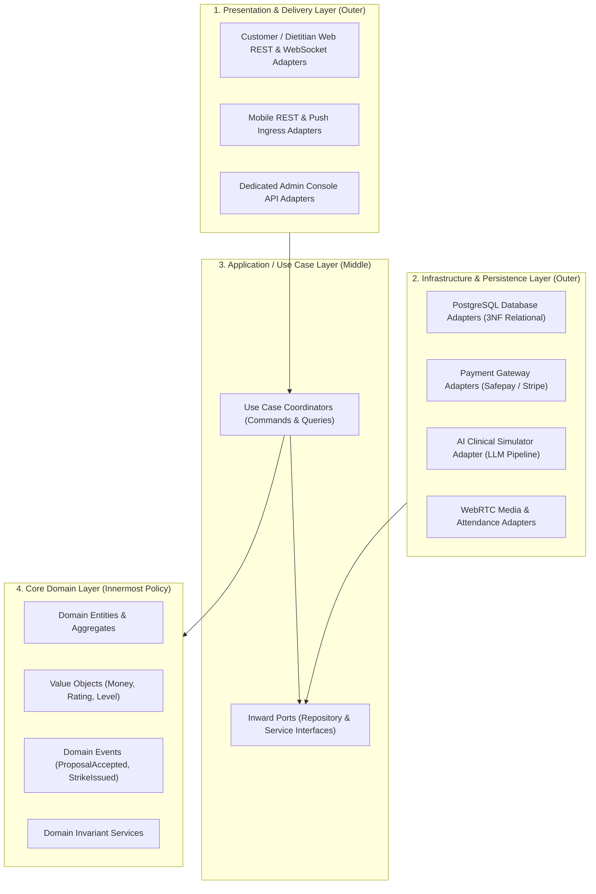
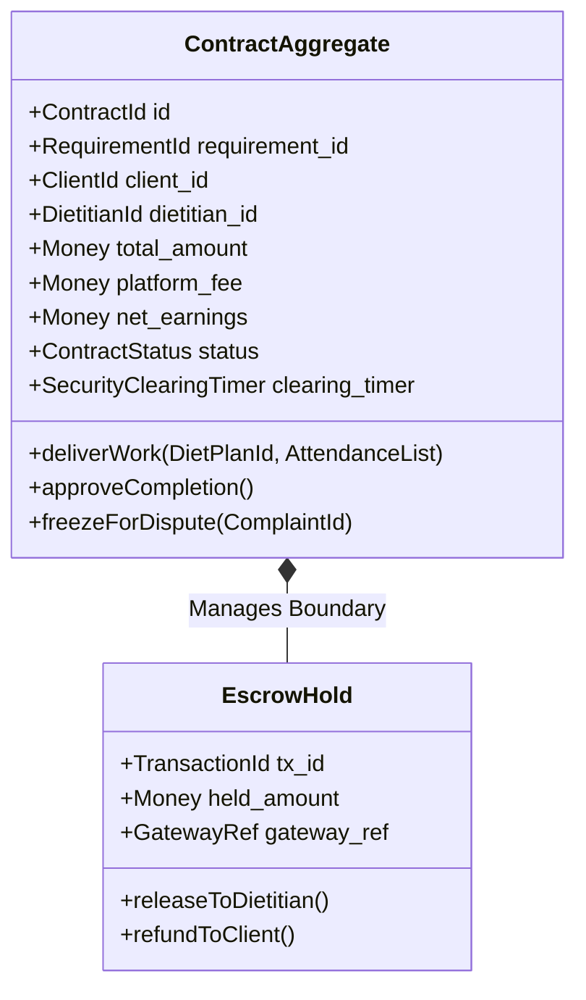
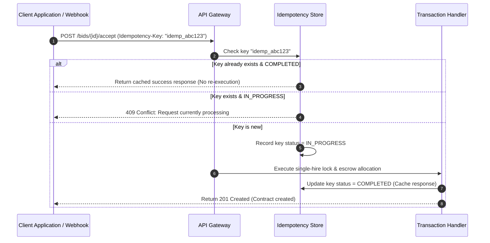

# Code Architecture & Programming Principles Specification
## Dietitian Freelance Marketplace Platform

**Standard Compliance:** Distilled Software Engineering Principles (14 Classic Texts)  
**Methodology:** Hexagonal Architecture (Ports & Adapters) · Domain-Driven Design (DDD) · Deep Modules  
**Scope:** Universal, Platform-Agnostic Code Architecture, Design Patterns, and Coding Guidelines  
**Companion Documents:**
- [`SOFTWARE_REQUIREMENTS_SPECIFICATION.md`](file:///d:/FullStackProjects/Diety/docs/SOFTWARE_REQUIREMENTS_SPECIFICATION.md) (SRS)
- [`SOFTWARE_DESIGN_SPECIFICATION.md`](file:///d:/FullStackProjects/Diety/docs/SOFTWARE_DESIGN_SPECIFICATION.md) (SDS)
- [`DATABASE_SCHEMA.md`](file:///d:/FullStackProjects/Diety/docs/DATABASE_SCHEMA.md) (3NF Relational Database Schema)

---

## 1. Executive Architecture Summary & Foundational Tenet

```
+---------------------------------------------------------------------------------------+
|                                THE DEPENDENCY RULE                                    |
|                                                                                       |
|   Outer Layers (Frameworks, DBs, UI, Gateways) depend on Inner Layers (Domain).       |
|   The Domain NEVER imports, references, or depends on Outer Technology Details.      |
|                                                                                       |
|   [ Delivery / UI ] ---> [ Application / Use Cases ] ---> [ Core Domain Entities ]   |
|   [ Database / IO ] --->           |                                                  |
|   [ External APIs ] ---> (Implements Inward Ports)                                    |
+---------------------------------------------------------------------------------------+
```

To guarantee that the Dietitian Freelance Marketplace remains robust, maintainable, testable, and insulated from vendor lock-in, the codebase strictly adheres to **Clean/Hexagonal Architecture** synthesized with **Tactical Domain-Driven Design (DDD)** and **Deep Module Design** (*A Philosophy of Software Design*).

### The Three Inviolable Laws:
1. **The Dependency Inversion Invariant (*Clean Architecture*):** Source code dependencies must point exclusively inward toward higher-level policy. The core domain layer knows nothing of SQL, HTTP, WebSockets, or third-party payment/AI SDKs.
2. **Deep Modules Over Shallow Wrappers (*A Philosophy of Software Design*):** Every module must provide a clean, narrow interface that conceals immense internal complexity. Pass-through layers that merely forward calls are classified as technical debt and forbidden.
3. **Make Invalid States Unrepresentable (*Domain-Driven Design*):** Use strongly typed Value Objects and domain constraints to ensure that corrupted states (e.g., negative money, an unverified dietitian bidding, a contract sum mismatch) cannot be instantiated in memory.

---

## 2. The 14 Classic Books Principle Matrix

The engineering standards across this codebase are directly grounded in 14 seminal software texts:

| Domain / Concern | Primary Book Authority | Architectural Mandate for This Platform |
| :--- | :--- | :--- |
| **Boundary Isolation** | *Clean Architecture* (Martin) | Core domain business rules isolated behind inward-facing interfaces (Ports). |
| **Module Complexity** | *A Philosophy of Software Design* (Ousterhout) | Deep modules (small interface, rich hidden logic). Pull complexity downward. |
| **Domain Modeling** | *Domain-Driven Design* (Evans & Vernon) | Bounded Contexts, Ubiquitous Language, Aggregates, and Value Objects. |
| **Data & State Invariants**| *Designing Data-Intensive Apps* (Kleppmann) | Authoritative source of truth, explicit idempotency keys, and transaction bounds. |
| **Production Stability** | *Release It!* (Nygard) | Timeouts, circuit breakers, bulkheads, and fail-fast verification on all IO. |
| **Code Construction** | *Clean Code* & *Code Complete* (Martin / McConnell) | Functions do one thing; single level of abstraction; intention-revealing names. |
| **Engineering Craft** | *The Pragmatic Programmer* (Hunt & Thomas) | DRY (one authoritative source per fact), orthogonality, and tracer bullets. |
| **Refactoring Discipline**| *Refactoring* (Fowler) & *WELC* (Feathers) | Behavior-preserving structural moves; characterization tests before modifications. |

---

## 3. Layered Hexagonal Structure (Ports & Adapters)

The system is organized into four concentric boundaries:



### 3.1 Layer Responsibilities & Rules

#### Layer 1: Core Domain (Innermost)
- **Contents:** Domain Entities, Value Objects, Domain Events, Domain Exceptions, and Pure Business Invariants.
- **Rules:**
  - Zero imports of external libraries, frameworks, or database drivers.
  - Entities encapsulate business state and enforce self-validation (e.g., a `Contract` entity verifies that `Total = PlatformFee + NetEarnings` upon creation).
  - Business operations mutate state through explicit intention-revealing methods (e.g., `contract.deliverWork()`, `dietitian.recordStrike()`), never via public setters.

#### Layer 2: Application / Use Cases
- **Contents:** Use Case Orchestrators, Application Commands, Query Handlers, and Port Definitions.
- **Rules:**
  - Coordinates domain objects to fulfill a single user interaction (e.g., `AcceptProposalUseCase`, `EvaluateDietitianLevelUseCase`).
  - Does **not** contain core business logic—delegates decisions to Domain Entities.
  - Owns the interfaces (Ports) that outer infrastructure adapters must implement (e.g., `ContractRepositoryPort`, `PaymentGatewayPort`, `AISimulatorPort`).
  - Manages database transaction boundaries (`Unit of Work`).

#### Layer 3: Infrastructure
- **Contents:** Database Repositories, Gateway Clients, Email/SMS Dispatchers, AI Model Connectors.
- **Rules:**
  - Implements the interfaces defined by the Application layer.
  - Translates internal domain models to external storage representations (Data Mappers).
  - Isolates external failures using circuit breakers and timeouts.

#### Layer 4: Presentation & Delivery
- **Contents:** HTTP Controllers, WebSocket Handlers, DTO Serializers, Middleware Filters.
- **Rules:**
  - Validates incoming request shapes and sanitizes inputs before passing them to application use cases.
  - Catches domain exceptions and maps them to standard HTTP status codes.
  - Enforces role-based perimeter access controls.

---

## 4. Domain-Driven Design (DDD) & Bounded Contexts

The platform is partitioned into **6 cohesive Bounded Contexts**, each speaking a unified Ubiquitous Language:

```mermaid
flowchart LR
    IdentityContext["1. Identity & Credentialing Context"]
    MarketplaceContext["2. Marketplace & Bidding Context"]
    EscrowContext["3. Escrow & Financial Ledger Context"]
    ReputationContext["4. Reputation & Level Ranking Context"]
    ClinicalContext["5. Clinical Consultation & Meal Plan Context"]
    TribunalContext["6. Dispute & Disciplinary Tribunal Context"]

    IdentityContext -->|Verified Dietitian Event| MarketplaceContext
    MarketplaceContext -->|Proposal Accepted Event| EscrowContext
    EscrowContext -->|Contract Cleared Event| ReputationContext
    MarketplaceContext -->|Contract Active Event| ClinicalContext
    ClinicalContext -.->|Attendance / Deliverable Logs| TribunalContext
    TribunalContext -->|Strike Issued Event| ReputationContext
    TribunalContext -->|Escrow Freeze Command| EscrowContext
```



### 4.1 Bounded Context Definitions & Aggregate Roots

#### Context 1: Identity & Credentialing Context
- **Aggregate Root:** `DietitianApplication`
- **Ubiquitous Language:** *Applicant, Accredited Degree, Academic Transcript, Practice License, AI Clinical Simulation, Clinical Safety Gate, Practitioner Type.*
- **Core Invariant:** A practitioner cannot submit bids or be listed in directory search until their `VerificationStatus` transitions to `APPROVED` (via active license verification OR passing the AI clinical case simulation).

#### Context 2: Marketplace & Bidding Context
- **Aggregate Roots:** `Requirement`, `Bid`
- **Ubiquitous Language:** *Client Requirement, Dynamic Intake, Active Proposal Cap, Single-Hire Lock, Delivery Timeline.*
- **Core Invariant:** A freelancer cannot exceed their dynamic proposal cap (`max_active_bids`: 25, 35, 50, or 75 determined by their current level tier).

#### Context 3: Escrow & Financial Ledger Context
- **Aggregate Roots:** `Contract`, `Wallet`
- **Ubiquitous Language:** *Escrow Hold, Platform Fee (10% standard, 8% Top Rated), Net Earnings, 72h/48h/24h Security Clearing, Local Currency Invariant.*
- **Core Invariant:**
  $$\text{TotalUSD} \equiv \text{PlatformFeeUSD} + \text{NetEarningsUSD}$$
  Client refunds must return the **exact local fiat units originally paid** regardless of subsequent exchange rate fluctuations.

#### Context 4: Reputation & Level Ranking Context
- **Aggregate Root:** `DietitianLevelProfile`
- **Ubiquitous Language:** *Rolling 60-Day Window, Completed Orders, Completion Rate, Level 1 (Silver), Level 2 (Gold), Top Rated (Platinum), 30-Day Grace Period, Strike Reset.*
- **Core Invariant:** Incurring Strike 2 or Strike 3 triggers an immediate transactional level demotion to New Dietitian tier, cancelling any active grace period.

#### Context 5: Clinical Consultation & Meal Plan Context
- **Aggregate Roots:** `DietPlan`, `Appointment`
- **Ubiquitous Language:** *Macronutrient Target, Meal Slot, Allergen Conflict, Cryptographic Room Token, Server Attendance Record, 15-Minute No-Show Window.*
- **Core Invariant:** A contract cannot be marked complete until a digital meal plan exists for every contracted week, all consultations have verified server attendance records, and $\ge 75\%$ of calendar time has elapsed.

#### Context 6: Dispute & Disciplinary Tribunal Context
- **Aggregate Root:** `ComplaintTicket`
- **Ubiquitous Language:** *Complainant Confidentiality, Evidence Vault, Three-Strike Protocol, Administrative Arbitrator, Pro-Rata Escrow Split.*
- **Core Invariant:** Opening a dispute on an active contract immediately freezes wallet clearance timers and halts escrow disbursements.

---

## 5. Tactical DDD Patterns: Aggregates & Value Objects

### 5.1 Value Objects: Making Invalid States Unrepresentable

Primitives (`int`, `string`, `float`) are forbidden for domain concepts. Meaningful domain logic must be encapsulated in **immutable Value Objects** validated at construction:

```
[ Domain Primitive Wrappers -> Value Objects ]
- int amount                  --> Money(usd_cents: 14000, currency: USD)
- float rating                --> Rating(value: 4.85) // Validates 1.0 <= value <= 5.0
- int bid_count               --> ProposalLimit(active: 28, max: 35) // Validates active <= max
- string clearance_status     --> SecurityClearingTimer(ends_at: 2026-11-23T18:00Z)
- string[] allergens          --> AllergenRestrictionSet(allergens: [PEANUTS, SHELLFISH])
```

#### Value Object Rules:
1. **Immutability:** Value Objects have no identity. Any change produces a new instance.
2. **Self-Validation:** Throws an explicit domain exception if initialized with invalid data (e.g., `Money(-500)` throws `NegativeMonetaryValueException`).
3. **Equality by Value:** Two `Money` objects with the same cents and currency are identical.

### 5.2 Aggregates & Consistency Boundaries



#### Aggregate Design Rules:
1. **Single Aggregate per Transaction:** A single database transaction shall mutate exactly one Aggregate Root.
2. **Reference by Identity Only:** Aggregates refer to other Aggregates by their surrogate ID (`UUID`), never by direct object reference.
3. **Optimistic Concurrency:** Every Aggregate Root contains a monotonic `version` number to reject concurrent conflicting writes (`OptimisticLockException`).

---

## 6. Deep Module Design (*A Philosophy of Software Design*)

Thin wrappers that merely pass data from a controller to an ORM are outlawed. Every service must be a **Deep Module**: a narrow, simple interface that conceals substantial internal complexity.

### Comparison: Shallow vs. Deep Module

```
SHALLOW MODULE (Forbidden Anti-Pattern):
Controller ---> ContractService.getContract() ---> ContractRepository.find() ---> DB
(Adds no logic, simply duplicates interfaces, passes through errors)

DEEP MODULE (Architectural Standard):
+---------------------------------------------------------------------------------------+
|  Interface: EscrowLedgerService.processMilestoneApproval(contract_id)                 |
+---------------------------------------------------------------------------------------+
|  HIDDEN COMPLEXITY MANAGED INTERNALLY:                                                |
|  1. Verifies deliverable prerequisite gate (meal plan exists, calls verified).        |
|  2. Fetches dietitian tier to determine clearance window (72h vs 48h vs 24h).         |
|  3. Deducts tier-specific platform commission (10% standard vs 8% Top Rated).         |
|  4. Records immutable double-entry ledger credit to PENDING_CLEARANCE.                 |
|  5. Schedules distributed Redis timer for automatic clearing unlock.                  |
|  6. Emits ContractApprovedEvent to notification and reputation services.               |
+---------------------------------------------------------------------------------------+
```

---

## 7. Data Consistency, Invariants & Resilience (*DDIA* & *Release It!*)

### 7.1 Single Source of Truth vs. Derived State
- **Authoritative Source of Truth:** The 3NF Relational Database (PostgreSQL) is the sole system of record for all state, identity, and financial transactions.
- **Derived Representations:** Full-text search feeds, Redis caches, and real-time proposal counters are strictly derived and disposable. In the event of a cache purge, the system must rebuild state deterministically from PostgreSQL.

### 7.2 Idempotency Invariant for Network IO
Network deliveries can fail, duplicate, or arrive out of order. All mutating operations must enforce idempotency:



### 7.3 Resilience & Stability Patterns (*Release It!*)
1. **Timeouts on All Outbound IO:** No network call (payment gateway, push notification, AI service) may run indefinitely. Outbound HTTP calls have a hard timeout of **3,000 ms**; AI case evaluations have a timeout of **15,000 ms**.
2. **Circuit Breakers:** External gateway calls must wrap inside circuit breakers. If Safepay or the AI simulation API fails 5 times consecutively within 30 seconds, the breaker opens, fast-failing subsequent calls for 60 seconds without hanging threads.
3. **Bulkheads:** Dedicated thread/connection pools must isolate administrative tribunal video playback from public job discovery feeds, ensuring heavy dispute auditing cannot degrade client checkout latency.

---

## 8. Code Construction & Craftsmanship (*Clean Code* & *Code Complete*)

### 8.1 Command-Query Separation (CQS)
- **Command:** Mutates state. Returns `void` (or a lightweight status/ID). Never returns query result sets.
- **Query:** Computes and returns data. Never mutates state or produces side effects.

### 8.2 Single Level of Abstraction (SLAP)
Every function must read like a top-down newspaper article, keeping all operations at a uniform abstraction level:

```
// COMPLIANT (Single Level of Abstraction):
function executeLevelEvaluation(dietitianId) {
    const metrics = computeRolling60DayMetrics(dietitianId);
    const targetTier = determineEligibleTier(metrics);
    applyTierTransition(dietitianId, targetTier);
}

// FORBIDDEN (Mixed Abstraction Levels):
function executeLevelEvaluation(dietitianId) {
    // High level concept
    const metrics = computeMetrics(dietitianId);
    // Suddenly dropping into raw SQL queries and math bitwise operators
    const rawSql = "SELECT SUM(amount) FROM contracts WHERE ...";
    db.query(rawSql);
    // Low level string parsing mixed with high level business rules
}
```

### 8.3 Tell, Don't Ask
Do not query an object's internal fields, make decisions on its behalf, and set its fields back. **Tell the object what to do:**
- ❌ **Wrong:** `if (contract.status === 'DELIVERED' && !contract.isDisputed) { contract.status = 'PENDING_CLEARANCE'; }`
-  **Right:** `contract.markApproved();` (The entity guards its own invariants).

### 8.4 Explicit Domain Results Over Hidden Exceptions
Expected business outcomes (e.g., proposal rejected, insufficient funds, grace period triggered) are modeled as explicit `Result<T, DomainError>` types rather than unstructured runtime exceptions. Runtime exceptions are reserved strictly for unexpected infrastructure failures (e.g., database connection dropped).

---

## 9. Canonical Package & Directory Layout (Vertical Slices)

The codebase is organized by **Business Feature / Bounded Context**, completely rejecting the anti-pattern of technical folders (`controllers/`, `services/`, `models/`):

```
src/
├── bounded-contexts/
│   ├── credentialing/                    # Context 1: Identity & KYC
│   │   ├── domain/
│   │   │   ├── entities/                 # DietitianApplication, VerificationDoc
│   │   │   ├── value-objects/            # LicenseNumber, AcademicDegree
│   │   │   └── events/                   # PractitionerVerifiedEvent
│   │   ├── application/
│   │   │   ├── use-cases/                # SubmitCredentials, RunAICaseSimulation
│   │   │   └── ports/                    # Inward: Repository, AISimulatorPort
│   │   └── infrastructure/
│   │       ├── persistence/              # PostgresVerificationRepository
│   │       ├── ai/                       # LLMClinicalCaseEvaluatorAdapter
│   │       └── controllers/              # VerificationRestController
│   │
│   ├── marketplace/                      # Context 2: Bidding & Jobs
│   │   ├── domain/                       # Requirement, Bid, ProposalCap
│   │   ├── application/                  # PostRequirement, SubmitBid, RetractBid
│   │   └── infrastructure/               # PostgresMarketplaceRepository
│   │
│   ├── escrow-ledger/                    # Context 3: Contracts & Payments
│   │   ├── domain/                       # Contract, EscrowHold, Money, Clearance
│   │   ├── application/                  # FundContract, ReleaseEscrow, RefundLocalFiat
│   │   └── infrastructure/               # SafepayGatewayAdapter, PostgresLedgerRepo
│   │
│   ├── reputation-ranking/               # Context 4: 60-Day Levels
│   │   ├── domain/                       # LevelTier, 60DayWindowMetrics, GracePeriod
│   │   ├── application/                  # EvaluateRollingLevelsBatch, IssueGraceWarning
│   │   └── infrastructure/               # PostgresRankingRepo, LevelCronScheduler
│   │
│   ├── clinical-workspace/               # Context 5: Meal Plans & Video
│   │   ├── domain/                       # DietPlan, DailyMeal, AllergenConflict
│   │   ├── application/                  # ComposeMealPlan, VerifyRoomAttendance
│   │   └── infrastructure/               # WebRTCVideoSessionAdapter
│   │
│   └── dispute-tribunal/                 # Context 6: Complaints & Strikes
│       ├── domain/                       # ComplaintTicket, StrikeRecord
│       ├── application/                  # FileComplaint, AdjudicateDispute, IssueStrike
│       └── infrastructure/               # AuditPlaybackAdapter, AdminTribunalController
│
├── shared-kernel/                        # Cross-Cutting Pure Types Only
│   ├── domain/
│   │   ├── types/                        # Money, Currency, AggregateRoot, DomainEvent
│   │   └── errors/                       # DomainError, InvariantViolationException
│   └── utils/                            # Mathematical Exact-Cent Rounding Helpers
│
└── apps/                                 # Entrypoint Bootstrap Roots
    ├── customer-web/                     # Customer Web Application Shell
    ├── customer-mobile/                  # Customer Mobile Application Shell
    ├── dietitian-web/                    # Dietitian Desktop Workstation Shell
    ├── dietitian-mobile/                 # Dietitian Mobile Practice Shell
    └── admin-portal/                     # Standalone Decoupled Administrative Shell
```

---

## 10. Automated Testing Philosophy & Verification Pyramid

Following *Working Effectively with Legacy Code* and *The Pragmatic Programmer*, automated tests are first-class production assets:

```
                  /\
                 /  \      E2E Journey Tests (5%)
                /----\     - Escrow Funding -> Delivery -> 72h Clearing
               /      \    - Single-Hire Atomic Checkout Lock
              /--------\
             /          \  Integration & Adapter Tests (25%)
            /------------\ - Postgres Repositories, Database Constraints
           /              \- Safepay Mock Webhooks, WebRTC Attendance
          /----------------\
         /                  \ Pure Domain & Use Case Unit Tests (70%)
        /--------------------\ - Exact Cent Arithmetic (Total = Fee + Net)
       /                      \- 60-Day Level Rolling Windows & Demotions
      /------------------------\- Allergen Conflict Scanning (Zero DB / Sub-ms)
```

### Testing Mandates:
1. **Core Domain Tests are Ultra-Fast:** The entire domain test suite must execute in under **5 seconds** without booting a database or web server.
2. **Behavior Over Implementation:** Tests verify observable outcomes (e.g., "accepting a bid locks the requirement and deducts 10% fee"), never private function calls or mock call sequences.
3. **The Boy Scout Rule:** Every engineer touching a file leaves the test coverage higher and the cyclomatic complexity lower than they found it.
4. **Regression Invariant:** Every bug fix must begin with a failing characterization test that reproduces the defect before applying the solution.
