# Software Design Specification (SDS)
## Dietitian Freelance Marketplace Platform

**Document Version:** 1.0  
**Design Standard:** Platform-Agnostic, Domain-Driven Architectural Design  
**Companion Documents:**
- [`SOFTWARE_REQUIREMENTS_SPECIFICATION.md`](file:///d:/FullStackProjects/Diety/docs/SOFTWARE_REQUIREMENTS_SPECIFICATION.md) (Functional & Non-Functional Requirements)
- [`DATABASE_SCHEMA.md`](file:///d:/FullStackProjects/Diety/docs/DATABASE_SCHEMA.md) (Complete 3NF Relational Database Schema & DDL)

---

## 1. Introduction & Design Principles

### 1.1 Purpose
This Software Design Specification (SDS) translates the functional and security requirements defined in the SRS into an authoritative, vendor-neutral system architecture. It specifies component boundaries, data ownership, transactional state transitions, sequence interactions, and failure-handling mechanisms.

### 1.2 Core Architectural Principles
1. **Separation of Concerns & Modularity:** Domain entities, transaction processors, real-time message routers, and administrative tribunals operate behind well-defined service contracts.
2. **Defense-in-Depth & Data Minimization:** Protected Health Information (PHI) and professional identity documents (PII) are isolated behind strict role-based and cryptographic boundaries.
3. **Financial Invariant Guarantees:** All ledger calculations execute in non-negative integer cents; exact mathematical checks ($\text{Total} = \text{PlatformFee} + \text{NetEarnings}$) and exact fiat refund invariants protect users and the platform from accounting imbalances and exchange rate volatility.
4. **Resilience & Idempotency:** Asynchronous events (payment notifications, real-time bids, presence logs) are strictly idempotent, ensuring duplicate network deliveries never trigger double-spending or corrupted state.

---

## 2. High-Level System Architecture & Subsystem Boundaries

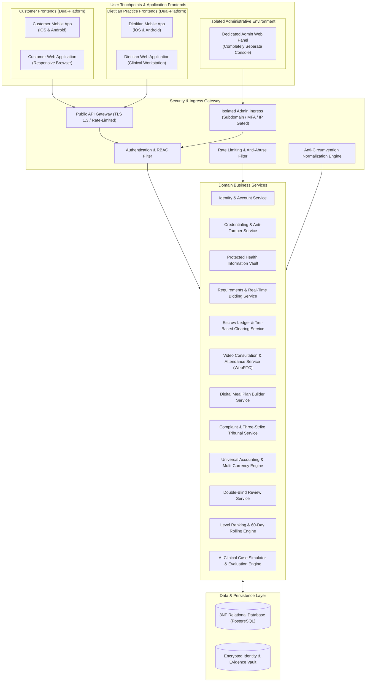

### 2.1 Application Frontends & Segregation Architecture

The system implements five distinct user touchpoints organized into three decoupled presentation domains:

1. **Customer System (Dual-Platform: Mobile & Web):**
   - **Customer Mobile Application (iOS & Android):** Portable, touch-first client interface for project wizard posting, real-time push alerts, live proposal evaluation, in-app encrypted video/voice consultations, daily meal plan schedule tracking, adherence logging, and rapid messaging.
   - **Customer Web Application (Responsive Desktop / Browser):** Rich desktop web portal providing multi-column proposal comparisons, in-depth dietitian credential inspection, large-screen video consultations, health history visualization, and billing/invoice receipt management.
2. **Dietitian Practice System (Dual-Platform: Mobile & Web):**
   - **Dietitian Mobile Application (iOS & Android):** Practice management on the go, real-time notifications for newly posted projects and inquiries, rapid proposal dispatch, mobile video consultations, quick client check-ins, and wallet balance/clearing tracking.
   - **Dietitian Web Application (Clinical Desktop Workstation):** High-productivity clinical desktop dashboard featuring an advanced multi-week digital meal plan composer (macronutrient & calorie calculations, meal timing schedules, recipe tagging), side-by-side proposal drafting, multi-client workspace navigation, and comprehensive financial ledger exports.
3. **Dedicated Administrator Operations Panel (Completely Separate Web Panel):**
   - **Architectural & Deployment Isolation:** The Admin Panel is engineered and deployed as a completely independent web application hosted on an isolated domain/subdomain (e.g., `admin.platform.internal` or dedicated administrative subdomain).
   - **Zero Codebase Leakage:** Customer and dietitian web/mobile bundles contain zero administrative routes, views, components, or operational logic. This eliminates client-side bundle inspection vulnerabilities.
   - **Dedicated Ingress & Role Enforcement:** Administrative API endpoints (`/api/v1/admin/*`) are blocked at the public gateway and require dedicated administrative ingress routing, mandatory Multi-Factor Authentication (MFA), and cryptographic role claims (`ADMIN`).
   - **Operational Scope:** Powers the multi-column KYC document audit viewer, sensitive change diff inspector, dispute tribunal playback, escrow fund controls, and Top Rated level vetting console.

---

## 3. Subsystem & Component Detailed Design

### 3.1 Subsystem 1: Identity, RBAC, AI Competency & Anti-Tamper Credentialing Engine

#### Responsibilities:
- Manage user lifecycles across Customers, Freelance Dietitians/Nutritionists, and Administrators.
- Enforce strict Role-Based Access Control (RBAC).
- Orchestrate multi-pathway document verification (Identity, Degree, Academic Transcript, and Board License).
- Host and evaluate the proctored **AI Clinical Case Simulation** for academic graduates who lack a formal board license.
- Triage borderline candidates to the dedicated **Platform Vetting Board** on the standalone Admin Panel.
- Maintain marketplace practitioner badges (`LICENSED_DIETITIAN`, `CLINICAL_NUTRITIONIST`, `ASSOCIATE_NUTRITIONIST`).
- Enforce automated bidding freezes upon sensitive profile attribute mutations.

#### Finalized Document Verification Standards:
1. **Mandatory Identity Proof:** Government National Identity Document (CNIC / Passport / Driver's License) + biometric liveness selfie.
2. **Mandatory Academic Foundation:** Accredited University Degree (BS, MS, DDNS, MPhil, PhD in Human Nutrition & Dietetics) OR Official University Academic Transcript / Provisional Certificate.
3. **Professional Board License (Optional):** Official practice license (PNDS, CDR, HCPC) - unlocks the "Licensed Dietitian (RD)" badge.
4. **Supplementary Experience (Optional):** Hospital internship letters, clinical rotation proofs, specialized certifications.

#### AI Clinical Case Simulation Engine Architecture:
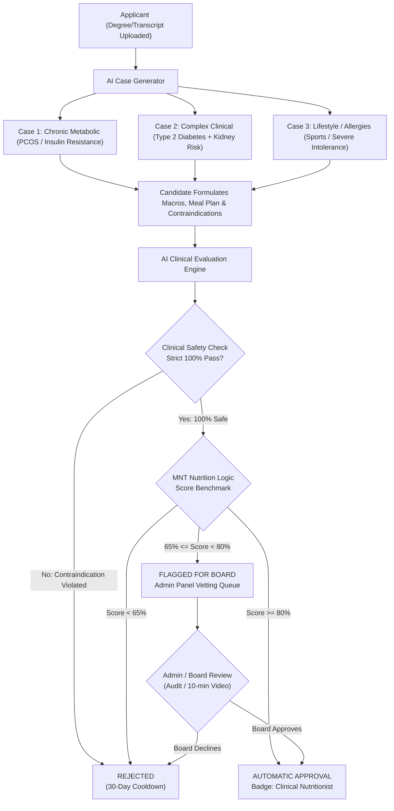

#### Marketplace Practitioner Badges:
- 🩺 **`LICENSED_DIETITIAN` (RD):** Verified university degree + active board license. Unrestricted clinical and complex medical projects.
- 🥗 **`CLINICAL_NUTRITIONIST`:** Verified university degree + passed AI clinical case simulation. Lifestyle, chronic metabolic, and body composition coaching.
- 🎓 **`ASSOCIATE_NUTRITIONIST`:** Provisional degree/transcript holder + passed AI safety assessment. General wellness and fitness meal plans.

#### Invariants & Rules:
- **Pre-Verification Lock:** Accounts in `PENDING_VERIFICATION`, `ACTION_REQUIRED`, or `REJECTED` cannot submit proposals, receive inquiries, or appear in public discovery.
- **AI Safety Zero-Tolerance Invariant:** A candidate who prescribes medically dangerous contraindications (e.g. extreme unmonitored keto for acute kidney disease, or harmful drug-nutrient collisions) receives an instant **0% on Safety** and is failed immediately, regardless of communication eloquence.
- **Sensitive Attribute Tamper Detection:** Any mutation to `legal_name`, `license_number`, `degree_title`, or uploaded credential files immediately transitions status to `MODIFIED_PENDING_REVIEW`.
- **Bidding Freeze:** When in `MODIFIED_PENDING_REVIEW`, existing active contracts continue unimpeded, but proposal creation is rejected at the API gateway until an Admin approves the diff.

---

### 3.2 Subsystem 2: Protected Health Information (PHI) & Privacy Vault

#### Responsibilities:
- Securely store and redact client biometric metrics, medical history, dietary constraints, and food allergies.

#### Data Isolation Tiers:
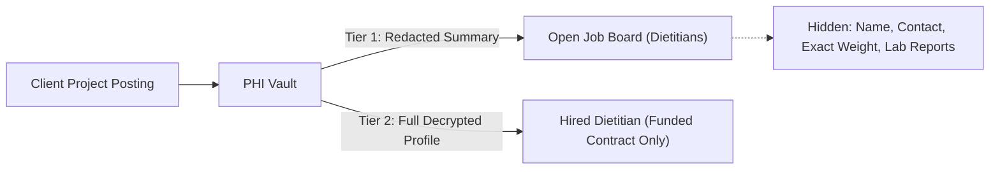

- **Tier 1 (Public Marketplace Feed):** Dietitians browsing open requirements see only anonymized lifestyle summaries (e.g., *"Goal: PCOS Management & Weight Loss; Timeline: 1 Month; Budget: $50"*). All client personal identifiers, exact weight numbers, and medical reports are completely redacted.
- **Tier 2 (Funded Contract Workspace):** Detailed biometrics (Age, Gender, Height, Current Weight, Target Goal Weight, Medical Conditions, and Allergies) unlock exclusively to the single dietitian hired under an active, escrow-funded contract.
- **Client Revocation Control:** Clients can archive or revoke dietitian access to historical health metrics once a contract reaches final completion.

---

### 3.3 Subsystem 3: Communication Gateway, 1-Message Gate & Anti-Circumvention

#### Responsibilities:
- Govern opening contact between clients and dietitians.
- Filter communication across all channels to prevent off-platform disintermediation.

#### Sequential Logic & Rules:
1. **1-Message Rule:** Clients can send exactly **one opening message** (maximum 500 characters) to a dietitian outside of an active contract. Attachments (files/images) are strictly disabled on this message.
2. **Input Locking:** Client composer is locked until the dietitian submits a response.
3. **72-Hour Expiration:** If no response is received within 72 hours, the inquiry transitions to `EXPIRED` and archives.
4. **Inquiry Velocity Limiting:** Clients are restricted to **5 new dietitian inquiries per 24 hours** unless they maintain an active funded contract.
5. **Multi-Layer Text Normalization & Filter:**
   - Text is stripped of whitespace, zero-width characters, symbols, and written-out numbers (e.g. *"zero three zero zero"*).
   - Regex patterns identify telephone numbers, email addresses, messaging links (WhatsApp, Telegram), and off-platform payment keywords.
   - Flagged messages are rejected with an explicit policy warning toast before persistence.
6. **Incentive Alignment:** Platform commission decreases from 10% to 5% on repeat contracts between the same client and dietitian, creating an economic incentive to remain on-platform.

---

### 3.4 Subsystem 4: Dynamic Project Posting & Real-Time Bidding Engine

#### Responsibilities:
- Guide clients through per-project health intakes.
- Broadcast open requirements to matching dietitians.
- Deliver real-time proposals to clients with proposal counter badge updates.

#### Architectural Flow & Invariants:
- **Velocity Cap:** Clients can maintain at most **3 active unhired projects** concurrently.
- **Dietitian Proposal Cap:** A dietitian can hold at most **25 active proposals** (`PENDING`) simultaneously. Submitting a 26th proposal is rejected at the domain boundary.
- **Proposal Lifecycle:**
  - Proposals expire automatically after **7 days** if unaccepted.
  - Dietitians can modify or retract proposals prior to client acceptance.
  - Client project scope modifications trigger a `PROJECT_UPDATED` broadcast to all active bidders.

---

### 3.5 Subsystem 5: Escrow Ledger, Contract Lifecycle & 72-Hour Security Clearing

#### Responsibilities:
- Safeguard client payments in platform escrow.
- Enforce the 72-hour Upwork-style security clearing buffer.
- Manage fee deductions and payout disbursals.

#### Financial State & Mathematical Invariants:
1. **Atomic Acceptance & Single-Hire Lock:**
   - Accepting a proposal executes under an atomic transaction lock (`SELECT ... FOR UPDATE` on `requirements`).
   - The requirement transitions from `OPEN` to `ASSIGNED` immediately, rejecting concurrent checkout sessions and duplicate charges.
2. **Exact-Cent Accounting:**
   - Platform Fee: $\text{platform\_fee\_usd\_cents} = \text{Round}(\text{total\_amount\_usd\_cents} \times 0.10)$.
   - Net Earnings: $\text{net\_amount\_usd\_cents} = \text{total\_amount\_usd\_cents} - \text{platform\_fee\_usd\_cents}$.
   - System invariant: $\text{Total} \equiv \text{PlatformFee} + \text{NetEarnings}$.
3. **The 72-Hour Security Clearance Window:**
   - Upon completion, net earnings transfer to the Dietitian's wallet under `PENDING_CLEARANCE`.
   - Funds remain locked for exactly **72 hours**.
   - Background clearing jobs use distributed locks; upon timer expiration with no active dispute, funds transfer to `AVAILABLE_FOR_WITHDRAWAL`.
   - Filing a complaint or dispute at any point freezes the wallet balance immediately.
4. **Client Refund Invariant (Zero Exchange Rate Risk):**
   - At checkout, both the base USD cents and the exact local fiat charged (e.g., PKR 14,000) are recorded.
   - Any client refund returns the **exact local fiat amount originally paid**, eliminating foreign exchange loss for clients.
5. **Withdrawal Thresholds:**
   - Regional Bank / Raast: Minimum **Rs. 5,000**.
   - Payoneer (USD): Minimum **$25.00 USD**.

---

### 3.6 Subsystem 6: Digital Meal Plan Builder & Deliverable Prerequisite Gate

#### Responsibilities:
- Structure daily dietary prescriptions (calories, macronutrients, hydration, timing).
- Provide cross-platform access: advanced multi-week drafting and calorie calculation on the Dietitian Web Workstation, with touch-optimized daily checklist and adherence logging on Customer and Dietitian Mobile Apps.
- Enforce quality prerequisites before project completion can be requested.

#### The Prerequisite Gate:
A dietitian **cannot** trigger completion or initiate the 7-day auto-approval clock until:
1. A structured meal plan exists for every agreed week in the `diet_plans` table.
2. All agreed video consultation appointments have verified server attendance records.
3. The contract has reached at least **75% of its agreed time duration**.

#### Auto-Approval Reminders:
Following deliverable submission, if the client takes no action:
- **Day 1:** Initial deliverable notification sent.
- **Day 4:** Reminder sent via push notification and SMS.
- **Day 6:** Final 24-hour warning alert sent via email, SMS, and push notification.
- **Day 7:** Auto-approval executes, releasing funds into 72-hour security clearance.

---

### 3.7 Subsystem 7: Video Consultation & Attendance Verification Engine

#### Responsibilities:
- Host encrypted 1-on-1 video consultations across both Mobile (iOS & Android native/embedded media clients) and Desktop Web browsers (WebRTC).
- Maintain tamper-proof attendance logs to resolve no-show disputes objectively.

#### Design & Protocols:
1. **Cryptographic Room Access:** Consultation rooms require single-use, time-limited cryptographic entry tokens issued only to the contracted client and dietitian. Unauthenticated access is blocked.
2. **Advance Rescheduling:** Either party can reschedule up to **4 hours** before start time.
3. **Disconnection Protocol:** If a call drops before 50% duration due to network issues, a **15-minute reconnection window** activates. If unresolved, either party can trigger an automated **"Technical Disconnect Reschedule"** once without penalty.
4. **Client No-Show Verification:** The `CLIENT_NO_SHOW` claim is valid only if server logs confirm the dietitian connected and remained present in the room for the full 15 minutes.
5. **Dietitian No-Show Automated Incident Logging:**
   - If a dietitian fails to connect within 15 minutes:
     1. The system automatically files an incident ticket.
     2. A quality strike is recorded against the dietitian.
     3. An immediate automated reassurance notification is sent to the client:
        > *"We deeply regret that your dietitian did not join the scheduled session. A formal report has been automatically recorded with our Quality Assurance team. We assure you that necessary corrective action will be taken. You can now reschedule this session at zero cost or request a refund."*
     4. The client receives a 1-click free reschedule or refund request option.

---

### 3.8 Subsystem 8: Dispute Arbitration & Three-Strike Complaint Tribunal

#### Responsibilities:
- Provide an unbiased tribunal for behavioral complaints and escrow disputes.
- Enforce the platform's Three-Strike disciplinary protocol.

#### Workflow & Enforcements:
1. **Automatic Escrow Freeze:** Filing a complaint on an active contract instantly freezes all escrow disbursements and clearance timers.
2. **Complainant Confidentiality:** The reporter's identity is confidential in conduct complaints to protect against retaliation.
3. **Isolated Admin Deliberation Thread:** Internal administrator notes (`INTERNAL_ADMIN_NOTE`) are strictly isolated; non-admin users cannot view internal ticket evaluations.
4. **Three-Strike Protocol:**
   - **Strike 1 (Minor Misconduct):** Formal written warning issued in-app and via email; permanently logged on internal record.
   - **Strike 2 (Repeated Misconduct):** 14-day suspension of bidding and discovery privileges.
   - **Strike 3 (Habitual Misconduct):** Permanent account deactivation. National ID, passport, phone number, and email permanently blacklisted.
   - **Zero-Tolerance Bypass:** Severe malpractice, harassment, or fraud triggers an **immediate permanent ban**.
5. **Tribunal Rulings:** Admins inspect raw chat logs, call attendance logs, and meal plans, and issue: (1) 100% Refund, (2) 100% Release, or (3) Pro-rata split.

---

### 3.9 Subsystem 9: Double-Blind Reputation & Review Engine

#### Responsibilities:
- Prevent review extortion and retaliatory feedback.

#### Design:
1. **Double-Blind Concealment:** Ratings and feedback remain strictly concealed until **both** parties have submitted their review, or until the **14-day review window** expires.
2. **Extortion Suppression:** If an Administrator confirms a party attempted feedback extortion during dispute arbitration, the abusive party's review privilege is permanently suppressed for that contract.
3. **Verified Contract Gate:** Reviews can only be submitted for contracts that were 100% escrow funded and officially completed.

---

### 3.10 Subsystem 10: Level Ranking & 60-Day Rolling Performance Engine (Fiverr Model)

#### Responsibilities:
- Continually aggregate and evaluate professional performance over a rolling 60-day window.
- Automate tier promotions, 30-day grace periods, and demotions.
- Enforce dynamic marketplace perks: proposal submission caps, security clearance durations, search discovery priority, and fee discounts.
- Coordinate with the Three-Strike Tribunal for immediate disciplinary level resets.

#### Performance Metrics & Aggregation Engine (60-Day Rolling Window):
All metric calculations operate strictly on events within $[t - 60\text{ days}, t]$:
1. **Rolling 60-Day Net Earnings ($\text{USD Cents}$):**
   $$\text{Earnings}_{60d} = \sum_{\substack{c \in \text{CompletedContracts} \\ c.\text{approved\_at} \ge t - 60d}} c.\text{net\_amount\_usd\_cents}$$
2. **Rolling 60-Day Completed Orders:**
   $$\text{Orders}_{60d} = \text{Count}\Big(\{c \in \text{Contracts} \mid c.\text{status} = \text{'COMPLETED'} \land c.\text{approved\_at} \ge t - 60d\}\Big)$$
3. **Rolling 60-Day Client Rating:**
   $$\text{Rating}_{60d} = \text{Average}\Big(\{r.\text{rating} \mid r \in \text{Reviews} \land r.\text{reviewee\_id} = \text{dietitian\_user\_id} \land r.\text{submitted\_at} \ge t - 60d\}\Big)$$
4. **Rolling 60-Day Order Completion Rate:**
   $$\text{CompletionRate}_{60d} = \frac{\text{Completed Orders}_{60d}}{\text{Completed Orders}_{60d} + \text{Cancelled/Refunded Orders}_{60d}} \times 100$$
5. **Disciplinary Integrity Check:** Active strikes on record within the last 60 days must equal zero.

#### Tier Structure & Marketplace Perk Matrix:
| Level Tier | Min. 60-Day Earnings | Min. 60-Day Orders | Min. Rating | Min. Completion Rate | Active Proposal Cap | Security Clearance Hold | Platform Fee |
| :--- | :--- | :--- | :--- | :--- | :--- | :--- | :--- |
| **New Dietitian** | $0 | 0 | None (New) | N/A | **25 Active Bids** | **72 Hours** | 10% |
| **Level 1 (Silver)** | **$400** (40,000¢) | **5 Contracts** | **4.7 / 5.0** | **≥ 90.0%** | **35 Active Bids** | **72 Hours** | 10% |
| **Level 2 (Gold)** | **$2,000** (200,000¢) | **20 Contracts** | **4.8 / 5.0** | **≥ 95.0%** | **50 Active Bids** | **48 Hours (Expedited)** | 10% |
| **Top Rated (Platinum)** | **$5,000** (500,000¢) | **50 Contracts** | **4.9 / 5.0** | **≥ 98.0%** | **75 Active Bids** | **24 Hours (Fast-Track)** | **8% (Loyalty)** |

#### Evaluation State Transitions & Grace Period Protocol:
1. **Scheduled Batch Execution:** An automated background job executes evaluations on a scheduled recurring cycle using distributed locks.
2. **Promotion Path:** If a dietitian meets all quantitative thresholds for a higher tier:
   - For Levels 1 and 2: Automatic immediate promotion; `current_level_id` is updated, grace period is cleared, and an audit row is written to `dietitian_level_history`.
   - For Top Rated: Automated evaluation flags profile as `TOP_RATED_ELIGIBLE`; tier activates upon mandatory Admin manual quality vetting.
3. **Grace Period Defense:** If an existing Level 1, Level 2, or Top Rated dietitian falls below the required 60-day thresholds:
   - **First Under-Performance Check:** The system does **not** demote immediately. A **30-day grace period** is initiated (`grace_period_expires_at = NOW() + INTERVAL '30 days'`). The dietitian receives high-priority warning alerts via in-app dashboard, email, and push notifications detailing the specific metric deficit.
   - **Grace Period Recovery:** If metrics are restored above thresholds before `grace_period_expires_at`, the grace period is cleared (`grace_period_expires_at = NULL`) and current tier is preserved.
   - **Grace Period Expiration & Demotion:** If the 30-day grace period elapses and metrics remain deficient, the engine executes an automated **single-tier demotion** (`current_level_id = current_level_id - 1`), resets `grace_period_expires_at = NULL`, logs a `DEMOTION` entry to `dietitian_level_history`, and adjusts the proposal cap.
4. **Immediate Disciplinary Reset (Strike Policy Integration):**
   - Incurring **Strike 1** blocks promotion to Top Rated and flags the profile for review.
   - Incurring **Strike 2 or Strike 3** triggers an **immediate event-driven level reset to New Dietitian** (`current_level_id = 1`), completely bypassing the 30-day grace period. Proposal caps are instantly restricted to 25, and clearance timers revert to 72 hours.

---

## 4. Sequence & Behavioral Interaction Diagrams

### Sequence Diagram 1: 1-Message Gate & Direct Contact Filter

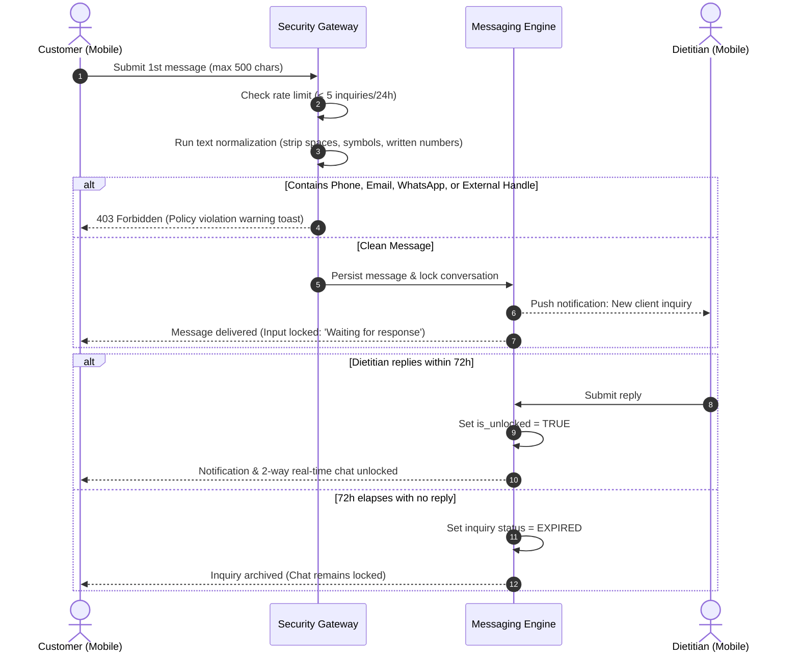

---

### Sequence Diagram 2: Proposal Acceptance, Escrow Lock & Single-Hire Protection

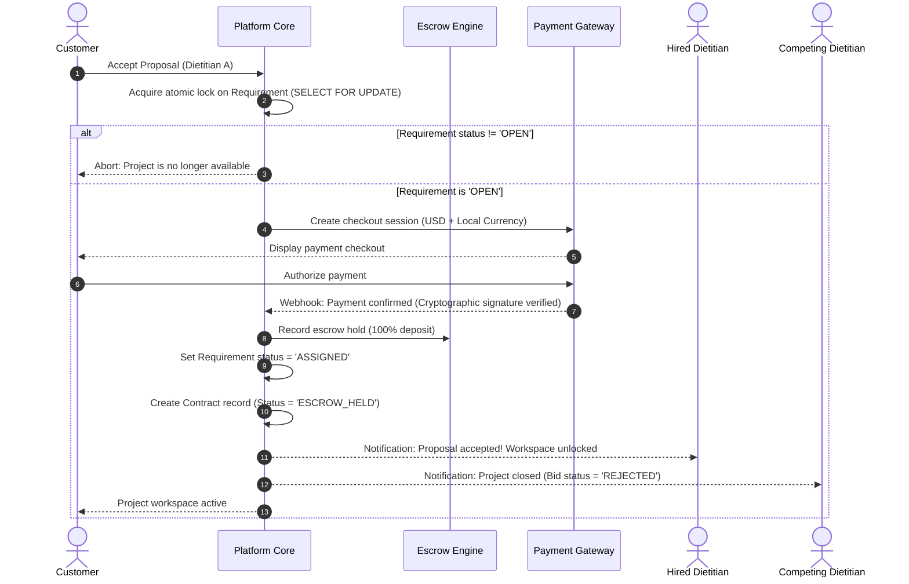

---

### Sequence Diagram 3: Deliverable Gating, Auto-Approval & 72-Hour Security Clearance

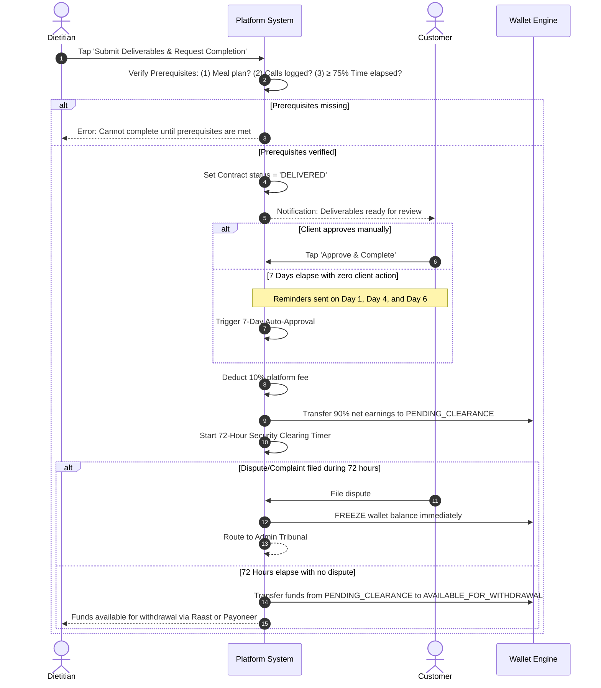

---

### Sequence Diagram 4: Video Consultation Attendance & No-Show Protocol

```mermaid
sequenceDiagram
    autonumber
    actor Client as Customer
    participant Server as Consultation Engine
    actor Dietitian as Dietitian

    Note over Client,Dietitian: Scheduled Appointment Time

    alt Both parties join within 15 minutes
        Dietitian->>Server: Connect (Server logs dietitian_joined_at)
        Client->>Server: Connect (Server logs client_joined_at)
        Server->>Server: Set Appointment status = 'COMPLETED'
    else Client fails to join within 15 minutes
        Dietitian->>Server: Connect (Server logs dietitian_joined_at)
        Note over Server: Dietitian remains in room for 15 minutes
        Dietitian->>Server: Request 'Client No-Show'
        Server->>Server: Verify dietitian attendance duration ≥ 15 mins
        Server->>Server: Set status = 'CLIENT_NO_SHOW' (Dietitian credited)
    else Dietitian fails to join within 15 minutes
        Client->>Server: Connect (Server logs client_joined_at)
        Note over Server: 15 minutes elapse; dietitian_joined_at is NULL
        Server->>Server: Trigger Automated Dietitian No-Show Protocol
        Server->>Server: File Quality Incident Ticket & Log Strike against Dietitian
        Server-->>Client: Automated reassurance message & 1-click free reschedule/refund
    end
```

---

### Sequence Diagram 5: Rolling 60-Day Level Evaluation, Grace Period & Disciplinary Reset Flow

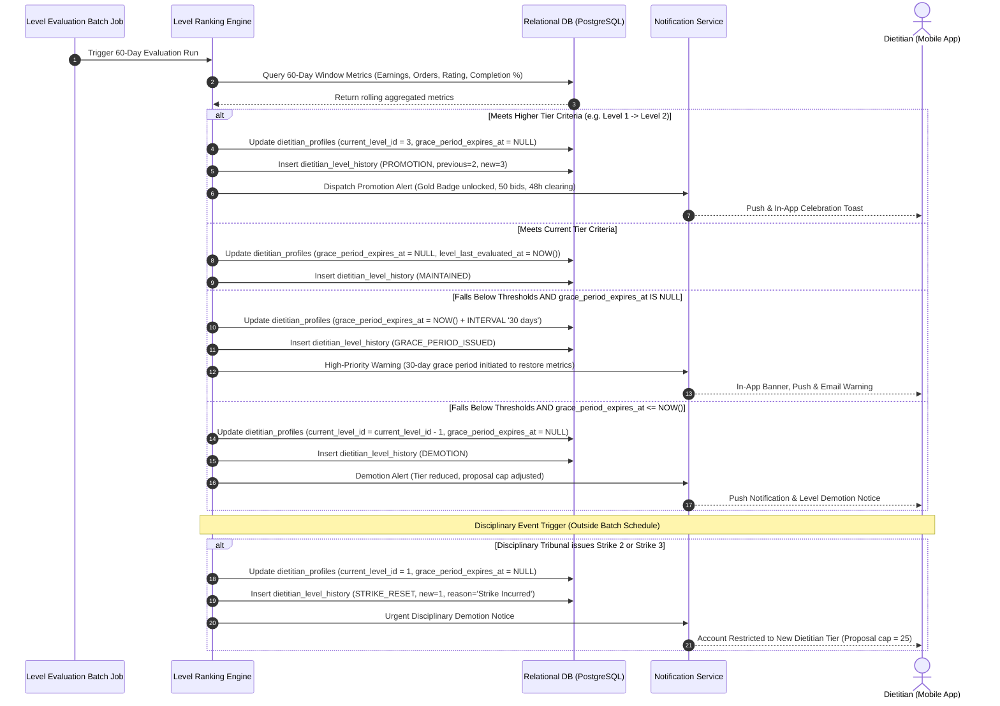

---

### Sequence Diagram 6: Dietitian Multi-Pathway Onboarding, AI Case Simulation & Board Review Flow

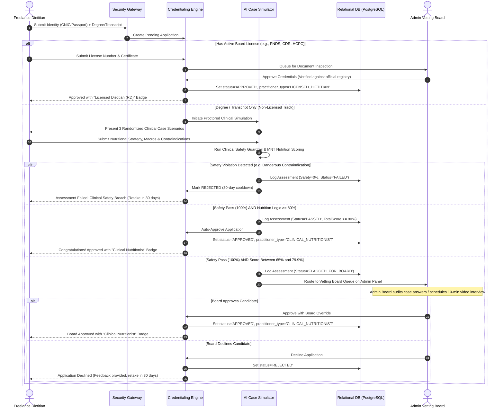

---

## 5. State Machine Specifications

### 5.1 Dietitian Verification State Machine
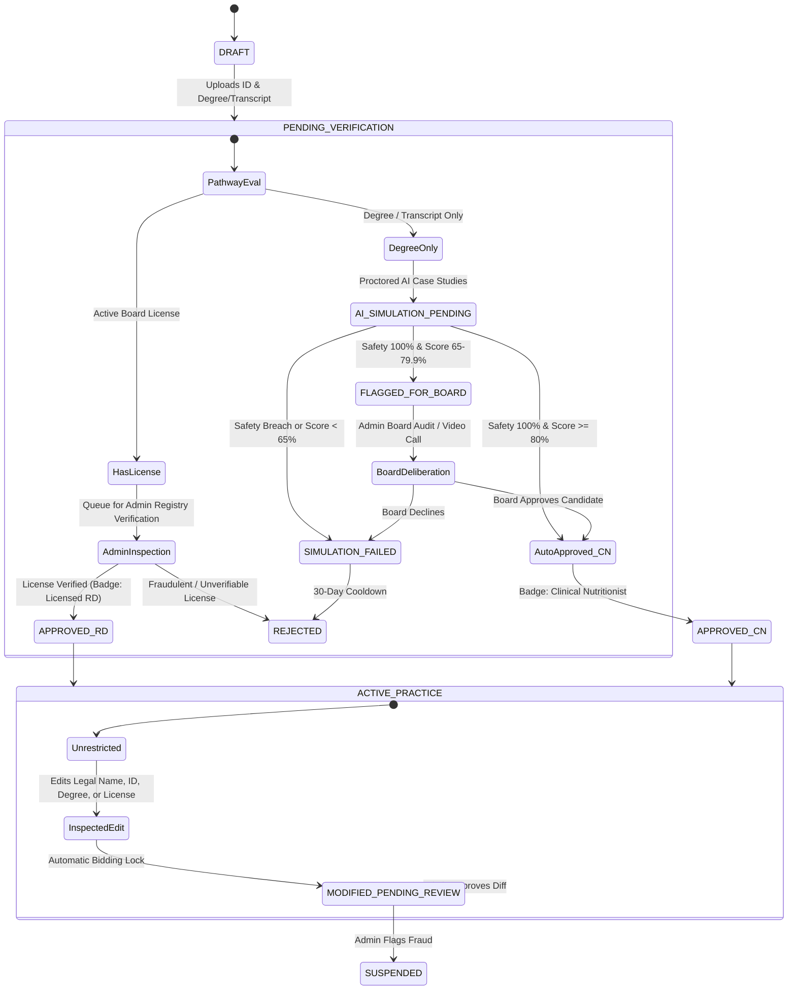

### 5.2 Contract Lifecycle State Machine
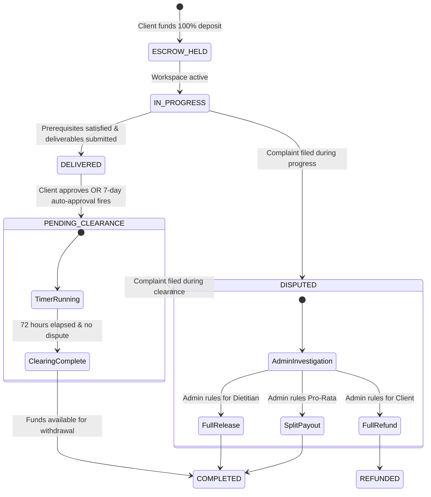

### 5.3 Dietitian Level Progression & Grace Period State Machine
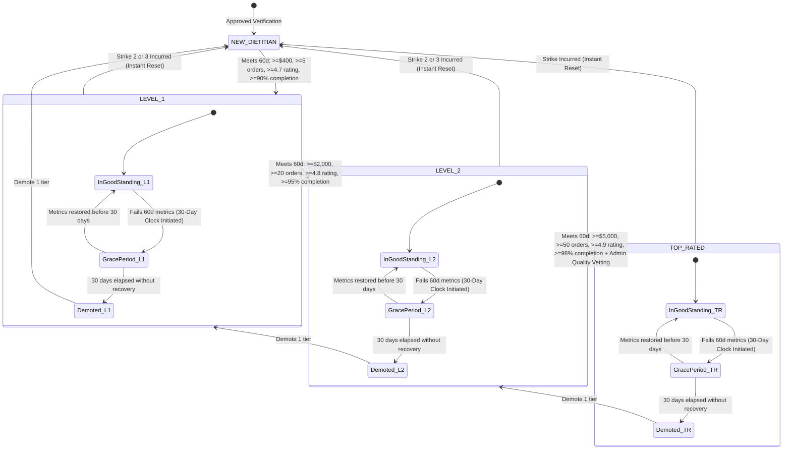

---

## 6. Security, Compliance & Invariant Checklist

| Security / Invariant Dimension | Design Mechanism | Verification Method |
| :--- | :--- | :--- |
| **Call Privacy & Eavesdropping** | Single-use, time-limited cryptographic room tokens. | Reject connection attempts without valid signed token. |
| **Double-Hire Race Condition** | Atomic row lock (`SELECT FOR UPDATE`) on requirement during checkout. | Automated concurrent request test aborts duplicate checkout. |
| **KYC Document Exposure** | Private encrypted vault storage with 15-minute presigned access URLs. | Direct public URL fetching returns 403 Forbidden. |
| **Escrow Double-Credit Bug** | Distributed Redis locks (`Redlock`) on 72h clearing cron job. | Multi-worker execution test verifies single credit execution. |
| **Platform Fee Rounding Math** | Integer cents with derived net payout: $\text{Net} = \text{Total} - \text{Fee}$. | Unit test across 10,000 random cent values asserts mathematical equality. |
| **Webhook Replay Attacks** | Raw HMAC SHA-256 signature check & unique transaction table deduplication. | Replaying captured webhook payload is dropped. |
| **Admin Note & Reporter Leaks** | Strict role-based message filtering on complaint tickets. | Non-admin API responses redact internal notes and reporter identity. |
| **Profile Status Tampering** | Strict DTO validation barring user mutation of `verification_status_id`. | Sending `"status": "APPROVED"` payload is rejected. |
| **WebSocket Spam Bypass** | Shared domain permission check (`canSendMessage`) across REST and WebSocket. | Raw WebSocket flood attempts are blocked at connection. |
| **Dynamic Proposal Cap Bypass** | Atomic transaction checks active proposals against `dietitian_levels.max_active_bids` (25/35/50/75). | Parallel script firing bids above dietitian's tier limit is rejected. |
| **Dietitian No-Show Scams** | Server-verified attendance timestamps (`dietitian_joined_at`). | Claiming `CLIENT_NO_SHOW` without 15 min server presence is rejected. |
| **Audit Log Deletion** | Soft deletion (`is_deleted`, `deleted_at`) on all transactional records. | Deleting user preserves ledger history and dispute records. |
| **Exchange Rate Refund Risk** | Exact local fiat amount recorded at checkout and refunded identically. | Simulating 30-day currency fluctuation asserts exact original fiat refunded. |
| **Level Evaluation Concurrency** | Distributed locks on evaluation cron job with per-dietitian atomic transactions. | Multi-worker batch evaluation test prevents duplicate history entries. |
| **Disciplinary Demotion Override** | Strike 2 or 3 triggers immediate transactional level reset to New Dietitian. | Emitting Strike 2 event resets tier and proposal cap instantly without 30-day delay. |
| **Expedited Clearance Enforcement** | Contract completion reads `clearance_hours` dynamically from `dietitian_levels` (72h/48h/24h). | Assert Top Rated contracts unlock after 24 hours while Level 1 remains 72 hours. |
| **Loyalty Fee Calculation** | Contract creation reads `commission_percentage` from `dietitian_levels` (10% vs 8%). | Assert Top Rated contracts deduct exactly 8% platform fee. |
| **Admin Panel Perimeter & Bundle Isolation** | Standalone web bundle hosted on isolated subdomain; zero admin code or routes in public client builds. | Static bundle analysis confirms absence of admin routes in client web/mobile bundles; public API gateway blocks unauthorized administrative paths. |
